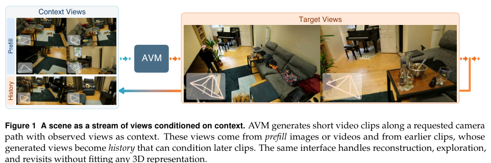

<!-- source-sha256: ba6186a4552d23d5da9dc59d08d52a31e47e2bfc5a6b929d517afb83c396d77b -->
# Autoregressive View Model

[简体中文](README.md)

> **Review only; no implementation**. Full experiments: **high cost, not reproduced (review DONE)**.

## Paper information

| Field | Value |
| --- | --- |
| Paper link | [arXiv:2611.23417v1](https://arxiv.org/abs/2611.23417v1); [fixed PDF](https://arxiv.org/pdf/2611.23417v1) |
| Company / institution / school | Jensen (Jinghao) Zhou: Meta / University of Oxford (verified fixed-v1 PDF byline) |
| Original publication date | 2026-11-17T19:20:06Z (arXiv v1); announcement2026-11-19 |
| Original source code | The[project page](https://autoregressive-view-model.github.io) returned404 in this review. No released AVM method source/license was verified in fixed v1. Wan2.1 and evaluation tools are dependencies, not AVM source. |
| Local adapter / key | `autoregressive-view-model`; `adapter: null`; not Evolve-integrated |
| Local reproduction code directory | `None (not reproduced)` |

## Original paper summary

### Background and main changes

AVM streams short view clips along a camera path without fitting explicit3D geometry. Prefill observations and generated history share one context interface, with retrieval bounding active context. An N-in-1-out flow-matching model is followed by causal tuning/distillation on its own rollouts so earlier outputs can support revisits. [Fixed-v1 source](https://arxiv.org/pdf/2611.23417v1).

~~~mermaid
flowchart LR
 I[Prefill views] --> R[Bounded context retrieval]
 H[Generated history] --> R
 C[Camera path] --> R
 R --> V[14B video flow model]
 V --> T[Causal rollout tuning and distillation]
 T --> N[New view clip]
 N --> H
~~~

<!-- paper-figure:start -->
### Original paper figure

Original PDF crop; author method/result, not local evidence. [Page, crop and SHA256](assets/provenance.json). Copyright remains with the original authors.
<!-- paper-figure:end -->

### Core equations

$$
\mathcal L_{FM}=\mathbb E\|v_\theta(x_t,t,C)-v_{target}\|^2,\qquad C_g=\operatorname{Retrieve}(C_{prefill}\cup C_{history},\operatorname{camera}_g).
$$

The notation summarizes the paper flow objective and context retrieval, not a new algorithm. Retrieved history includes both observations and model-generated views. No explicit3D representation does not mean no geometric conditioning: cameras, time and context roles still matter.

### Paper offline and online results

Evaluation separates camera/text/object control, visual quality, dynamics and persistence under image/video/history context. A single similar image cannot establish all dimensions. No randomized production A/B is reported; none of its benchmark tables is reproduced locally.

## Local reproduction

### Data protocol and code mapping

Review-only method, affiliation, cost and boundary intake. No operator, checkpoint, training, synthetic-data pipeline, metrics or GPU receipt is supplied. Generic similarity/retrieval fixtures do not substitute for a14B video model’s persistence.

### Same-topic comparison and boundaries

CWM changes an action after an observed event and reuses its disturbance residual. AVM continues camera-conditioned generation with retrieved history. Scene-revisit consistency does not establish identifiable same-disturbance counterfactuals.

### High-cost full experiment

Fixed v1 uses a14B video diffusion transformer and approximately8M scenes/clips, with bidirectional flow training, causal tuning, on-policy distillation and multidimensional video evaluation. A faithful campaign is beyond one A100/A30 or Mac short-run budget; no weights, videos or model probes are downloaded/run.

This is a configuration-based cost estimate, not a measured full-run duration. **High cost, not reproduced (review DONE)**; no large downloads, full experiments, automatic retries or implementation queue. No capability improvement or Evolve promotion is claimed.
