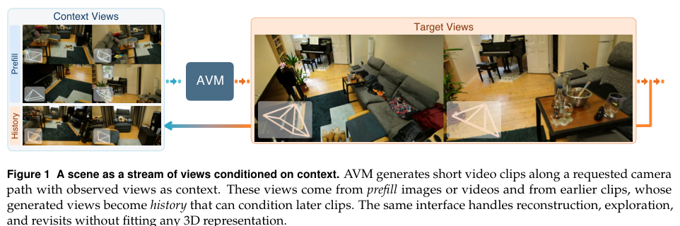

# AVM：把场景作为带检索上下文的视图流生成

[English](README-en.md)

> **仅资料收录；无实现**. 完整实验：**成本过高，不复现（审查 DONE）**。

## 论文信息

| 字段 | 内容 |
| --- | --- |
| 论文链接 | [arXiv:2611.23417v1](https://arxiv.org/abs/2611.23417v1); [fixed PDF](https://arxiv.org/pdf/2611.23417v1) |
| 公司 / 机构 / 学校 | 一作 Jensen (Jinghao) Zhou：Meta / University of Oxford（已核对固定v1 PDF署名） |
| 首次公开日期 | 2026-11-17T19:20:06Z（arXiv v1）；公告2026-11-19，不把PDF内日期或公告当首发日期 |
| 原作者开源代码 | 原文[项目页](https://autoregressive-view-model.github.io)本轮请求404；固定v1未找到已发布的AVM方法源码/许可证。Wan2.1及评价工具是依赖，不算AVM开源。 |
| 本地 adapter / key | `autoregressive-view-model`；`adapter: null`；未接入Evolve |
| 本地复现代码目录 | `无（不复现）` |

## 原始论文总结

### 背景与主要改动

AVM不拟合显式3D表示，而在给定相机路径下生成短视图片段。预填图像/视频与历史生成片段统一成为context；检索保持活动上下文有界。先把双向视频DiT微调为N-in-1-out的flow matching，再以自身rollout做因果tuning和蒸馏，让生成内容可回到历史中支持后续重访。 [Fixed-v1 source](https://arxiv.org/pdf/2611.23417v1).

~~~mermaid
flowchart LR
 I[Prefill views] --> R[Bounded context retrieval]
 H[Generated history] --> R
 C[Camera path] --> R
 R --> V[14B video flow model]
 V --> T[Causal rollout tuning and distillation]
 T --> N[New view clip]
 N --> H
~~~

<!-- paper-figure:start -->
### 原论文关键图

固定v1原始PDF裁切，是作者方法/结果，不是本地指标。[页码、裁切与SHA256](assets/provenance.json)。图片来自[原论文](https://arxiv.org/pdf/2611.23417v1)，版权归原作者所有。
<!-- paper-figure:end -->

### 核心公式

$$
\mathcal L_{FM}=\mathbb E\|v_\theta(x_t,t,C)-v_{target}\|^2,\qquad C_g=\operatorname{Retrieve}(C_{prefill}\cup C_{history},\operatorname{camera}_g).
$$

上式用统一记号概括原文flow目标与context检索，不补造新的算法。检索对象既有真实输入也有模型生成的历史；没有显式3D不等于没有几何条件。相机、时间和context角色仍影响生成。

### 论文离线与线上效果

原文分别评测camera/text/object控制、视觉质量、动态性和图像/视频/历史context下的场景持久性；这些是不同任务维度，不能仅用一张相似图片声称全部完成。论文未报告生产随机流量线上A/B，本轮没有复跑其表格。

## 本地复现

### 数据协议与代码映射

仅原文方法、机构、成本与边界收录；没有operator、模型加载、训练、合成数据、metrics或GPU回执。不会用通用图像相似度/检索fixture代替14B视频模型的场景持久性。

### 同主题比较与边界

CWM在一个事实事件之后改变动作并复用同一扰动残差；AVM沿相机轨迹继续生成并检索历史视图。二者都使用world model语汇，但AVM的场景重访一致性不证明同一扰动反事实可识别。

### 高成本完整实验

固定v1使用14B视频diffusion transformer，约8M场景/视频，含双向flow训练、因果tuning、自rollout蒸馏和多维视频评测。本机单A100/A30或Mac无法在本轮短时低成本预算忠实重做，不下载权重/视频，不运行大模型探针。

以上是配置依据的成本估计，不是完整实验实测耗时。**成本过高，不复现（审查 DONE）**；不下载大资源、不启动完整实验、不自动重试、不加入自动实现队列，不声明能力提升或Evolve晋级。
