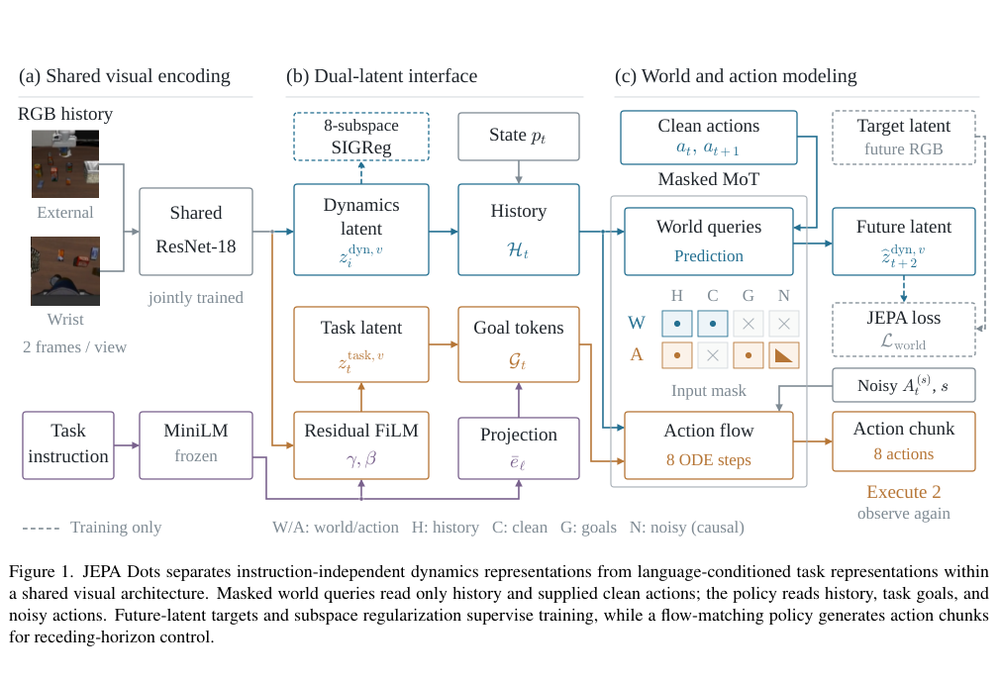

<!-- source-sha256: 6ac91a29f242096ab4dc5ff7bd067052897606bccd38a70c3f80aa4f6fd29192 -->
# JEPA Dots: Dual-Latent World Model for Language-Guided Robot Control

[简体中文](README.md)

> **Review only; no implementation**. Full experiments: **high cost, not reproduced (review DONE)**.

## Paper information

| Field | Value |
| --- | --- |
| Paper link | [arXiv:2611.24062v1](https://arxiv.org/abs/2611.24062v1); [fixed PDF](https://arxiv.org/pdf/2611.24062v1) |
| Company / institution / school | Xianhao Pan: Z Robotics (fixed-v1 PDF byline) |
| Original publication date | 2026-11-18T08:55:54Z (arXiv v1); announcement2026-11-19 |
| Original source code | No author method source or license verified in fixed v1; dependencies are not a method release. |
| Local adapter / key | `jepa-dots`; `adapter: null`; not Evolve-integrated |
| Local reproduction code directory | None (not reproduced) |

## Original paper summary

### Background and main changes

A shared visual backbone feeds separate dynamics and task latents; language FiLM enters only the task path. World queries read dynamics history and supplied clean actions; the policy reads history, goals and noisy actions. Multi-layer masks also block indirect leakage. Fixed observations/actions/parameters yield instruction-invariant world predictions while policy actions may change.

~~~mermaid
flowchart LR
 O[Observations] --> B[Shared visual backbone]
 B --> D[Dynamics latent]
 B --> T[Task latent with language FiLM]
 L[Instruction] --> T
 D --> W[World branch with clean supplied actions]
 D --> P[Flow policy]
 T --> P
 P --> A[Execute first two of eight actions]
 W --> S[Training supervision only]
~~~

<!-- paper-figure:start -->
### Original paper figure

Original PDF crop, no semantic edits; author method, not local evidence. [Page, crop and SHA256](assets/provenance.json). Copyright retained by the original authors.
<!-- paper-figure:end -->

### Core equations

$$
\widetilde F(\ell)=F+\gamma(e_\ell)\odot F+\beta(e_\ell),\quad\hat Z(H,A;\ell_1)=\hat Z(H,A;\ell_2),\qquad\mathcal L=\mathcal L_{act}+\mathcal L_{world}+0.04\mathcal L_{sub}.
$$

The invariance is a forward-conditioning property, not statistical independence after joint backbone training. The world branch supplies training supervision; deployment generates eight actions by action flow and executes the first two before replanning, rather than searching actions through the world model.

### Paper offline and online results

The reference experiment reports84.9% over40 trained LIBERO tasks versus76.0% for its task-ID adaptation baseline. Published NanoVLA-S comparisons use different protocols, not a controlled matched-budget win. No production A/B or local robot-success measurement is claimed.

## Local reproduction

### Data protocol and code mapping

Review-only method, equations, affiliation and cost. There is no operator, training, LIBERO installation, robot run, metrics or GPU receipt. A trivially language-free function would not reproduce the dual-latent controller.

### Same-topic comparison and boundaries

LeWAM jointly models worlds/actions and plans through prediction. JEPA Dots separates language goals from fixed-action dynamics and does not use its world branch for deployment action search. Shared masked-MoT ancestry does not imply identical inference.

### High-cost full experiment

The39.1M total includes a frozen sentence encoder. Training uses60epochs/about15k updates;40tasks require4000closed-loop episodes/model, up to600steps each, and three-run ablations use12000episodes/variant. Small parameter count does not make this campaign cheap. No LIBERO download, training probe or long control run is attempted.

**High cost, not reproduced (review DONE)**. No full experiment, large download, automatic retry or implementation queue; no capability promotion.
