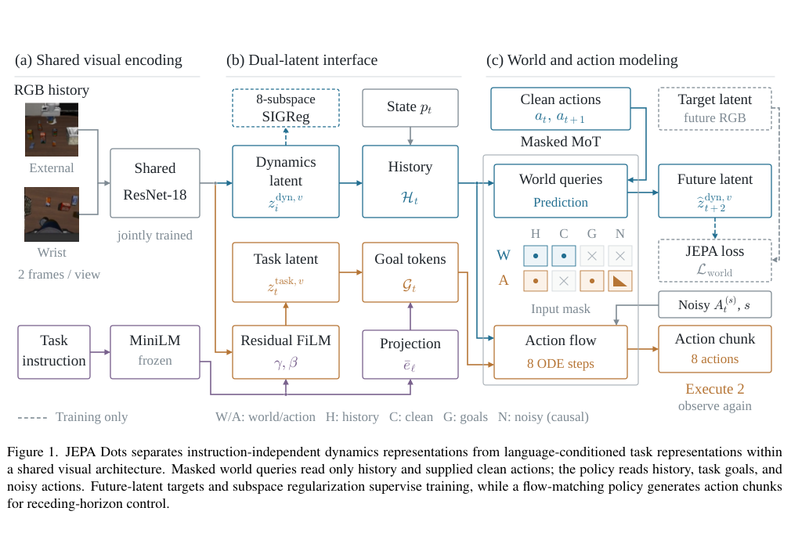

# JEPA Dots：隔离语言任务表征与固定动作下的动力学预测

[English](README-en.md)

> **仅资料收录；无实现**. 完整实验：**成本过高，不复现（审查 DONE）**。

## 论文信息

| 字段 | 内容 |
| --- | --- |
| 论文链接 | [arXiv:2611.24062v1](https://arxiv.org/abs/2611.24062v1); [fixed PDF](https://arxiv.org/pdf/2611.24062v1) |
| 公司 / 机构 / 学校 | Xianhao Pan: Z Robotics (fixed-v1 PDF byline) |
| 首次公开日期 | 2026-11-18T08:55:54Z (arXiv v1); announcement2026-11-19 |
| 原作者开源代码 | 固定v1未找到可核验的原作者方法源码/许可证；依赖仓库不算本方法开源。 |
| 本地 adapter / key | `jepa-dots`；`adapter: null`；未接入Evolve |
| 本地复现代码目录 | 无（不复现） |

## 原始论文总结

### 背景与主要改动

共享视觉骨干之后拆动力学和任务两条latent路径，语言FiLM只进入任务路径。world query只读动力学历史和给定clean动作，policy读历史、goal和noisy动作；多层mask同时阻断间接泄漏。固定参数、观测和给定动作时，换指令不能改变world预测，但policy可以生成不同动作。

~~~mermaid
flowchart LR
 O[Observations] --> B[Shared visual backbone]
 B --> D[Dynamics latent]
 B --> T[Task latent with language FiLM]
 L[Instruction] --> T
 D --> W[World branch with clean supplied actions]
 D --> P[Flow policy]
 T --> P
 P --> A[Execute first two of eight actions]
 W --> S[Training supervision only]
~~~

<!-- paper-figure:start -->
### 原论文关键图

固定v1原始PDF裁切，未修改科学内容；是作者方法，不是本地证据。[页码、裁切与SHA256](assets/provenance.json)。图片来自[原论文](https://arxiv.org/pdf/2611.24062v1)，版权归原作者所有。
<!-- paper-figure:end -->

### 核心公式

$$
\widetilde F(\ell)=F+\gamma(e_\ell)\odot F+\beta(e_\ell),\quad\hat Z(H,A;\ell_1)=\hat Z(H,A;\ell_2),\qquad\mathcal L=\mathcal L_{act}+\mathcal L_{world}+0.04\mathcal L_{sub}.
$$

不变性约束的是forward信息通路，不是说共享骨干训练后两种latent统计独立。world预测分支只在训练监督中使用，部署是action flow生成8动作、执行前2个后重规划，不是用world model在线搜索动作。

### 论文离线与线上效果

原文reference实验40个已训练LIBERO任务总体84.9%，对照task-ID适配76.0%。NanoVLA-S等外部发表成绩使用不同protocol，不可当严格同预算胜出。未报告生产线上A/B，本轮没有机器人成功率测量。

## 本地复现

### 数据协议与代码映射

仅资料、公式、机构及成本收录，无operator、训练、LIBERO安装、机器人执行、metrics或GPU回执。不得用一个语言无关函数的恒等式fixture冒充完整双latent控制模型。

### 同主题比较与边界

LeWAM联合world/action并用预测模型规划；JEPA Dots强调语言目标与动力学给定动作输入的隔离，部署world分支不参与动作搜索。相同masked-MoT背景不代表推理链相同。

### 高成本完整实验

39.1M参数含冻结句子encoder，训练60epochs约15k更新；40任务每模型4000闭环episode、每episode最多600步，三run消融每variant12000episode。小参数量不代表低完整实验成本；单A100/A30/Mac本轮不下载LIBERO、不试训或运行长闭环。

**成本过高，不复现（审查 DONE）**；不启动完整实验、不下载大资源、不自动重试、不进入自动实现队列，不作能力晋级。
