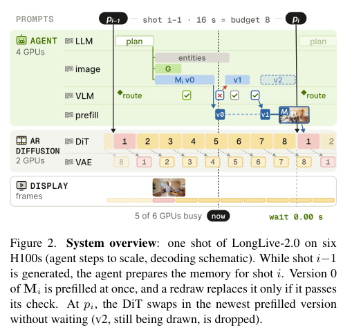

# Agentic LongLive: prepare entity memory without stopping video generation

<!-- source-sha256: 1b3727eb004e119257b2290d687d6e2f8c88878238064c59c2322d5315b325ba -->

[简体中文](README.md)

> `deferred_high_cost` / review-only, not implemented or run. High cost, not reproduced (review DONE). No local adapter, operator, command, metrics or GPU receipt; no retry/implementation queue or Evolve integration.

## Paper information

| Field | Content |
| --- | --- |
| Paper | [Agentic LongLive: Asynchronous Agentic Memory for Long Video Generation](https://arxiv.org/abs/2611.34907v1), fixed v1 |
| Institutions | First author Shaoteng Liu: CUHK; coauthor affiliations NVIDIA and MIT, PDF page 1; do not infer first-author affiliation from the last author |
| Original publication | 2026-11-25 18:54:03 UTC, arXiv v1; the PDF header's 2026-11-26 is not its initial arXiv release; announced/discovered/reviewed 2026-11-26, verified against this batch's announcement pool |
| Author code | [NVlabs/LongLive Agentic-LongLive](https://github.com/NVlabs/LongLive/tree/main/Agentic-LongLive), Apache-2.0; public README inspected, with agent/runtime/backends/rl structure. Merged RL-planner weights and RL data remain coming soon; not all weights are released |
| Local adapter/key | `agentic-longlive`; `adapter: null`, `local_operator: null`, `local_command: null` |
| Local code directory | None: review-only bilingual documentation and original figure; no local algorithm/experiment |

## Original method

### Motivation and changes

Real-time generation cannot read future scripts, pause for an agent or repair played shots. The memory agent reads revealed prompts, not generated videos, preventing generation errors from feeding back. Entity text/images form a global image G and per-shot M; auxiliary GPUs prefill their attention-sink KV. Shot boundaries swap the newest fully prefilled version without waiting for ongoing drawing. Missing updates reuse older memory. The first M version may commit despite a failed check; replacements must pass without lower scores. Scene routing and entity cards use revealed prompts only.

<!-- paper-figure:start -->
### Original figure

图片来自[原论文](https://arxiv.org/pdf/2611.34907v1#page=2)，版权归原作者所有。Figure 2, page 2, retains the complete six-H100 timeline and caption; only unrelated text/whitespace cropped, visually reviewed. [Hashes/crop](assets/provenance.json). This is the authors' system, not a local deployment.
<!-- paper-figure:end -->

### Equations

$$
v_i=F(p_i,KV_i,m_i),\qquad m_i=A(p_{1:i-1},m_{1:i-1}).
$$

Memory must precede revelation of the current prompt and cannot depend on generated video. An unfinished update falls back to older memory; k is memory lag. A fixed generator attention window does not establish constant total CPU entity/location storage. Qwen3-8B LoRA receives teacher rejection-sampling SFT and per-shot GRPO. Image reward is calibrated against downstream video outcomes rather than assuming factual recall equals video quality.

$$
r=0.35r_{text}+0.3r_{img}+0.15r_{prec}+0.05r_{ret}-r_{pen}.
$$

Hidden future scripts/annotations are available only to training-reward/evaluation components, not the planner. A scorer or oracle-next-prompt is not this online agent.

### Reported results

LongStory-Online has 25 stories/857 shots, revealed one prompt at a time and generated once. The authors report LongLive-2.0 state 38.2→64.5, identity 44.1→89.0 and revisit 15.0→55.4, with H100 time approximately 15.8→16.0 seconds/shot. An eight-B200 node reaches 34.3 FPS in BF16. This throughput uses additional GPUs; roughly 1% added generation time is not 1% added compute and excludes extra GPU value. No production online A/B or local measurement is reported.

## Local scope

### Protocol and mapping

Only method/date/affiliation/code/cost review and same-topic comparison. No algorithm, LLM policy, generator, reward implementation, training, GPU run or Evolve mapping; no invented seeds, metrics or receipts. Upstream CPU mocks are not complete video capability and are not run to bypass the cost gate.

### Same-topic comparison

Reviewed peer [PixVid](../2611.17336-pixvid/README.md) belongs to `world-state-actions`. PixVid changes generator representation, transferring latent DiT knowledge to pixels through alignment, noise calibration and a detailer. Agentic LongLive freezes an existing generator and adds open-loop entity memory, prefill and boundary swaps. Pixel migration does not supply online memory; memory injection neither removes the VAE nor reproduces pixel migration. Both full matrices are high-cost and unrun locally, with no comparable local video metrics.

### Full-campaign cost decision

Figure 2 already uses six H100s. Appendix B Table B1's full LongLive-2.0 B200 layout is one DiT + two auxiliary + three agent GPUs within an eight-B200 node (180GB/card); H3 requires larger parallel layouts. The agent includes a 35B checker/router, FLUX.2-klein-4B and 8B RL planner. Public README download sizes list 9.4GB video weights, 32GB encoder/VAE, 37GB checker and 16GB image model, plus about 16GB planner/optional H3; these are author listings, not local downloads. Training involves 56 stories, teacher sampling, SFT/GRPO and shared services, followed by multi-seed/multi-arm evaluation. This clearly exceeds the short one-A100/A30-or-Mac budget: high cost, not reproduced (review DONE). No model/data downloads, probes or automatic restarts.

### Sources

Fixed-v1 PDF SHA256: `8156da13cfd71188b0b89b56d46c8c033615aaa67f6596123bd3d8244039c106`. Method Section 2, results Section 3/Tables 1–2, cost Appendix B; [author project](https://nvlabs.github.io/LongLive/Agentic-LongLive/) and public README verify code status. Bounded incremental review, not exhaustive video-generation coverage.
