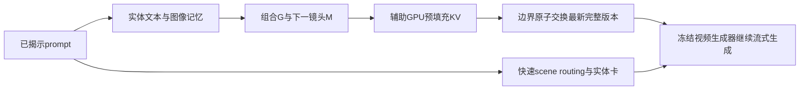
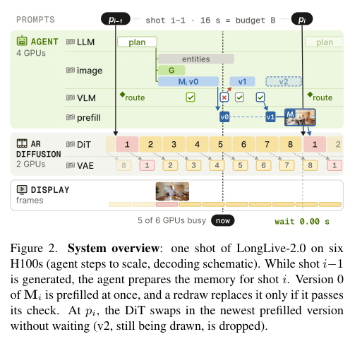

# Agentic LongLive：在视频不停流时异步准备实体记忆

[English](README-en.md)

> `deferred_high_cost` / 仅资料收录，未实现、未运行。完整系统**成本过高，不复现（审查 DONE）**；无本地adapter、代码operator、运行命令、metrics或GPU回执，不进入重试/实现队列或Evolve。

## 论文信息

| 字段 | 内容 |
| --- | --- |
| 论文链接 | [Agentic LongLive: Asynchronous Agentic Memory for Long Video Generation](https://arxiv.org/abs/2611.34907v1)，固定v1 |
| 公司/机构/学校 | 一作Shaoteng Liu：CUHK；其余署名NVIDIA、MIT，按PDF第1页；不按最后一作推断一作机构 |
| 首次公开日期 | 2026-11-25 18:54:03 UTC，arXiv v1；PDF页眉2026-11-26不是首次arXiv公开时间；2026-11-26公告/发现/审查，公告日由本轮公告池核实 |
| 原作者开源代码 | [NVlabs/LongLive的Agentic-LongLive目录](https://github.com/NVlabs/LongLive/tree/main/Agentic-LongLive)，Apache-2.0；已读取公开README，确有agent/runtime/backends/rl结构；RL planner合并权重与RL数据仍标coming soon，不能声称所有权重已发布 |
| 本地 Adapter / 方法 | key `agentic-longlive`；`adapter: null`、`local_operator: null`、`local_command: null` |
| 本地复现代码目录 | 无：review-only，仅本目录双语文档与原图，没有本地算法或实验 |

## 原始论文总结

### 背景与主要改动

实时视频不能提前读脚本、停流等agent或回滚已播放镜头。memory agent只读已揭示prompt而不读生成视频，避免把生成错误写回；维护实体文本/图像，组合长期全局图$G$与每镜头图$M$，由辅助GPU提前编码为attention-sink KV。边界只交换已完整prefill的最新版本；没准备好就用旧版本，不等正在绘制的图。图像首版可先commit，即使未通过检查；后续重画须通过且不降分才能替换。scene routing和实体文本卡只使用已揭示prompt。

<!-- paper-figure:start -->
### 原论文关键图

图片来自[原论文](https://arxiv.org/pdf/2611.34907v1#page=2)第2页Figure 2，版权归原作者所有。完整保留六张H100的时间线及图注，仅裁无关正文/留白，已目视核对；[来源SHA256与裁剪坐标](assets/provenance.json)。这是原论文系统，不是本地部署。
<!-- paper-figure:end -->

### 核心公式

$$
v_i=F(p_i,KV_i,m_i),\qquad m_i=A(p_{1:i-1},m_{1:i-1}).
$$

$m_i$必须在$p_i$揭示前准备，不能依赖已生成视频；尚未完成时可退回$m_{i-k}$，$k$是memory lag。生成器窗口固定不表示CPU实体库/场景缓存总空间永不增长。Qwen3-8B LoRA先teacher best-of/rejection SFT，再用逐镜头GRPO学习选择记忆；image reward用下游视频结果校准，避免把“记住更多事实”直接当更好视频。

$$
r=0.35r_{text}+0.3r_{img}+0.15r_{prec}+0.05r_{ret}-r_{pen}.
$$

未来隐藏脚本/标注只供训练奖励与评估侧使用，不供planner读取。实现scorer或oracle-next-prompt不能冒充这个在线agent。

### 论文离线与线上效果

LongStory-Online25故事857镜头，每prompt逐镜头揭示、每镜头生成一次。作者报告LongLive-2.0 persistent state38.2→64.5、identity44.1→89.0、revisit15.0→55.4；H100每镜头约15.8→16.0秒。8×B200节点报告BF16完整系统34.3FPS。这是加GPU后的系统吞吐，不是单卡仅加1%算力；“约1%额外生成时间”不包含额外GPU价值。未报告生产线上A/B，亦非本地测量。

## 本地复现与边界

### 数据协议与代码映射

仅全文机制、时间、署名、开源状态、成本与同主题对照审查。无本地算法、LLM policy、视频generator、reward实现、训练、GPU执行或Evolve映射；不制造三seed数据/指标或回执。作者上游有CPU mock测试不等于完整视频能力，不运行它来绕过成本门槛。

### 同主题比较与边界

已实读[PixVid](../2611.17336-pixvid/README.md)，属于`world-state-actions`。PixVid改变生成器表示：把latent DiT经线性对齐、噪声校准和detailer迁回像素；Agentic LongLive冻结已有生成器，增加开放环实体记忆、预填充与镜头边界交换。前者不自动提供在线记忆，后者也没有取消VAE或复现像素迁移。两者完整视频矩阵均高成本且本地未跑，无可比较本地视频指标。

### 完整实验与成本决定

原文Figure2即六H100架构；附录B TableB1的B200完整LongLive-2.0布局为1 DiT+2辅助+3 agent GPU，节点8×B200（180GB/卡），H3另需更大并行。agent三模型包括35B checker/router、FLUX.2-klein-4B与8B RL planner。公开README列基础视频9.4GB、encoder/VAE32GB、checker37GB、图像模型16GB，另有planner约16GB及可选H3；这是作者列出下载大小，不是本地下载。RL用56训练故事、teacher采样、SFT/GRPO和共享服务，完整评测还有多seed/多arm。明显超出单A100/A30或Mac短时资源，**成本过高，不复现（审查 DONE）**；不下载模型/数据、不试跑、不自动重启。

### 来源核对

固定v1 PDF SHA256：`8156da13cfd71188b0b89b56d46c8c033615aaa67f6596123bd3d8244039c106`。机制§2、结果§3/Table1–2、成本附录B；[作者项目页](https://nvlabs.github.io/LongLive/Agentic-LongLive/)与公开README独立核验代码发布状态。有限增量审查，不代表穷尽视频生成领域。
