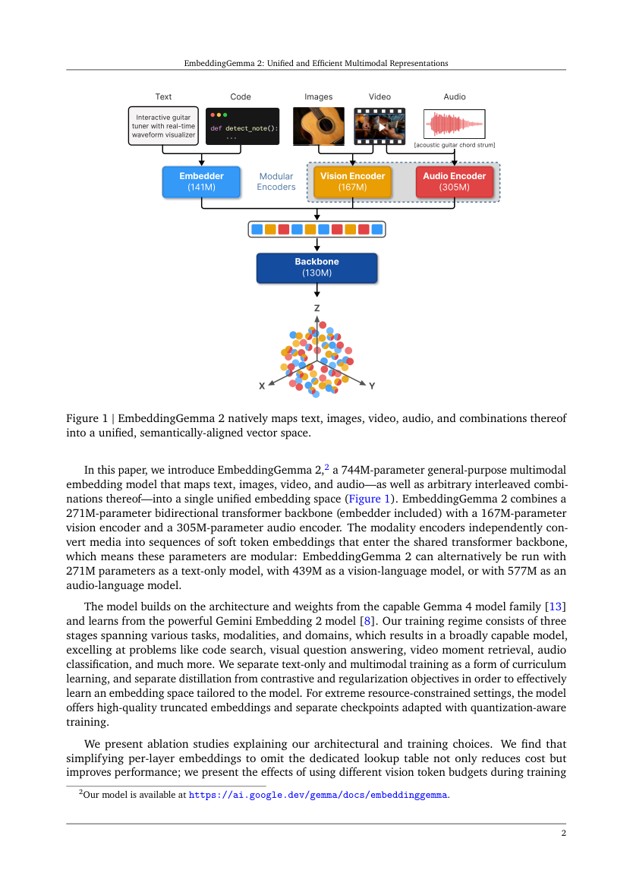

# EmbeddingGemma 2: unified image–text embeddings with truncatable representations

<!-- source-sha256: eff70bf2012d4fee3d5343c5e47707ce0d4d953155dc354b5ed71b48acc890f1 -->

[简体中文](README.md)

## Paper information

This entry covers the official October 6 model release and integration of the existing checkpoint. The October 27 technical paper describes the same model and is included here rather than as a duplicate. We do not claim to reproduce pretraining. This revision updates references and learning notes only; it does not change runtime code, rerun the October 14 GPU measurement, or upgrade its evidence.

| Field | Details |
| --- | --- |
| Paper | [EmbeddingGemma 2: Unified and Efficient Multimodal Representations](https://arxiv.org/abs/2610.37364v1); [Google's original model release](https://blog.google/innovation-and-ai/technology/developers-tools/embeddinggemma-2/); [pinned model card](https://huggingface.co/google/embeddinggemma-2/blob/914f7f89142e33e77833254d9c9b90c3cef7303b/README.md) |
| Organization | First author Henrique Schechter Vera, EmbeddingGemma Team at Google; the paper marks joint first authors. |
| First public release | Official model release: 2026-10-06. Technical paper arXiv v1: 2026-10-27 15:00:42 UTC. These are distinct dates; repository creation is not release. |
| Authors' code | Yes: [official Transformers implementation](https://github.com/huggingface/transformers/tree/28034545c35acac05793695bd5c878f66e6b544e/src/transformers/models/embedding_gemma2) and [public weights](https://huggingface.co/google/embeddinggemma-2/tree/914f7f89142e33e77833254d9c9b90c3cef7303b), Apache-2.0. The full original training data and recipe are not public. |
| Adapter | `embedding-gemma2`, a standalone checkpoint inference component, not a registered paper training adapter |
| Local reproduction code | [`src/auto_research/multimodal/embedding_gemma2.py`](https://github.com/daiwk/auto-research/blob/main/src/auto_research/multimodal/embedding_gemma2.py); `scripts/run_embedding_gemma2.py` |

## Original paper

### Motivation and method

EmbeddingGemma 2 maps text, images, audio, and video into a shared 768-dimensional space for retrieval, classification, and clustering. Independent modality towers can be disabled when not needed. Text uses task prefixes and attention-mask mean pooling. Matryoshka Representation Learning (MRL) retains the first 128, 256, or 512 dimensions and renormalizes the vector to trade quality for storage.

The technical paper reports 744M total parameters: 271M in the text backbone including the embedder, 167M in vision, and 305M in audio. The authors give 439M for the image–text path; these are rounded approximations. The local path instantiates only text and vision, with no random small model substituted for the official checkpoint. The paper's simplified PLE projects the shared input embedding instead of adding a dedicated lookup table. This does not establish a local reproduction of its multistage training.

### Architecture and data flow

~~~mermaid
flowchart LR
    T[Text with query or document prefix] --> B[Official text backbone]
    I[Image with fixed soft-token budget] --> V[Official vision tower]
    V --> B
    B --> P[Attention-mask mean pooling]
    P --> E[Shared 768-dimensional representation]
    E --> M[Fixed MRL prefix truncation]
    M --> N[L2 renormalization]
    N --> R[Bidirectional multi-positive image–text retrieval]
~~~

The diagram above is a local redraw, not an image from the paper. Previously this entry had only the model card; it now includes the technical paper and its original figure. The pinned model card remains the source for official parameter counts, selective loading, and results at each dimension.

<!-- paper-figure:start -->
### Key figure from the paper

Full-page capture from the [pinned v1 PDF](https://arxiv.org/pdf/2610.37364v1), not redrawn. Page and source hash are in `assets/provenance.json`. The paper is CC BY 4.0 and copyright remains with the authors. Audio and video paths shown in the figure are not integrated locally.
<!-- paper-figure:end -->

### Core equations

$$
z=\frac{\sum_t m_t h_t}{\sum_t m_t},\qquad
e_d=\frac{z_{1:d}}{\lVert z_{1:d}\rVert_2},\quad d\in\{128,256,512,768\}.
$$

Padding tokens are excluded and truncated vectors must be renormalized. Images do not need text task prefixes. Queries use `task: search result | query: ` and documents use `title: none | text: `. Do not use FP16: the authors warn that its activation range can produce nonfinite values. Local inference uses FP32 and checks outputs for nonfinite values and zero vectors.

Section 2.1 of the paper describes mean pooling of the 512-dimensional backbone, linear projection to 768 dimensions, and L2 normalization. In the pinned official Transformers commit, `EmbeddingGemma2TextModel` applies the bias-free `embedding_projection` before returning `last_hidden_state`. Thus $h_t$ in the local equation is a projected token representation. A linear projection commutes with an equally weighted masked mean: no projection is missing, and applying it twice would be incorrect. This revision checked the source mapping only; the old 16-image result does not reproduce all seven evaluation suites in the new paper.

### Official results

At full dimension 768, the pinned card reports 61.36 on multilingual MTEB v2, 78.68 on code MTEB v1, and 64.64 on MIEB lite. Multimodal quality drops more at 128 dimensions. These are official results, not local measurements or scores that can be averaged as though they were one metric. No production online A/B result is claimed.

## Local reproduction

### Installation and run instructions

Use a separate environment so the older papers' HF Hub `<2` dependencies stay intact. Pin the official Transformers source instead of relying on a moving `main`. If the architecture is unavailable, the runner fails explicitly rather than substituting another embedding model.

~~~bash
python -m venv .venv-eg2
source .venv-eg2/bin/activate
python -m pip install -r requirements-embedding-gemma2.txt
python -m pip install -e . --no-deps

PYTHONPATH=src python scripts/prepare_embedding_gemma2.py \
  --output data/embeddinggemma2
PYTHONPATH=src python scripts/prepare_oct12_public_sources.py \
  --source coco --maximum 40 --output data/coco40
PYTHONPATH=src python scripts/run_embedding_gemma2.py \
  --checkpoint-path data/embeddinggemma2 --dataset-dir data/coco40 \
  --device cuda --images 16 --seed 42 --output runs/embeddinggemma2-42
~~~

`data/coco40` is the pinned public COCO-Caption2017 validation mirror, revision `3bdd5827e243cc3084ac69a1111e69c3ab9193ff`, produced by the public data preparer above. Keep `provenance.json`. An arbitrary same-named directory is not a substitute: the script checks SHA256 for every image, JSONL, and checkpoint input.

The checkpoint is pinned at `914f7f89142e33e77833254d9c9b90c3cef7303b`. Only about 1.49 GB of official weights and configuration are downloaded, with training disabled. Inference permits up to 40 images. This run prespecified the first 16 images with five captions each, image batch size 2, text batch size 4, and 70 soft tokens. It reports all four MRL dimensions and does not select the best one on this holdout.

### Results and limits

Actual image–text retrieval on A100 took about 1.51 seconds, excluding download and model load. Results for the fixed 16 images and 80 captions:

| Dimensions | Image-to-text R@1 | Text-to-image R@1 | Both directions R@5 / R@10 |
| --- | ---: | ---: | ---: |
| 128 | 93.75% | 96.25% | 100% |
| 256 | 93.75% | 96.25% | 100% |
| 512 | 93.75% | 97.50% | 100% |
| 768 | 93.75% | 97.50% | 100% |

See the [real inference metrics](metrics/coco16-a100-seed42.json) and [source-bound GPU receipt](../../gpu-validations/embedding-gemma2-a100-20261014.json). In the first real run, the official processor interpreted a flat list of images as one multi-image sample, collapsing the sample axis and causing the scorer to fail. The artifact retains the failure and pre-fix commit. Nesting one image per batch item fixed the issue; the **same** model, examples, and budget passed on rerun without altering evaluation conditions to improve results.

This verifies the image–text retrieval path on a small candidate pool, not full COCO/MTEB/MMEB, training, or a multi-seed model comparison. Audio, video, interleaved multimodal inputs, and evolve genomes are not integrated. **Full pretraining and large benchmarks were not reproduced because of cost (review complete)** and will not be expanded or retried automatically.

### Code mapping

- `embedding_gemma2.py`: loads the official model, selectively disables the audio tower, preserves processor fields, and implements masked pooling, MRL, and multi-positive scoring.
- `prepare_embedding_gemma2.py`: validates pinned public inputs and weights. Download failures can leave the existing mirror intact; the provenance manifest is generated only when complete.
- `run_embedding_gemma2.py`: enforces fixed budgets and non-overwriting outputs, and reports real retrieval measurements. Scorer annotations do not affect encoding.
