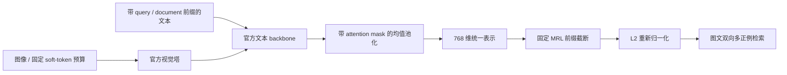

# EmbeddingGemma 2：统一图文嵌入与可截断表示

## 论文信息

这是官方模型发布与 checkpoint 接入，不是另造一篇 arXiv 论文，也不声称复现其预训练。

| 项目 | 内容 |
| --- | --- |
| 论文链接 | [Google 官方发布说明](https://blog.google/innovation-and-ai/technology/developers-tools/embeddinggemma-2/)；[固定版本模型卡](https://huggingface.co/google/embeddinggemma-2/blob/914f7f89142e33e77833254d9c9b90c3cef7303b/README.md) |
| 公司/机构 | Google DeepMind（官方发布，无论文一作排序） |
| 首次公开日期 | 2026-10-06（官方发布日；仓库创建日不是发布日期） |
| 原文开源代码 | 是：[官方 Transformers 模型实现](https://github.com/huggingface/transformers/tree/28034545c35acac05793695bd5c878f66e6b544e/src/transformers/models/embedding_gemma2)与[公开权重](https://huggingface.co/google/embeddinggemma-2/tree/914f7f89142e33e77833254d9c9b90c3cef7303b)，Apache-2.0；完整原始训练数据/配方未公开 |
| Adapter | `embedding-gemma2`（独立 checkpoint 推理组件，未注册论文训练 adapter） |
| 本地复现代码 | [`src/auto_research/multimodal/embedding_gemma2.py`](https://github.com/daiwk/auto-research/blob/main/src/auto_research/multimodal/embedding_gemma2.py)；`scripts/run_embedding_gemma2.py` |

## 原始论文总结

### 背景与主要改动

EmbeddingGemma 2 将文本、图像、音频与视频映射到统一的 768 维空间，支持检索、分类和聚类。独立模态塔可以按需关闭；文本使用任务前缀，输出经 attention-mask 均值池化，MRL 允许保留前 128/256/512 维并重新归一化，以权衡质量与向量存储成本。

官方总参数约 740M，其中文本约 270M、视觉约 170M、音频约 300M。本地只实例化文本和视觉，约 440M，不使用随机小模型代替官方 checkpoint。

### 架构与数据流



模型卡没有独立论文架构图；上图为本地重绘，不冒充原论文截图。官方参数、选择性加载和各维度结果均可在固定版本模型卡核对。

### 核心公式

$$
z=\frac{\sum_t m_t h_t}{\sum_t m_t},\qquad
e_d=\frac{z_{1:d}}{\lVert z_{1:d}\rVert_2},\quad d\in\{128,256,512,768\}.
$$

padding token 必须排除，截断后必须再次归一化。图像无需文本任务前缀；查询文本使用 `task: search result | query: `，文档使用 `title: none | text: `。不得使用 FP16：官方指出其激活范围可能产生非有限值；本地固定 FP32，并在输出处检查非有限值和零向量。

### 论文离线与线上效果

固定模型卡报告完整 768 维的 multilingual MTEB v2 为 61.36、code MTEB v1 为 78.68、MIEB lite 为 64.64；128 维的多模态质量下降更明显。这些是官方结果，不是本地测量，也不是同一指标的可混合均值。没有生产线上 A/B 声明。

## 本地复现

### 安装与运行

使用独立环境，避免改变旧论文依赖的 HF Hub `<2` 环境。固定官方 Transformers 源码，而不是长期依赖浮动 `main`；缺少架构时直接报错，不换成别的 embedding 模型。

```bash
python -m venv .venv-eg2
source .venv-eg2/bin/activate
python -m pip install -r requirements-embedding-gemma2.txt
python -m pip install -e . --no-deps

PYTHONPATH=src python scripts/prepare_embedding_gemma2.py \
  --output data/embeddinggemma2
PYTHONPATH=src python scripts/prepare_oct12_public_sources.py \
  --source coco --maximum 40 --output data/coco40
PYTHONPATH=src python scripts/run_embedding_gemma2.py \
  --checkpoint-path data/embeddinggemma2 --dataset-dir data/coco40 \
  --device cuda --images 16 --seed 42 --output runs/embeddinggemma2-42
```

`data/coco40` 是固定公开 COCO-Caption2017 validation 镜像，版本
`3bdd5827e243cc3084ac69a1111e69c3ab9193ff`，由上述公开数据准备器生成。必须保留 `provenance.json`，不能用任意同名图像目录替代；脚本核验每张图、JSONL 和 checkpoint 输入的 SHA256。

checkpoint 固定为 `914f7f89142e33e77833254d9c9b90c3cef7303b`；只下载约 1.49GB 官方权重与配置，训练关闭。推理最多 40 图，本轮预先固定前 16 图、每图五条 caption、图像 batch=2、文本 batch=4、70 soft tokens，四个 MRL 维度全部报告，不在这组留出数据上选最优维度。

### 结果与边界

实际 A100 图文检索约 1.51 秒（不含下载/模型加载）。固定 16 图、80 captions 的结果如下：

| 维度 | 图检文 R@1 | 文检图 R@1 | 两方向 R@5 / R@10 |
| --- | ---: | ---: | ---: |
| 128 | 93.75% | 96.25% | 100% |
| 256 | 93.75% | 96.25% | 100% |
| 512 | 93.75% | 97.50% | 100% |
| 768 | 93.75% | 97.50% | 100% |

详见[真实推理指标](metrics/coco16-a100-seed42.json)与[绑定源码的 GPU 回执](../../gpu-validations/embedding-gemma2-a100-20261014.json)。首次实跑发现平铺图像列表被官方 processor 当成单个多图样本，造成样本轴合并和 scorer 报错；失败及修复前 commit 保留在产物中。修复为嵌套单图 batch 后，在**同一**模型/样本/预算重新验证通过，没有为了效果改变评测条件。

这是小候选库上的图文检索链路验证，不是完整 COCO/MTEB/MMEB，也不是训练或多种子模型比较。当前没有音频、视频、跨模态交错输入或 evolve genome 接入。完整预训练及大型 benchmark 按成本门槛暂缓，不自行扩规模。

### 代码映射

- `embedding_gemma2.py`：官方模型加载、选择性关闭音频塔、保留 processor 字段、mask 池化、MRL 与多正例 scorer。
- `prepare_embedding_gemma2.py`：固定公开输入与权重校验；下载失败可保留已有镜像，完整后才生成来源清单。
- `run_embedding_gemma2.py`：固定预算、不可覆盖的输出与真实检索指标；不使用 scorer 标注影响编码。
