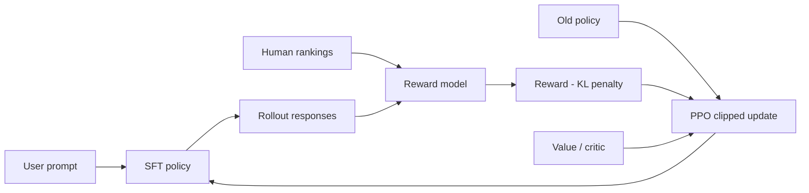
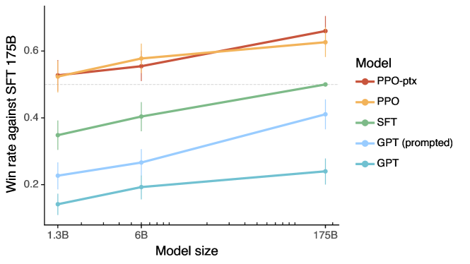

<!-- source-sha256: d68c63a67f0b4d8005ab931d028b7478c93ba9b1565aae48c2409d570db084ab -->

[简体中文](README.md) · English

# InstructGPT / PPO-RLHF

> The local implementation runs PPO-RLHF with old-policy sampling, a clipped surrogate, an independent critic, and a KL constraint. The candidate-policy experiment is not a 175B InstructGPT reproduction.

## Paper information

| Field | Details |
| --- | --- |
| Paper | [Training language models to follow instructions with human feedback](https://arxiv.org/abs/2203.02155) |
| Institution | OpenAI |
| First public release | 2022-03-04 |
| Author code | [Partially released](https://github.com/openai/following-instructions-human-feedback): evaluation examples and model cards. Full SFT/RM/PPO training code was not released. |
| Local adapter or method key | `ppo-rlhf` |
| Local reproduction code | `src/auto_research/post_training/` |

## Original paper summary

### Background and main changes

Increasing language-model size alone does not guarantee alignment with user intent. InstructGPT establishes the three-stage pipeline: SFT on annotator demonstrations, reward-model training on pairwise rankings, and PPO policy optimization with a KL penalty to limit drift from the SFT/reference model.



<!-- paper-figure:start -->
### Key figure from the paper

[](https://ar5iv.labs.arxiv.org/html/2203.02155/assets/x1.png)

> **Figure 1:** The training pipeline and key optimization stages in the paper. From the [paper](https://arxiv.org/abs/2203.02155); copyright belongs to the authors. Click for the source.
<!-- paper-figure:end -->

### Core equations

$$
\mathcal{L}_{\mathrm{clip}}(\theta)=
\mathbb{E}_t\left[
\min\left(r_t(\theta)\hat A_t,
\operatorname{clip}(r_t(\theta),1-\epsilon,1+\epsilon)\hat A_t\right)
\right],
\qquad
r_t(\theta)=\frac{\pi_\theta(a_t\mid s_t)}
{\pi_{\theta_{\mathrm{old}}}(a_t\mid s_t)}.
$$

The local critic estimates the baseline, and KL against the reference policy is subtracted from reward.

### Offline and online results

In human preference evaluations, 1.3B InstructGPT is preferred to 175B GPT-3. The preference rate for 175B InstructGPT over 175B GPT-3 is about 85% (±3%). TruthfulQA truthfulness roughly doubles, and toxicity decreases about 25% under respectful prompts. The paper does not report a production online A/B traffic experiment.

## Local reproduction

Official OpenAI GSM8K JSONL data is used to construct a six-candidate policy task. The run uses 512 training and 128 validation examples, 300 steps, group size 4, and seed 42.

| Metric | Untrained policy | PPO-RLHF |
|---|---:|---:|
| Accuracy | 0.1641 | **0.8125** |
| Mean reward | 0.3126 | **0.8335** |
| KL(reference) | 0.0000 | 0.8731 |

```bash
auto-research post-train --algorithm ppo-rlhf \
  --dataset gsm8k-candidate --maximum-examples 512 \
  --steps 300 --group-size 4 --seed 42 --offline
```

Stable metrics: [`classic-post-training-gsm8k-seed42.json`](../../experiments/classic-post-training-gsm8k-seed42.json).

## Scope

The local implementation retains PPO's actor, old policy, critic, clipping, and KL updates. It uses an interpretable linear candidate policy, with rewards from deterministic outcome and process dimensions. It does not train GPT-3 or a reward model, or use OpenAI's private prompts and human annotations.
