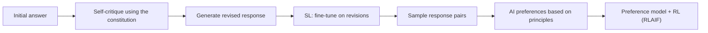
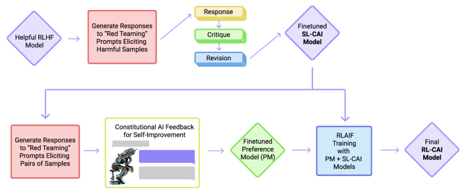

<!-- source-sha256: 0028e6be3f7dd52a6121858b4a8c21852885e9723dd1c9e253be6a19c41ebcbc -->

[简体中文](README.md) · English

# Constitutional AI: Learning harmlessness from AI feedback

> Implements the two stages of self-critique and revision followed by SFT on revised examples and RLAIF with AI preferences. The local candidate policy is not Anthropic's large-model safety training.

## Paper information

| Field | Details |
| --- | --- |
| Paper | [Constitutional AI: Harmlessness from AI Feedback](https://arxiv.org/abs/2212.08073) |
| Institution | Anthropic |
| First public release | 2022-12-15 |
| Author code | [Supplementary materials released](https://github.com/anthropics/ConstitutionalHarmlessnessPaper); not a complete training framework. |
| Local adapter or method key | `constitutional-ai` |
| Local reproduction code | `src/auto_research/post_training/` |

## Original paper summary

### Background and main changes

Labeling individual harmful responses is costly and makes underlying values opaque. The paper distills human supervision into natural-language principles. In stage one, the model critiques and rewrites its responses according to the principles, then learns by SFT on the revisions. In stage two, AI compares responses, a preference model is trained, and its reward drives RLAIF.



<!-- paper-figure:start -->
### Key figure from the paper

[](https://ar5iv.labs.arxiv.org/html/2212.08073/assets/x1.png)

> **Figure 1:** Overall design and components. From the [paper](https://arxiv.org/abs/2212.08073); copyright belongs to the authors. Click for the source.
<!-- paper-figure:end -->

### Core equations

$$
\mathcal L_{\mathrm{CAI}}
=-\log \pi_\theta(y_{\mathrm{rev}}\mid x)
-\lambda\log\sigma\!\left(
\beta\Delta\log\frac{\pi_\theta}{\pi_{\mathrm{ref}}}
\right),
$$

The first term is SFT on revised responses. In the second, chosen and rejected labels come from AI preferences generated using the constitution.

### Offline and online results

Human evaluations show that RLAIF reduces harmfulness while retaining helpfulness and gives fewer evasive refusals than the SL-only model. Chain-of-thought principle judgments further improve transparency. No production online A/B test is reported.

## Local reproduction

Public GSM8K candidate data (512/128), 300 steps, seed 42. Four auditable principle dimensions guide critique/revision and AI preferences. Human preference labels are not read.

| Metric | Untrained policy | Constitutional AI |
|---|---:|---:|
| Accuracy | 0.1641 | **0.8438** |
| Mean reward | 0.3126 | **0.8617** |
| KL(reference) | 0.0000 | 1.0214 |

```bash
auto-research post-train --algorithm constitutional-ai \
  --dataset gsm8k-candidate --maximum-examples 512 \
  --steps 300 --seed 42 --offline
```

Stable metrics: [`p0-missing-post-training-gsm8k-seed42.json`](../../experiments/p0-missing-post-training-gsm8k-seed42.json).

## Scope

Implements explicit principle scoring, SFT on self-revisions, and updates from AI preference ranking. The GSM8K dimensions are correctness, format, process, and brevity, not safety red-team data. The run does not train a standalone preference model or run large-model PPO.
