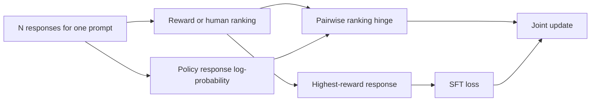
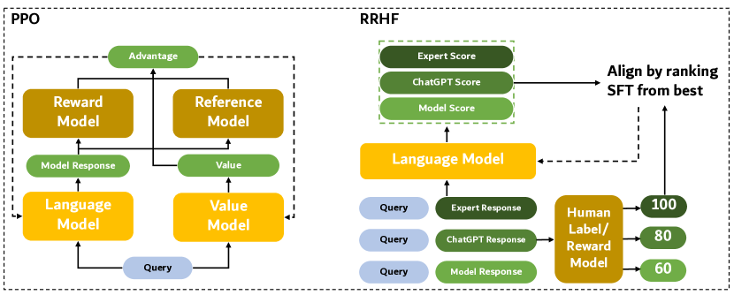

<!-- source-sha256: 2f2ceb86185f701ccc8c7b6b026c23b84eb80c1a4c1537e7656f53a7429faa90 -->

[简体中文](README.md) · English

# RRHF: Ranking response probabilities by reward

> Implements full-candidate reward ordering, a response log-probability ranking loss and best-response SFT. This is not DPO on one chosen/rejected pair.

## Paper information

| Field | Details |
| --- | --- |
| Paper | [RRHF: Rank Responses to Align Language Models with Human Feedback without tears](https://arxiv.org/abs/2304.05302) |
| Institution | Alibaba DAMO Academy / Tsinghua University |
| First public release | 2023-04-11 |
| Author code | [Public author code](https://github.com/GanjinZero/RRHF). |
| Local adapter or method key | `rrhf` |
| Local reproduction code | `src/auto_research/post_training/` |

## Original paper summary

### Background and main changes

PPO-RLHF coordinates policy, old policy, reward and value models, making training and tuning complex. RRHF samples responses from several models or humans, uses reward to rank them all, aligns the model's average log-likelihood order with reward order, and applies SFT to the highest-quality answer.



<!-- paper-figure:start -->
### Key figure from the paper

[](https://ar5iv.labs.arxiv.org/html/2304.05302/assets/x1.png)

> **Figure 1:** Overall workflow, stages and data flow. From the [paper](https://arxiv.org/abs/2304.05302); copyright belongs to the authors. Click for the source.
<!-- paper-figure:end -->

### Core equations

$$
\mathcal L_{\mathrm{rank}}
=\sum_{r_i<r_j}\max(0,p_i-p_j),\qquad
\mathcal L_{\mathrm{RRHF}}
=\mathcal L_{\mathrm{rank}}-\log\pi_\theta(y_{\arg\max r}\mid x).
$$

$p_i$ is the response's length-normalized log-probability.

### Offline and online results

On Anthropic Helpful/Harmless, reward-model scores and human preference are comparable to PPO. The author code page reports Alpaca-RRHF reward -1.02 versus Alpaca-PPO -1.03. No production A/B.

## Local reproduction

Public GSM8K candidate split 512/128, 300 steps, seed 42. All 6 responses in each group enter reward ranking and misordered-pair statistics.

| Metric | Untrained policy | RRHF |
|---|---:|---:|
| Accuracy | 0.1641 | **0.8125** |
| Mean reward | 0.3126 | **0.8401** |
| KL(reference) | 0.0000 | 0.8344 |

```bash
auto-research post-train --algorithm rrhf \
  --dataset gsm8k-candidate --maximum-examples 512 \
  --steps 300 --seed 42 --offline
```

Stable metrics: [`p0-missing-post-training-gsm8k-seed42.json`](../../experiments/p0-missing-post-training-gsm8k-seed42.json).

## Scope

Retains the full-ranking hinge and best-response SFT. Candidate log-probability is an auditable policy probability. No 7B LLaMA training, HH data generation, external reward model or human evaluation.
