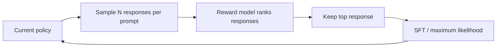
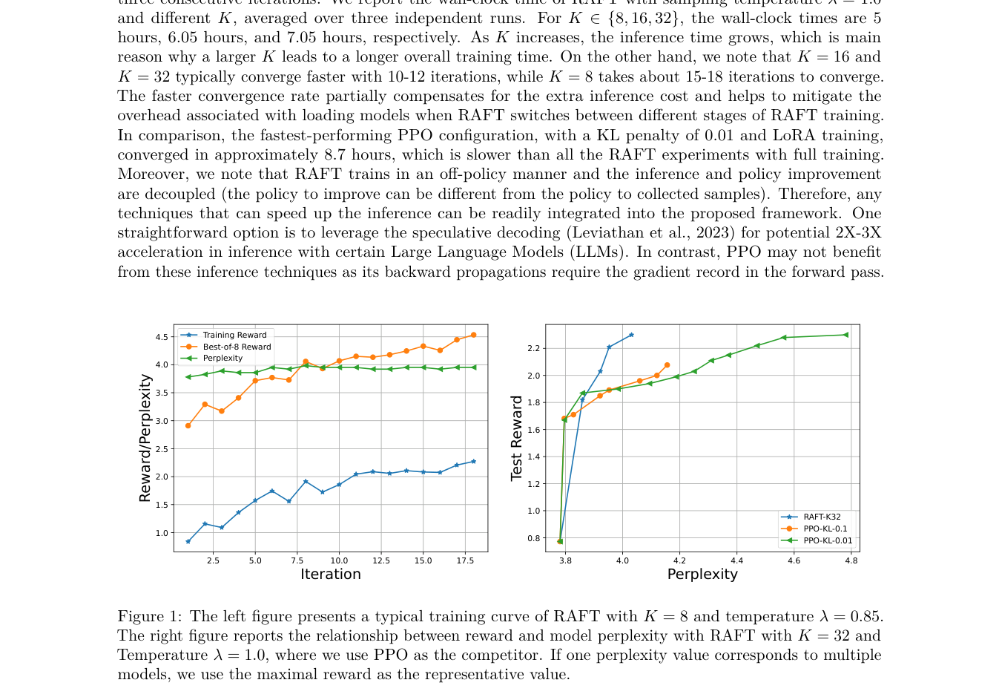

<!-- source-sha256: d83285c5ba1fa2d5b98dda75d2767524b1e73d0f4bde1a663ad2fec7bb2ef01d -->

[简体中文](README.md) · English

# RAFT: Reward Ranked Fine-Tuning

> Iterative rejection sampling: sample from the current policy, rank by reward, run SFT only on retained responses and resample. This differs from the full-ranking RRHF loss.

## Paper information

| Field | Details |
| --- | --- |
| Paper | [RAFT: Reward rAnked FineTuning for Generative Foundation Model Alignment](https://arxiv.org/abs/2304.06767) |
| Institutions | HKUST / University of Illinois Urbana-Champaign |
| First public release | 2023-04-13 |
| Author code | [Integrated in the authors' LMFlow](https://github.com/OptimalScale/LMFlow) |
| Local adapter / CLI key | `raft` |
| Local reproduction code | `src/auto_research/post_training/` |

## Original paper summary

### Background and main changes

Online PPO can be unstable, while static SFT cannot continuously use a better policy. RAFT samples multiple responses from the current model each round, ranks them with a reward model, discards lower-quality samples and maximum-likelihood fine-tunes on the selected responses. The updated policy starts the next round.



<!-- paper-figure:start -->
### Key figure from the paper

[](https://arxiv.org/pdf/2304.06767#page=8)

> **Figure 1:** Training workflow and key optimizations. From the [paper](https://arxiv.org/abs/2304.06767); copyright belongs to the authors. Click for the source.
<!-- paper-figure:end -->

### Core equations

$$
y^\star=\arg\max_{y\in\mathcal S_x}r(x,y),\qquad
\theta_{t+1}=\arg\min_\theta
-\mathbb E_x\log\pi_\theta(y^\star\mid x).
$$

### Offline and online results

The paper improves reward and automatic metrics on language-model sentiment/reward alignment and image generation, emphasizing training stability and lower resource requirements. No production A/B is reported.

## Local reproduction

Public GSM8K candidate split 512/128, 300 steps and seed 42. Sample 4 responses without replacement from the current policy and keep the one with highest reward for SFT (keep ratio 0.25).

| Metric | Untrained policy | RAFT |
|---|---:|---:|
| Accuracy | 0.1641 | **0.8438** |
| Mean reward | 0.3126 | **0.8617** |
| KL(reference) | 0.0000 | 0.8789 |

```bash
auto-research post-train --algorithm raft \
  --dataset gsm8k-candidate --maximum-examples 512 \
  --steps 300 --group-size 4 --seed 42 --offline
```

Stable metrics: [`p0-missing-post-training-gsm8k-seed42.json`](../../experiments/p0-missing-post-training-gsm8k-seed42.json).

## Scope

Online sampling, reward ranking, top-response filtering and iterative SFT are implemented. No actual generative LLM or reward model was trained, and the diffusion experiments were not reproduced. Candidate-policy scores verify algorithmic state transitions only.
