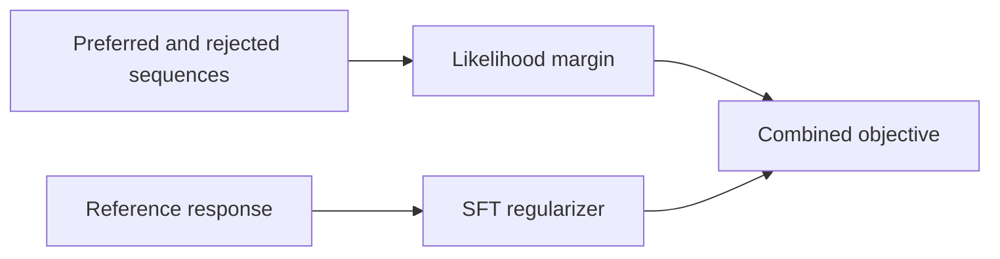
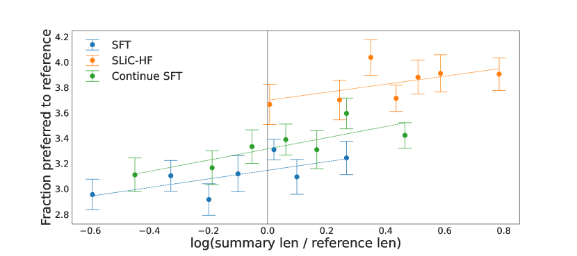

# SLiC-HF: Learn human preferences with sequence-likelihood calibration

<!-- source-sha256: 274dc3fb96dc375c4d7515b7545a866beeb5fd26fc15eb2043d1712439460bdd -->

[简体中文](README.md)

> Sequence margin and SFT regularization on a candidate policy, not T5-XXL.

## Paper information

| Field | Details |
|---|---|
| Paper | [SLiC-HF](https://arxiv.org/abs/2305.10425) |
| Institution | Google DeepMind / Google Research. |
| First public release | 2023-05-17 |
| Author code | No standalone author implementation found. |
| Local adapter or method key | `slic-hf` |
| Local reproduction code | `src/auto_research/post_training/` |

## Paper method and evidence

Instead of a multi-model PPO-RLHF stack, enforce a margin between preferred and rejected sequence log-likelihoods while regularizing with SFT. The objective can use off-policy preferences collected for other models.



<!-- paper-figure:start -->
### Original paper figure

[](https://ar5iv.labs.arxiv.org/html/2305.10425/assets/x1.png)

The original figure shows preference calibration. From the [original paper](https://arxiv.org/abs/2305.10425); copyright remains with the authors.
<!-- paper-figure:end -->

### Core equation

$$
\mathcal L_{\mathrm{SLiC-HF}}
=\max\!\left(0,\delta-\log \pi_\theta(y^+\mid x)
+\log \pi_\theta(y^-\mid x)\right)
-\lambda\log \pi_\theta(y_{\mathrm{ref}}\mid x).
$$

### Reported results

On Reddit TL;DR, T5-Large ranking SLiC-HF wins 66% to 34% in human evaluation against the cited 6B PPO-RLHF. It is selected best 73% of the time in a four-way human evaluation. No production A/B.

## Local reproduction

GSM8K candidate 512/128, 300 steps, seed 42, common untrained baseline.

| Metric | Untrained | SLiC-HF |
|---|---:|---:|
| Accuracy | 0.1641 | 0.7812 |
| Mean reward | 0.3126 | 0.8074 |
| KL to reference | 0.0000 | 0.2512 |

```bash
auto-research post-train --algorithm slic-hf --dataset gsm8k-candidate \
  --maximum-examples 512 --steps 300 --seed 42 --offline
```

[Stable metrics](../../experiments/p1-alignment-candidates-gsm8k-seed42.json). Implements sequence margin, off-policy labels and reference regularization with candidates standing in for full answers. No T5, separate ranker, or TL;DR human evaluation.
