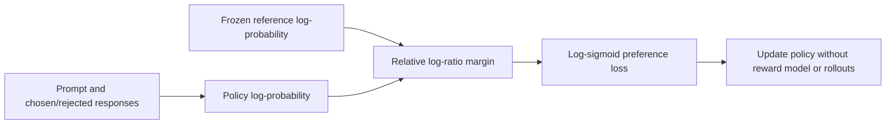
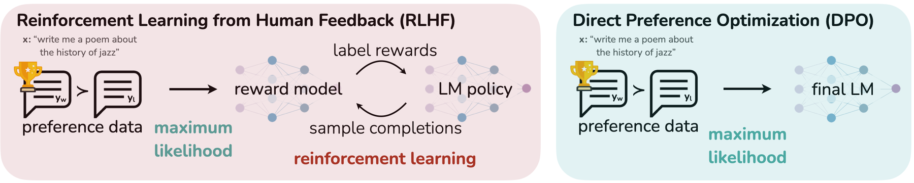

<!-- source-sha256: a54594bea7a424401714d5eebff0524039aed35495680075243dab7355be9acd -->

[简体中文](README.md) · English

# DPO: Direct Preference Optimization

> Implements closed-form preference classification for chosen/rejected responses relative to a reference policy, without training a reward model or collecting online rollouts.

## Paper information

| Field | Details |
| --- | --- |
| Paper | [Direct Preference Optimization: Your Language Model is Secretly a Reward Model](https://arxiv.org/abs/2305.18290) |
| Institution | Stanford University |
| First public release | 2023-05-29 |
| Author code | [Public author code](https://github.com/eric-mitchell/direct-preference-optimization). |
| Local adapter or method key | `dpo` |
| Local reproduction code | `src/auto_research/post_training/` |

## Original paper summary

### Background and main changes

Conventional RLHF fits a reward model and then optimizes the policy with PPO, making training complex and unstable. DPO starts from the optimum of KL-regularized RLHF, writes the implicit reward as a policy-to-reference log ratio, and reduces training to binary classification on preference pairs.



<!-- paper-figure:start -->
### Key figure from the paper

[](https://ar5iv.labs.arxiv.org/html/2305.18290/assets/figures/diagrams/teaser.png)

> **Figure 1:** Overall design and components. From the [paper](https://arxiv.org/abs/2305.18290); copyright belongs to the authors. Click for the source.
<!-- paper-figure:end -->

### Core equations

$$
\mathcal L_{\mathrm{DPO}}(\theta)=-
\mathbb E\log\sigma\left(
\beta\log\frac{\pi_\theta(y_w\mid x)}{\pi_{\mathrm{ref}}(y_w\mid x)}
-\beta\log\frac{\pi_\theta(y_l\mid x)}{\pi_{\mathrm{ref}}(y_l\mid x)}
\right).
$$

### Offline and online results

The paper beats PPO-based RLHF on sentiment control and matches or exceeds PPO for summarization and single-turn dialogue, with a simpler training path. The automatic and human evaluations are offline, not production A/B.

## Local reproduction

On the common GSM8K candidate protocol, use the gold candidate as chosen and the highest-scoring incorrect candidate as rejected. Record the reference-corrected preference margin.

| Metric | Untrained policy | DPO |
|---|---:|---:|
| Accuracy | 0.1641 | **0.8047** |
| Mean reward | 0.3126 | **0.8347** |
| KL(reference) | 0.0000 | 0.0683 |

```bash
auto-research post-train --algorithm dpo \
  --dataset gsm8k-candidate --maximum-examples 512 \
  --steps 300 --seed 42 --offline
```

Stable metrics: [`classic-post-training-gsm8k-seed42.json`](../../experiments/classic-post-training-gsm8k-seed42.json).

## Scope

Implements DPO's reference-relative pairwise loss and margin. Candidate policies can calculate whole-response probabilities exactly, but no autoregressive LLM was trained and no Anthropic HH or TL;DR preference dataset was reproduced.
