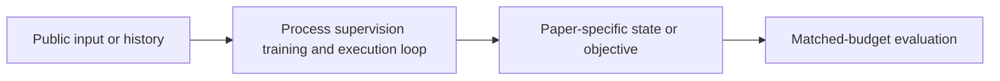
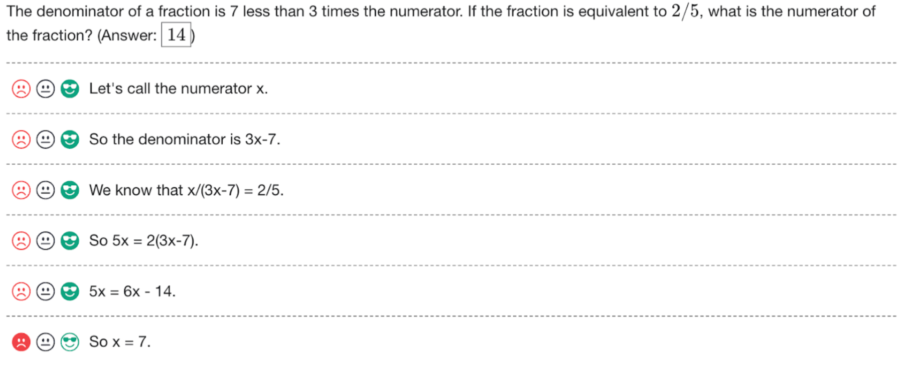

# Let's Verify Step by Step: process supervision and active annotation

<!-- source-sha256: 1f28ef145ca1bf64ad87f68069e402128add9a209d0183b6a602ae9c92c470dd -->

[简体中文](README.md)

> **Fidelity: core mechanism.** The deterministic mini-suite does not stand in for the paper's full benchmark.

## Paper information

| Field | Details |
|---|---|
| Paper | [Let's Verify Step by Step: process supervision and active annotation (arXiv 2305.20050)](https://arxiv.org/abs/2305.20050) |
| Organization | OpenAI |
| First public release | 2023-05-31 (arXiv v1) |
| Authors' code | The authors released [PRM800K data](https://github.com/openai/prm800k). |
| Adapter / method | `process-supervision` |
| Local reproduction code | [`src/auto_research/post_training/`](https://github.com/daiwk/auto-research/tree/main/src/auto_research/post_training/) |

## Original paper

### Motivation and method

A step-level reward model judges each reasoning step and prioritizes uncertain steps for annotation. The local comparison uses the same candidates and budget as outcome-only reward.



<!-- paper-figure:start -->
### Key figure from the paper

[](https://ar5iv.labs.arxiv.org/html/2305.20050/assets/figures/data_interface_simple.png)

> **Figure 1:** Overview of the paper's method and key components. From the [original paper](https://arxiv.org/abs/2305.20050); copyright remains with the authors.
<!-- paper-figure:end -->

### Core equations

$$
\mathcal L_{PRM}=-\sum_t[y_t\log r_t+(1-y_t)\log(1-r_t)],\quad t^*=\arg\max_tH(r_t).
$$

### Paper results

The process-supervised model solves 78% of a representative MATH subset and outperforms outcome supervision. No production online A/B test is reported; no online figures are inferred.

## Local reproduction

Arithmetic candidate suite, 120 steps, 256 examples, seed 42: accuracy 0.2344 → **0.5781 (+146.67%)**, at the same reward, KL, length, and candidate budgets.

```bash
auto-research post-train --algorithm process-supervision --dataset arithmetic-smoke --maximum-examples 256 --steps 120 --seed 42
auto-research evolve --model post-training --dataset arithmetic-smoke --direction "组合 process-supervision 与已安装论文算子" --generations 2 --population 4
```

See the [fixed metrics](../../experiments/global-p0-20260808-seed42.json).

## Reproduction boundaries

The local run checks the paper-specific objective, state updates, and fair budgets. It does not reproduce large models, multi-GPU RL, private environments, real websites, or the full benchmark. It validates the mechanism, not the numerical results in the original tables.
