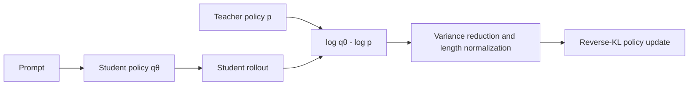
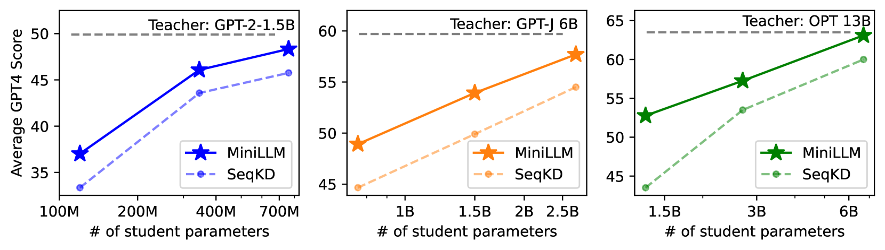

<!-- source-sha256: 9d3642836d8f054f83bb4909e0bca73de51c9c166c318255c456470d03da6648 -->

[简体中文](README.md) · English

# MiniLLM: Reverse-KL distillation for generative models

> Reverse KL on student rollouts, teacher-mixed sampling, a variance-reducing baseline and length normalization are implemented as diagnostics. The paper's 120M–13B autoregressive models were not trained locally.

## Paper information

| Field | Details |
|---|---|
| Paper | [MiniLLM: Knowledge Distillation of Large Language Models](https://arxiv.org/abs/2306.08543) |
| Institutions | Tsinghua University / Microsoft Research |
| First public release | 2023-06-14 |
| Author code | [microsoft/LMOps/minillm](https://github.com/microsoft/LMOps/tree/main/minillm) |
| Local adapter/algorithm key | `minillm` |
| Local reproduction code | [`src/auto_research/post_training/`](https://github.com/daiwk/auto-research/tree/main/src/auto_research/post_training) |

## Original paper summary

### Background and main changes

Forward KL covers all teacher probability mass, so a small student may overestimate low-probability teacher regions. MiniLLM optimizes mode-seeking reverse KL on the student's own generation distribution and stabilizes policy gradients with teacher-mixed sampling, single-step decomposition, length normalization and a reward baseline.



<!-- paper-figure:start -->
### Key figure from the paper

[](https://arxiv.org/html/2306.08543v2/x1.png)

> **Figure 1:** MiniLLM versus SeqKD across teacher/student sizes. From the [paper](https://arxiv.org/abs/2306.08543); copyright belongs to the authors.
<!-- paper-figure:end -->

### Core equation

$$
\mathcal L_{\mathrm{MiniLLM}}
=D_{\mathrm{KL}}(q_\theta\Vert p_T)
=\mathbb E_{y\sim q_\theta}
\left[\log q_\theta(y|x)-\log p_T(y|x)\right].
$$

### Offline and online results

Across GPT-2, GPT-J, OPT and LLaMA, the paper reports higher response quality, less exposure bias and better long-text performance than SeqKD. GPT-4 feedback win rate reaches 82.1% in some settings. This is public offline instruction following, not a production A/B.

## Local reproduction

```bash
auto-research post-train --algorithm minillm \
  --dataset gsm8k-candidate --maximum-examples 128 \
  --steps 120 --seed 42
```

| Metric | Untrained policy | MiniLLM |
|---|---:|---:|
| Validation accuracy | 0.2500 | **0.8750** |
| Mean reward | 0.3732 | **0.8817** |
| KL(reference) | 0.0000 | 0.5477 |
| Teacher mix / online teacher scores | — | 0.20 / 480 |

Stable metrics: [`classic-agentic-rl-opd-seed42.json`](../../experiments/classic-agentic-rl-opd-seed42.json).

## Scope

A candidate policy verifies reverse-KL sampling and gradient direction. It does not include a real tokenizer, long-text generation or a GPT-4 judge. Local accuracy is not the paper's generation-quality score.
