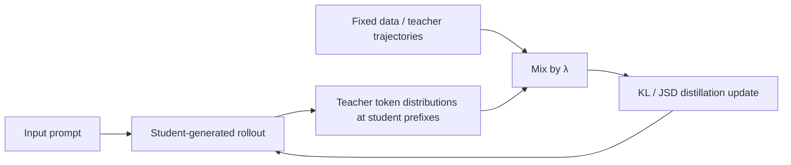
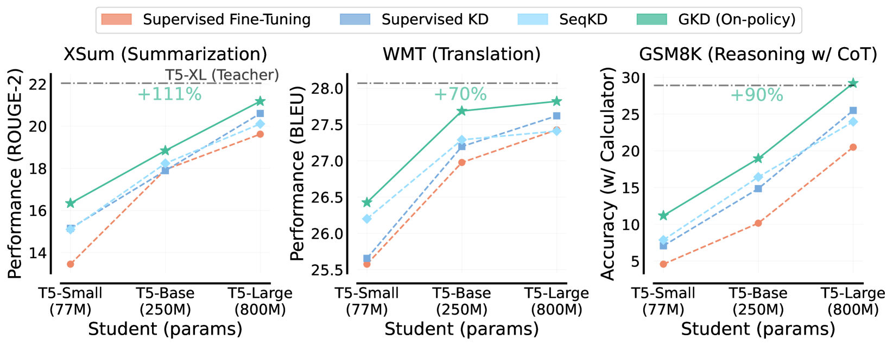

<!-- source-sha256: 2ab62ef8abeb52d245df7464048bea93a0622c2239fa7baae80261321f6ecd3e -->

[简体中文](README.md) · English

# GKD: Generalized knowledge distillation from students' own mistakes

> **Fidelity:** Implements student on-policy sampling, teacher scoring on student-visited states, on/off-policy mixing, and divergence diagnostics. This is a candidate-policy mechanism reproduction, not token-level distillation from T5-XL to a smaller model.

## Paper information

| Field | Details |
| --- | --- |
| Paper | [On-Policy Distillation of Language Models: Learning from Self-Generated Mistakes](https://arxiv.org/abs/2306.13649) |
| Institution | Google DeepMind / Mila / University of Toronto |
| First public release | 2023-06-23 |
| Author code | The authors did not release a standalone repository. [Hugging Face TRL subsequently implemented it](https://github.com/huggingface/trl/blob/main/docs/source/distillation_trainer.md). |
| Local adapter or method key | `gkd` |
| Local reproduction code | [`src/auto_research/post_training/`](https://github.com/daiwk/auto-research/tree/main/src/auto_research/post_training) |

## Original paper summary

### Background and main changes

Fixed teacher trajectories create a mismatch between prefixes seen during training and the prefixes a student generates at inference. GKD lets the student generate rollouts from its current policy and queries the teacher for full distributions at the states the student actually visits. The `student data fraction` interpolates fixed and on-policy data, and the divergence may be forward KL, reverse KL, or generalized JSD.



<!-- paper-figure:start -->
### Key figure from the paper

[](https://arxiv.org/html/2306.13649v3/x1.png)

> **Figure 1:** Fixed-trajectory KD versus on-policy GKD at different student sizes. From the [paper](https://arxiv.org/abs/2306.13649); copyright belongs to the authors. Click for the source.
<!-- paper-figure:end -->

### Core equations

$$
\mathcal L_{\mathrm{GKD}}(\theta)
=(1-\lambda)\mathbb E_{(x,y)\sim(X,Y)}
\mathcal D(p_T\Vert p_\theta)(y|x)
+\lambda\mathbb E_{x\sim X,y\sim p_\theta(\cdot|x)}
\mathcal D(p_T\Vert p_\theta)(y|x).
$$

### Offline and online results

Relative to improvements from conventional KD, the paper reports roughly 2.1×, 1.7×, and 1.9× average gains from on-policy GKD in summarization, translation, and arithmetic reasoning, respectively. Task-agnostic distillation improves BBH by 2 percentage points and MMLU by 1. No production A/B test is reported.

## Local reproduction

```bash
auto-research post-train --algorithm gkd \
  --dataset gsm8k-candidate --maximum-examples 128 \
  --steps 120 --seed 42
```

| Metric | Untrained policy | GKD |
|---|---:|---:|
| Validation accuracy | 0.2500 | **0.9375** |
| Mean reward | 0.3732 | **0.9289** |
| KL(reference) | 0.0000 | 0.5122 |
| Student rollouts / online teacher scoring events | — | 480 / 480 |

Stable metrics: [`classic-agentic-rl-opd-seed42.json`](../../experiments/classic-agentic-rl-opd-seed42.json).

## Scope

Local candidates form an auditable support set of student trajectories. The teacher distribution is constructed from GSM8K outcomes and process quality. The run does not train an autoregressive T5 or repeat XSum/WMT. Local percentages verify data flow and objectives only and are not comparable to paper metrics.
