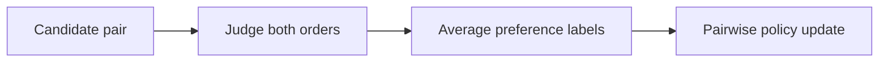
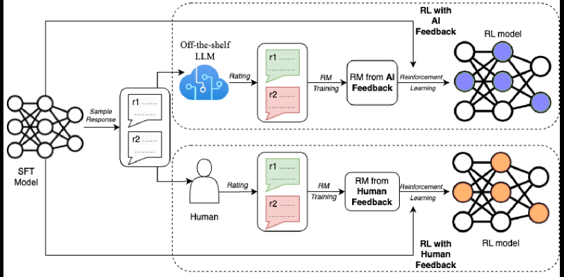

# RLAIF: Use AI feedback instead of costly human preference labels

<!-- source-sha256: 25307069d0666b799bc21ce563c94647d3853ff5b026da78bcc1c9258d0d5f17 -->

[简体中文](README.md)

> Core mechanism diagnostic, not the original full benchmark.

## Paper information

| Field | Details |
|---|---|
| Paper | [RLAIF (arXiv 2309.00267)](https://arxiv.org/abs/2309.00267) |
| Institution | Google Research / Google DeepMind. |
| First public release | 2023-09-01 (arXiv v1) |
| Author code | No standalone author training repository found or released. |
| Local adapter or method key | `rlaif` |
| Local reproduction code | [`src/auto_research/post_training/`](https://github.com/daiwk/auto-research/tree/main/src/auto_research/post_training/) |

## Paper method and evidence

An AI labeler judges candidates in both presentation orders. Average away positional bias and train the preference policy with the paired labels.



<!-- paper-figure:start -->
### Original paper figure

[](https://ar5iv.labs.arxiv.org/html/2309.00267/assets/x3.png)

The original figure shows AI feedback and policy training. From the [original paper](https://arxiv.org/abs/2309.00267); copyright remains with the authors.
<!-- paper-figure:end -->

### Core equation

$$
\hat r=\tfrac12[r_{AI}(a,b)+r_{AI}^{swap}(b,a)],\quad\mathcal L=-\log\sigma(\log\pi(y^+)-\log\pi(y^-)).
$$

### Reported results

The paper reports comparable performance to RLHF on summarization and helpful/harmless dialog, with stronger direct-RLAIF. No production A/B.

## Local reproduction

Arithmetic candidate suite, 120 steps, 256 examples, seed 42: accuracy **0.2344→0.6406 (+173.33%)** with matching reward, KL, length and candidate budgets.

```bash
auto-research post-train --algorithm rlaif --dataset arithmetic-smoke --maximum-examples 256 --steps 120 --seed 42
auto-research evolve --model post-training --dataset arithmetic-smoke --direction "Combine rlaif with installed paper operators" --generations 2 --population 4
```

[Fixed metrics](../../experiments/global-p0-20260808-seed42.json). Checks objective and state updates under a fair budget, not large models, multi-GPU RL, private or live web environments, or paper-scale scores.
