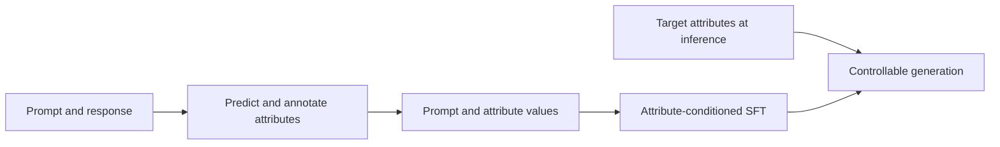
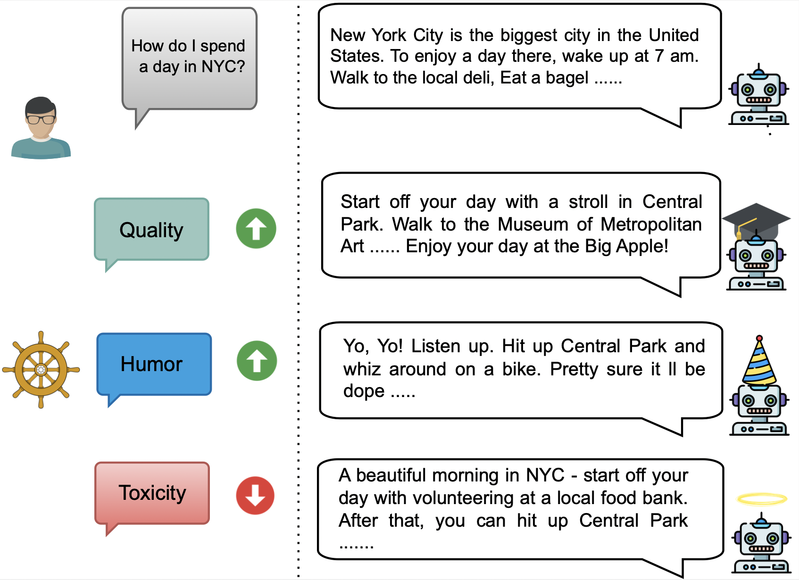

# SteerLM: supervised fine-tuning conditioned on multiple attributes

<!-- source-sha256: 7e0ae7062f233e2ead4d15faa1b5b601bb95397b158bc04ba99e742457f07f02 -->

[简体中文](README.md)

> Implements explicit attribute annotation, target-conditioned selection, and SFT. Four local attributes do not reproduce NVIDIA's 43B model.

## Paper information

| Field | Details |
|---|---|
| Paper | [SteerLM](https://arxiv.org/abs/2310.05344) |
| Organization | NVIDIA |
| First public release | 2023-10-09 |
| Authors' code | [NVIDIA NeMo-Aligner](https://github.com/NVIDIA/NeMo-Aligner) |
| Adapter / method | `steerlm` |
| Local reproduction code | `src/auto_research/post_training/` |

## Original paper

### Motivation and method

Traditional RLHF reduces multidimensional preferences to one reward, and users cannot change the target at inference. SteerLM uses an attribute predictor to label responses for helpfulness, quality, and other properties, adds attributes and values as conditions in ordinary SFT, and lets the user specify target attributes at inference.



<!-- paper-figure:start -->
### Key figure from the paper

[](https://ar5iv.labs.arxiv.org/html/2310.05344/assets/images/steerlm_front.png)

> **Figure 1:** Overview of the paper's method and key components. From the [original paper](https://arxiv.org/abs/2310.05344); copyright remains with the authors.
<!-- paper-figure:end -->

### Core equation

$$
\mathcal L_{\mathrm{SteerLM}}
=-\sum_t\log \pi_\theta
\left(y_t\mid x,\mathbf a,y_{<t}\right),
\qquad \mathbf a=(a_1,\ldots,a_K).
$$

### Paper results

On 80 Vicuna prompts scored by GPT-4, SteerLM 43B achieves 104.2% of ChatGPT-3.5's score. Human Elo is 1040, above ChatGPT-3.5 at 981 and Guanaco-65B at 977. No production online A/B is reported.

## Local reproduction

Four reward axes supply auditable attribute labels. The target-attribute vector selects responses before conditional SFT.

| Metric | Untrained policy | SteerLM |
|---|---:|---:|
| Accuracy | 0.1641 | **0.8516** |
| Mean reward | 0.3126 | **0.8654** |
| KL(reference) | 0.0000 | 0.9112 |

```bash
auto-research post-train --algorithm steerlm --dataset gsm8k-candidate \
  --maximum-examples 512 --steps 300 --seed 42 --offline
```

See the [stable metrics](../../experiments/p1-alignment-candidates-gsm8k-seed42.json).

## Reproduction boundaries

Multidimensional annotation and conditional SFT are retained. Local attributes are deterministic reward axes from public candidate data. No large attribute predictor or genuine text-token conditional generation was implemented.
