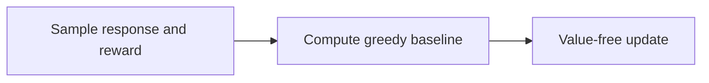
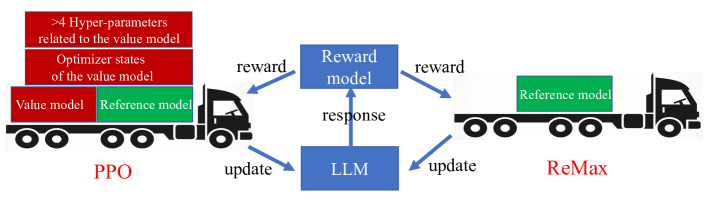

# ReMax

<!-- source-sha256: b4f69fb52c4ee7f11f904590183f96ea4a0ccd1db1876c4ed99a3e49d674484f -->

[简体中文](README.md)

> Value-free RLHF mechanism with sampled and greedy candidate rollouts.

## Paper information

| Field | Details |
|---|---|
| Paper | [Paper or original source](https://arxiv.org/abs/2310.10505) |
| Institution | The Chinese University of Hong Kong, Shenzhen / Shenzhen Research Institute of Big Data / Nanjing University. |
| First public release | 2023-10-16 |
| Author code | [liziniu/ReMax](https://github.com/liziniu/ReMax). |
| Local adapter or method key | `remax` |
| Local reproduction code | `src/auto_research/post_training/` |

## Paper method and evidence

LLM rollouts have fast simulation, deterministic token transitions and typically terminal rewards. Drop PPO's value model and subtract the current policy's greedy reward as a prompt-dependent baseline for lower-variance REINFORCE.



<!-- paper-figure:start -->
### Original paper figure

[](https://ar5iv.labs.arxiv.org/html/2310.10505/assets/x1.png)

Figure shows a greedy control rollout. From the [original paper](https://arxiv.org/abs/2310.10505); copyright remains with the authors.
<!-- paper-figure:end -->

### Core equation

$$
\hat A(x,y)=r(x,y)-r\!\left(x,
\operatorname{Greedy}(\pi_\theta(\cdot\mid x))\right),
\qquad
\nabla_\theta J =
\mathbb E[\hat A(x,y)\nabla_\theta\log\pi_\theta(y\mid x)].
$$

### Reported results

The paper reports about 46% less GPU memory than PPO for 7B training. Mistral-7B reaches 94.78% AlpacaEval win rate and 7.739 MT-Bench. No production A/B.

## Local reproduction

Local accuracy **0.1641→0.7031**, reward **0.3126→0.7554**, KL **0.0000→0.7939**. [Metrics](../../experiments/classic-post-training-gsm8k-seed42.json). Greedy candidates stand in for autoregressive decoding. No Mistral-7B, distributed training, memory benchmark or AlpacaEval reproduction.

```bash
auto-research post-train --algorithm remax \
  --dataset gsm8k-candidate --maximum-examples 512 \
  --steps 300 --group-size 4 --seed 42 --offline
```
