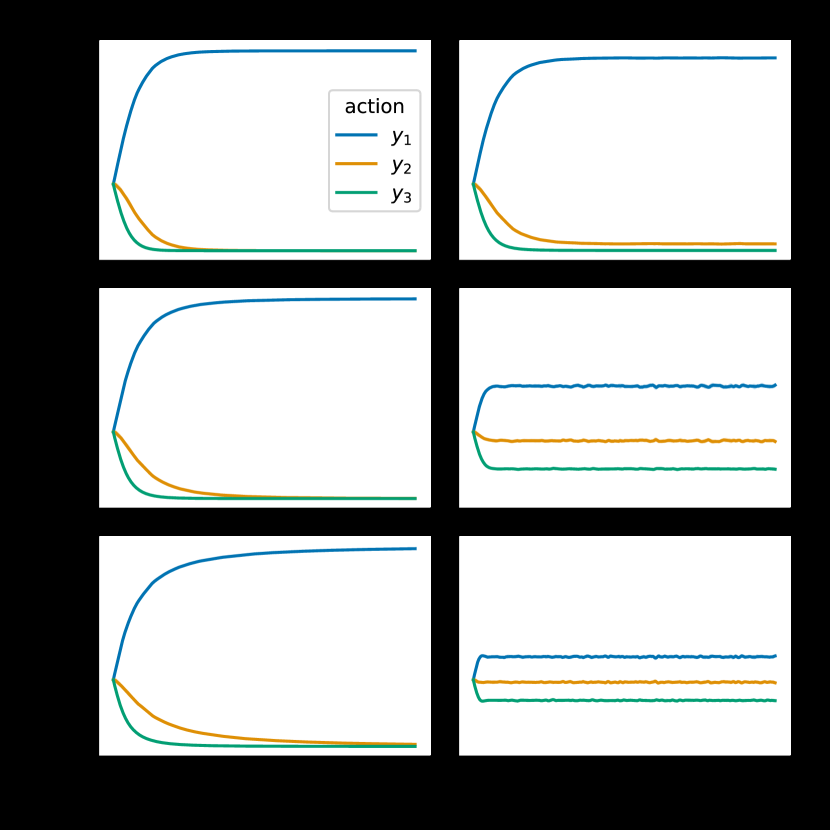

# Identity Preference Optimization (IPO)

<!-- source-sha256: 38091eac1f9cb930803e83fdf2f942d66fd274955e00312075d2f5d4e7de97dd -->

[简体中文](README.md)

> Fits a preference log-ratio with squared regression so separable data does not drive the policy toward DPO's deterministic extreme.

## Paper information

| Field | Details |
|---|---|
| Paper | [A General Theoretical Paradigm to Understand Learning from Human Preferences](https://arxiv.org/abs/2310.12036) |
| Organization | Google DeepMind |
| First public release | 2023-10-18 |
| Authors' code | No standalone official repository was released or found. |
| Adapter / method | `ipo` |
| Local reproduction code | `src/auto_research/post_training/` |

## Original paper

### Motivation and method

RLHF and DPO assume pairwise preferences can be converted to scalar rewards. The paper proposes $\Psi$PO, which optimizes preference probabilities directly. The identity mapping yields IPO: fit a finite target margin instead of indefinitely widening the chosen/rejected gap with logistic loss on separable training data.


<!-- paper-figure:start -->
### Key figure from the paper

[](https://ar5iv.labs.arxiv.org/html/2310.12036/assets/x1.png)

> **Figure 1:** Overview of the paper's method and key components. From the [original paper](https://arxiv.org/abs/2310.12036); copyright remains with the authors.
<!-- paper-figure:end -->

### Core equation

$$
\mathcal L_{\mathrm{IPO}}=
\left[
\log\frac{\pi_\theta(y_w|x)\pi_{\rm ref}(y_l|x)}
{\pi_\theta(y_l|x)\pi_{\rm ref}(y_w|x)}
-\frac{1}{2\tau}
\right]^2.
$$

### Paper results

Theory and controlled experiments show stronger regularization than DPO and better results on some examples. No production online A/B is reported.

## Local reproduction

The local run uses a character tokenizer, GRU causal LM, and numerical verifier for free generation. After SFT warmup, the correct completion is chosen and the lowest-reward current-policy rollout is rejected. Token log probabilities implement reference-relative IPO.

```bash
auto-research post-train --algorithm ipo --dataset arithmetic-generate \
  --maximum-examples 48 --steps 6 --seeds 42,43,44 --offline
```

See the [stable metrics](../../experiments/free-generation-post-training-seeds42-44.json).

## Reproduction boundaries

The tokenizer-level sequence probability, free generation, reference policy, and IPO squared objective are retained. The local model and arithmetic data test training mechanics, not the paper's large-model preference evaluation.
