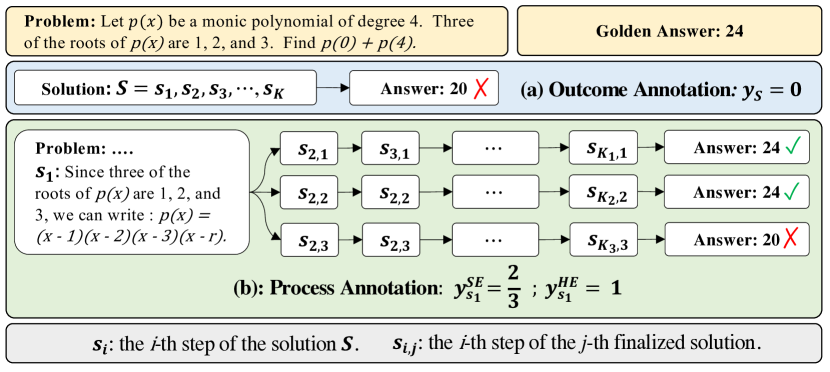

# Math-Shepherd: Process rewards without manual step labels

<!-- source-sha256: bd20779889ec2aef3b5c34adb87cc8a67c15d811aab371984ceef78f6b94e655 -->

[简体中文](README.md)

> Core mechanism diagnostic; not the original 7B/13B benchmark.

## Paper information

| Field | Details |
|---|---|
| Paper | [Math-Shepherd (arXiv 2312.08935)](https://arxiv.org/abs/2312.08935) |
| Institution | Peking University / Alibaba Group. |
| First public release | 2023-12-14 (arXiv v1) |
| Author code | No standalone author repository found or released. |
| Local adapter or method key | `math-shepherd` |
| Local reproduction code | [`src/auto_research/post_training/`](https://github.com/daiwk/auto-research/tree/main/src/auto_research/post_training/) |

## Paper method and evidence

Sample several continuations from an intermediate reasoning step. Their final answer correctness supplies automatic step labels for verifier training and reranking.


<!-- paper-figure:start -->
### Original paper figure

[](https://ar5iv.labs.arxiv.org/html/2312.08935/assets/x3.png)

The original figure shows automated step labels. From the [original paper](https://arxiv.org/abs/2312.08935); copyright remains with the authors.
<!-- paper-figure:end -->

### Core equation

$$
v(s_t)=K^{-1}\sum_{k=1}^K\mathbf1[\operatorname{Ans}(\tau_k)=y^*],\quad\mathcal L=-\sum_t\operatorname{BCE}(r(s_t),v(s_t)).
$$

### Reported results

The paper improves generation and reranking of several 7B/13B models on GSM8K and MATH. No production A/B.

## Local reproduction

Arithmetic candidates, 120 steps, 256 examples, seed 42: **0.2344→0.6250 (+166.67%)** with matched reward, KL, length and candidate budgets.

```bash
auto-research post-train --algorithm math-shepherd --dataset arithmetic-smoke --maximum-examples 256 --steps 120 --seed 42
auto-research evolve --model post-training --dataset arithmetic-smoke --direction "Combine math-shepherd with installed paper operators" --generations 2 --population 4
```

[Fixed-seed metrics](../../experiments/global-p0-20260808-seed42.json). Only the method-specific objective, state updates and matched budget are tested. No large model, multi-GPU RL, private environment, live web or full benchmark.
