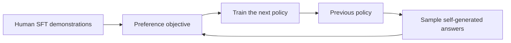
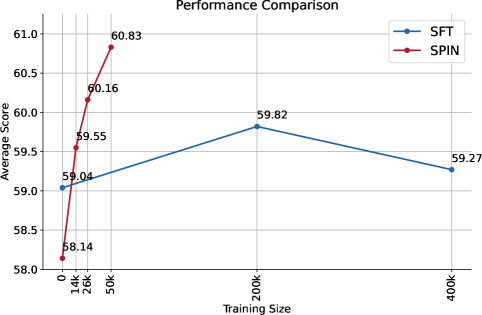

# SPIN: iterative fine-tuning by self-play

<!-- source-sha256: c6ed2668c3301ecb1302efc6c12b91b72a08fa822db4dffe9b5fa689d3f29a33 -->

[简体中文](README.md)

> Implements iteration state: previous policies generate negatives, human and self-generated responses are contrasted, and the opponent is refreshed periodically. Candidate sampling is not a full LLM rollout.

## Paper information

| Field | Details |
|---|---|
| Paper | [SPIN](https://arxiv.org/abs/2401.01335) |
| Organization | University of California, Los Angeles |
| First public release | 2024-01-02 |
| Authors' code | [uclaml/SPIN](https://github.com/uclaml/SPIN) |
| Adapter / method | `spin` |
| Local reproduction code | `src/auto_research/post_training/` |

## Original paper

### Motivation and method

Additional preference annotation is costly. Starting from an SFT model, SPIN uses the previous model to answer training prompts, treats human demonstrations as positives and self-generated answers as negatives, and trains the next model with a self-play discriminative objective. This repeats without new human preference labels.



<!-- paper-figure:start -->
### Key figure from the paper

[](https://ar5iv.labs.arxiv.org/html/2401.01335/assets/x4.png)

> **Figure 4:** Training flow and key optimization steps. From the [original paper](https://arxiv.org/abs/2401.01335); copyright remains with the authors.
<!-- paper-figure:end -->

### Core equation

$$
\mathcal L_{\mathrm{SPIN}}
=-\log\sigma\!\left(
\lambda\log\frac{\pi_\theta(y_{\mathrm{data}}\mid x)}
{\pi_{\theta_t}(y_{\mathrm{data}}\mid x)}
-\lambda\log\frac{\pi_\theta(y_{\theta_t}\mid x)}
{\pi_{\theta_t}(y_{\theta_t}\mid x)}
\right).
$$

### Paper results

The paper reports successive gains on HuggingFace Open LLM Leaderboard, MT-Bench, and BIG-Bench. Without additional GPT-4 preferences, it beats a DPO model trained on extra GPT-4 preferences. No production online A/B is reported.

## Local reproduction

The previous candidate policy samples negatives and is refreshed every 16 updates.

| Metric | Untrained policy | SPIN |
|---|---:|---:|
| Accuracy | 0.1641 | **0.8594** |
| Mean reward | 0.3126 | **0.8691** |
| KL(reference) | 0.0000 | 0.1294 |
| Opponent refreshes | 0 | 18 |

```bash
auto-research post-train --algorithm spin --dataset gsm8k-candidate \
  --maximum-examples 512 --steps 300 --seed 42 --offline
```

See the [stable metrics](../../experiments/p1-alignment-candidates-gsm8k-seed42.json).

## Reproduction boundaries

Implements a frozen opponent, self-play sampling, reference-relative preference loss, and iteration refresh. No real text generation, distributed training, or paper-scale model is used.
