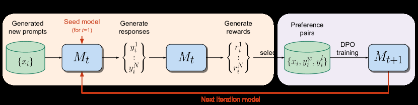

# Self-Rewarding LM: The model generates responses and judges them

<!-- source-sha256: 860ad714f6211a198bd7d830f54934c0e9004dc289311ae5c2171b2979dca468 -->

[简体中文](README.md)

> Core mechanism diagnostic, not original-scale alignment.

## Paper information

| Field | Details |
|---|---|
| Paper | [Self-Rewarding LM (arXiv 2401.10020)](https://arxiv.org/abs/2401.10020) |
| Institution | Meta AI / New York University. |
| First public release | 2024-01-18 (arXiv v1) |
| Author code | No standalone author training repository found or released. |
| Local adapter or method key | `self-rewarding` |
| Local reproduction code | [`src/auto_research/post_training/`](https://github.com/daiwk/auto-research/tree/main/src/auto_research/post_training/) |

## Paper method and evidence

The current model generates candidates and judges them each round. New preference pairs feed the next DPO step, forming a bootstrapping loop.


<!-- paper-figure:start -->
### Original paper figure

[](https://ar5iv.labs.arxiv.org/html/2401.10020/assets/x1.png)

The original figure shows generation, judgment and repeated DPO. From the [original paper](https://arxiv.org/abs/2401.10020); copyright remains with the authors.
<!-- paper-figure:end -->

### Core equation

$$
D_{t+1}=D_t\cup\{(x,y^+,y^-):J_{\theta_t}(x,y^+)>J_{\theta_t}(x,y^-)\},\quad\theta_{t+1}=\operatorname{DPO}(D_{t+1}).
$$

### Reported results

The paper reports improved instruction following and judging over three self-rewarding rounds. No production A/B.

## Local reproduction

Arithmetic candidates, 120 steps, 256 examples, seed 42: **0.2344→0.6250 (+166.67%)** with matched reward, KL, length and candidate budgets.

```bash
auto-research post-train --algorithm self-rewarding --dataset arithmetic-smoke --maximum-examples 256 --steps 120 --seed 42
auto-research evolve --model post-training --dataset arithmetic-smoke --direction "Combine self-rewarding with installed paper operators" --generations 2 --population 4
```

[Fixed-seed metrics](../../experiments/global-p0-20260808-seed42.json). Only the method-specific objective, state updates and matched budget are tested. No large model, multi-GPU RL, private environment, live web or full benchmark.
