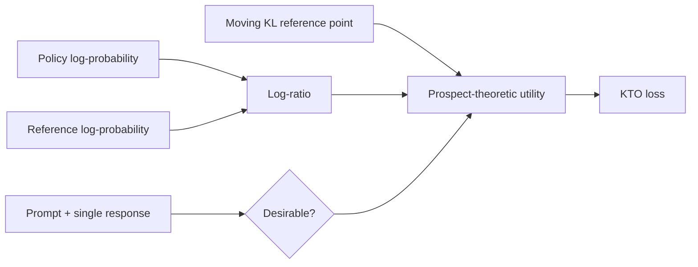
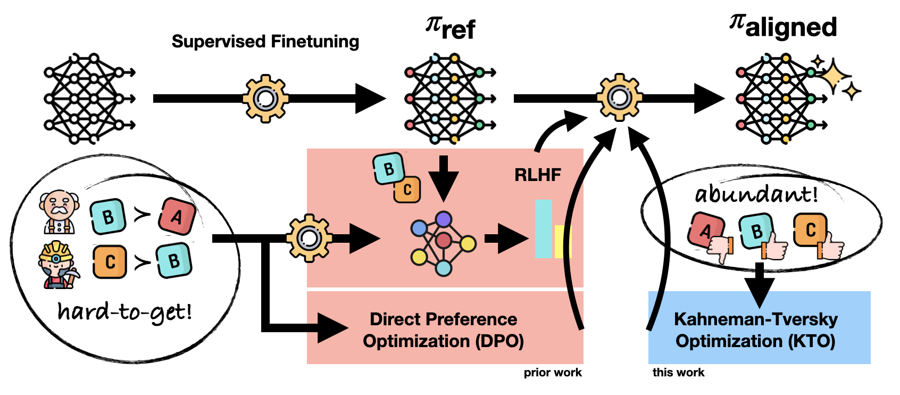

<!-- source-sha256: 8aaca649f20cf248967af06a24b620da847d5b4187a10f56fd2f103a9400de5d -->

[简体中文](README.md) · English

# KTO: Prospect-theoretic alignment without preference pairs

> KTO needs only a desirable or undesirable label on each response. It constructs prospect-theoretic utility using reference KL as the reference point, with no chosen/rejected pair for the same prompt.

## Paper information

| Field | Details |
| --- | --- |
| Paper | [KTO: Model Alignment as Prospect Theoretic Optimization](https://arxiv.org/abs/2402.01306) |
| Institution | Contextual AI / Stanford University |
| First public release | 2024-02-02 |
| Author code | [Released: ContextualAI/HALOs](https://github.com/ContextualAI/HALOs) |
| Local adapter or method key | `kto` |
| Local reproduction code | `src/auto_research/post_training/` |

## Original paper summary

### Background and main changes

DPO needs paired preferences, but production feedback often consists only of a thumbs-up, thumbs-down, or acceptance decision. KTO maps individual examples to desirable or undesirable utility. It uses the expected KL between policy and reference as a reference point. Examples of each class can be collected independently and need not be balanced.



<!-- paper-figure:start -->
### Key figure from the paper

[](https://ar5iv.labs.arxiv.org/html/2402.01306/assets/figures/teaser.png)

> **Figure 1:** The overall workflow, stages, and data flow in the paper. From the [paper](https://arxiv.org/abs/2402.01306); copyright belongs to the authors. Click for the source.
<!-- paper-figure:end -->

### Core equations

$$
z(x)=D_{\mathrm{KL}}\!\left(\pi_\theta(\cdot|x)\Vert\pi_{\mathrm{ref}}(\cdot|x)\right),
\qquad
r_\theta(x,y)=\log\frac{\pi_\theta(y|x)}{\pi_{\mathrm{ref}}(y|x)},
$$

$$
v(x,y)=
\begin{cases}
\lambda_D\sigma\!\left(\beta(r_\theta-z)\right), & y\text{ desirable},\\
\lambda_U\sigma\!\left(\beta(z-r_\theta)\right), & y\text{ undesirable}.
\end{cases}
$$

### Offline and online results

On models ranging from 1B to 30B parameters, the paper reports that KTO matches or beats baselines that require preference pairs, and studies class imbalance in feedback. Results come from offline language-model evaluations, not production A/B tests.

## Local reproduction

| Metric | Untrained policy | KTO |
|---|---:|---:|
| Accuracy | 0.1641 | **0.8359** |
| Mean reward | 0.3126 | **0.8560** |
| KL(reference) | 0.0000 | 0.0143 |

Final-step desirable and undesirable utility are 0.5030 and 0.4972; KL EMA is 0.0074.

```bash
auto-research post-train --algorithm kto \
  --dataset gsm8k-candidate --maximum-examples 512 \
  --steps 300 --seed 42 --offline
```

Stable metrics: [`classic-post-training-gsm8k-seed42.json`](../../experiments/classic-post-training-gsm8k-seed42.json).

## Scope

The implementation includes single-example binary feedback, a reference log-ratio, a moving KL reference point, and utilities for both classes. The local policy is linear with six candidates, not a free-generating 1B–30B LLM. The experiment does not reproduce the scale of human preference data.
