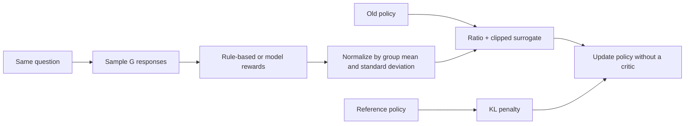
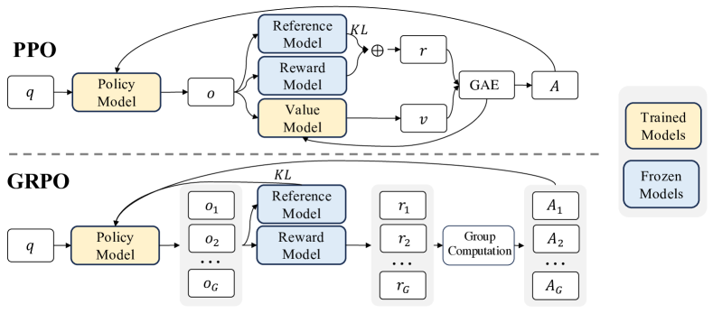

<!-- source-sha256: 43d89e0ce5fb714a0bd1158c64f9d7410596997dae717a03ba3dcdd99f21b6e2 -->

[简体中文](README.md) · English

# DeepSeekMath / GRPO

> Implements group-relative advantage, an old-policy ratio, the clipped surrogate, and reference KL. The local run verifies online policy updates without a critic.

## Paper information

| Field | Details |
| --- | --- |
| Paper | [DeepSeekMath: Pushing the Limits of Mathematical Reasoning in Open Language Models](https://arxiv.org/abs/2402.03300) |
| Institution | DeepSeek-AI |
| First public release | 2024-02-05 |
| Author code | [Released](https://github.com/deepseek-ai/DeepSeek-Math) |
| Local adapter or method key | `grpo` |
| Local reproduction code | `src/auto_research/post_training/` |

## Original paper summary

### Background and main changes

PPO's value model is as large as the policy, making mathematical reasoning RL expensive in GPU memory. GRPO samples a group of responses to each question and computes advantages from the group's reward mean and standard deviation, removing the critic. The policy still uses an old-policy ratio, clipping, and reference KL.



<!-- paper-figure:start -->
### Key figure from the paper

[](https://ar5iv.labs.arxiv.org/html/2402.03300/assets/x2.png)

> **Figure 4:** The training pipeline and key optimization stages in the paper. From the [paper](https://arxiv.org/abs/2402.03300); copyright belongs to the authors. Click for the source.
<!-- paper-figure:end -->

### Core equations

$$
\hat A_i=\frac{r_i-\operatorname{mean}(r_1,\ldots,r_G)}
{\operatorname{std}(r_1,\ldots,r_G)+\epsilon},
$$

$$
\mathcal J_{\mathrm{GRPO}}=
\frac1G\sum_i\min\left(
\rho_i\hat A_i,\operatorname{clip}(\rho_i,1-\epsilon,1+\epsilon)\hat A_i
\right)-\beta D_{\mathrm{KL}}(\pi_\theta\Vert\pi_{\mathrm{ref}}).
$$

### Offline and online results

DeepSeekMath 7B reaches 51.7% on MATH and 60.9% with 64-sample self-consistency. The paper attributes improved math capability to continued pretraining on 120B math tokens and GRPO. It does not report a production A/B test.

## Local reproduction

| Metric | Untrained policy | GRPO |
|---|---:|---:|
| Accuracy | 0.1641 | **0.7812** |
| Mean reward | 0.3126 | **0.8169** |
| KL(reference) | 0.0000 | 1.0401 |

Final-step diagnostics include 4 group samples, importance ratios, and the clip fraction. The old policy is refreshed 18 times in 300 steps; there are 0 value-model parameters.

```bash
auto-research post-train --algorithm grpo \
  --dataset gsm8k-candidate --maximum-examples 512 \
  --steps 300 --group-size 4 --seed 42 --offline
```

Stable metrics: [`classic-post-training-gsm8k-seed42.json`](../../experiments/classic-post-training-gsm8k-seed42.json).

## Scope

The local implementation retains online group sampling, critic-free advantages, ratio clipping, and KL. A response is one of six complete candidate actions. It does not train DeepSeekMath 7B or reproduce 120B-token pretraining and free-generation mathematical verifiers.
