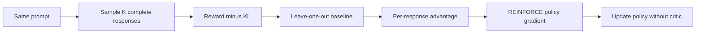
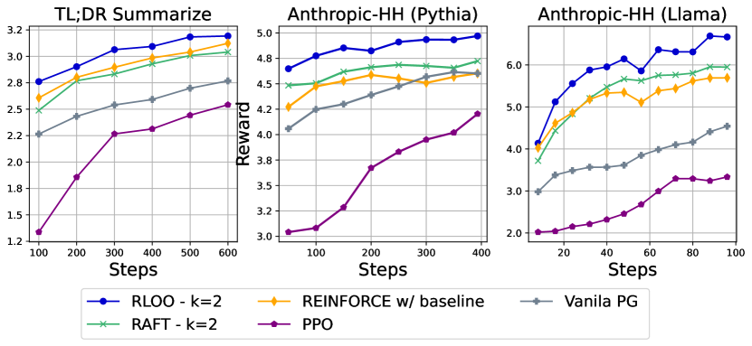

<!-- source-sha256: 07ebf63638eb93c804d3122a7c60995c0a29db5eb1ab2023b10546f87a50a0a1 -->

[简体中文](README.md) · English

# RLOO: Returning to REINFORCE for RLHF

> Implements response-level REINFORCE, leave-one-out baselines and KL-shaped rewards, with no PPO critic.

## Paper information

| Field | Details |
| --- | --- |
| Paper | [Back to Basics: Revisiting REINFORCE Style Optimization for Learning from Human Feedback in LLMs](https://arxiv.org/abs/2402.14740) |
| Institution | Cohere For AI / Cohere |
| First public release | 2024-02-22 |
| Author code | No standalone official training repository. The authors released data links; TRL and OpenRLHF later provided third-party implementations. |
| Local adapter or method key | `rloo` |
| Local reproduction code | `src/auto_research/post_training/` |

## Original paper summary

### Background and main changes

PPO's value model, GAE and repeated clipping incur memory and tuning cost in LLM RLHF. RLOO treats a full response as one action. Sample several responses for the same prompt and use the other responses' mean reward as the current one’s baseline.



<!-- paper-figure:start -->
### Key figure from the paper

[](https://ar5iv.labs.arxiv.org/html/2402.14740/assets/x3.png)

> **Figure 2:** Training workflow and key optimizations. From the [paper](https://arxiv.org/abs/2402.14740); copyright belongs to the authors. Click for the source.
<!-- paper-figure:end -->

### Core equations

$$
\hat A_i =
\tilde r_i-\frac{1}{K-1}\sum_{j\ne i}\tilde r_j,
\qquad
\tilde r_i=r(x,y_i)-\beta\log
\frac{\pi_\theta(y_i\mid x)}{\pi_{\mathrm{ref}}(y_i\mid x)}.
$$

$$
\nabla_\theta J(\theta)\approx
\frac{1}{K}\sum_{i=1}^{K}\hat A_i
\nabla_\theta\log\pi_\theta(y_i\mid x).
$$

### Offline and online results

On TL;DR, HH-Pythia and HH-Llama, RLOO (K=4) win rates are 77.9, 43.7 and 64.1 versus PPO 67.6, 29.2 and 32.0, gains of 10.3, 14.5 and 32.1 percentage points. No production A/B.

## Local reproduction

Uses exactly the same GSM8K candidate data, features, rewards, steps and seed as PPO-RLHF.

| Metric | Untrained policy | RLOO |
|---|---:|---:|
| Accuracy | 0.1641 | **0.8281** |
| Mean reward | 0.3126 | **0.8509** |
| KL(reference) | 0.0000 | 0.5707 |

```bash
auto-research post-train --algorithm rloo \
  --dataset gsm8k-candidate --maximum-examples 512 \
  --steps 300 --group-size 4 --seed 42 --offline
```

Stable metrics: [`classic-post-training-gsm8k-seed42.json`](../../experiments/classic-post-training-gsm8k-seed42.json).

## Scope

K=4 leave-one-out advantages, full candidate actions and KL shaping run without a value model. The 6.9B/7B models, learned reward model and paper data scale are not reproduced.
