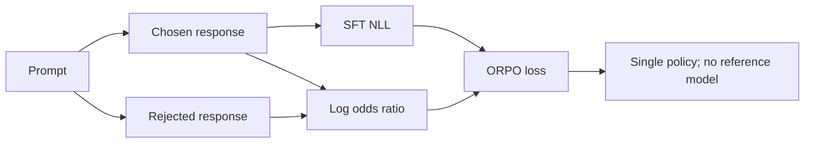
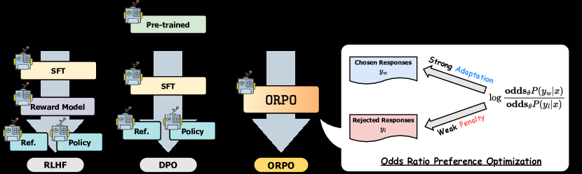

<!-- source-sha256: e567d2a6d228de3c55a92ff4ae724af454667a9a5be754924fd104ddd2d9bb62 -->

[简体中文](README.md) · English

# ORPO: Incorporating preference odds directly into SFT

> ORPO uses a single model for supervised learning and preference separation, without a frozen reference model.

## Paper information

| Field | Details |
| --- | --- |
| Paper | [ORPO: Monolithic Preference Optimization without Reference Model](https://arxiv.org/abs/2403.07691) |
| Institution | KAIST |
| First public release | 2024-03-12 |
| Author code | [Released: xfactlab/orpo](https://github.com/xfactlab/orpo) |
| Local adapter or method key | `orpo` |
| Local reproduction code | `src/auto_research/post_training/` |

## Original paper summary

### Background and main changes

Standard alignment often uses SFT followed by a reference-relative preference objective. ORPO combines the chosen response's NLL and a chosen-versus-rejected odds-ratio penalty into one objective. Near probabilities of 0 or 1, odds provide a more sensitive contrastive signal than raw probability differences.



<!-- paper-figure:start -->
### Key figure from the paper

[](https://ar5iv.labs.arxiv.org/html/2403.07691/assets/x2.png)

> **Figure 2:** Overall design and components. From the [paper](https://arxiv.org/abs/2403.07691); copyright belongs to the authors. Click for the source.
<!-- paper-figure:end -->

### Core equations

$$
\operatorname{odds}_\theta(y|x)=
\frac{\pi_\theta(y|x)}{1-\pi_\theta(y|x)},
$$

$$
\mathcal L_{\mathrm{ORPO}}=
\mathcal L_{\mathrm{SFT}}(y_w)
-\lambda\log\sigma\!\left(
\log\frac{\operatorname{odds}_\theta(y_w|x)}
{\operatorname{odds}_\theta(y_l|x)}
\right).
$$

### Offline and online results

The paper's Mistral-ORPO-$\beta$ reaches 12.20% on AlpacaEval 2.0, 66.19% on IFEval, and 7.32 on MT-Bench. These are offline results; no production online A/B test is reported.

## Local reproduction

| Metric | Untrained policy | ORPO |
|---|---:|---:|
| Accuracy | 0.1641 | **0.8438** |
| Mean reward | 0.3126 | **0.8618** |
| KL(reference, diagnostic only) | 0.0000 | 0.8973 |

Final-step SFT NLL is 0.0715, and chosen/rejected log-odds margin is 6.3502. The objective has no reference-model parameters.

```bash
auto-research post-train --algorithm orpo \
  --dataset gsm8k-candidate --maximum-examples 512 \
  --steps 300 --seed 42 --offline
```

Stable metrics: [`classic-post-training-gsm8k-seed42.json`](../../experiments/classic-post-training-gsm8k-seed42.json).

## Scope

The implementation uses a single-stage update with chosen SFT and the odds-ratio preference penalty. The local response action is a complete candidate. It does not train the paper's Mistral/Llama models, and KL is reported uniformly but does not enter the objective.

The candidate kernel `src/auto_research/post_training/algorithm_families/family_1.py` adds `1e-12` to the `p` and `1-p` log-odds terms and computes the preference loss with `logaddexp(0, -margin)`. This reduces the numerical risks of taking log zero or computing softplus directly. The constant is a local safeguard, not a paper hyperparameter. Complete-candidate probabilities are not real language-model token response probabilities.
