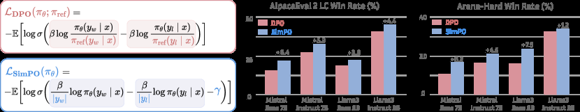

# SimPO: Simple Preference Optimization with a Reference-Free Reward

<!-- source-sha256: cc1502d3d9aa69bbffc3c96dca62eab32640aa50608c4b4e1feabf12f10b59ec -->

[简体中文](README.md)

> Real token-level preference loss on a small free-generation model, not paper-scale training.

## Paper information

| Field | Details |
|---|---|
| Paper | [SimPO: Simple Preference Optimization with a Reference-Free Reward](https://arxiv.org/abs/2405.14734) |
| Institution | Princeton University. |
| First public release | 2024-05-23 |
| Author code | [princeton-nlp/SimPO](https://github.com/princeton-nlp/SimPO). |
| Local adapter or method key | `simpo` |
| Local reproduction code | `src/auto_research/post_training/` |

## Paper method and evidence

DPO keeps a reference model and sequence probability tends to favor short responses. SimPO uses mean token log-probability as the implicit reward, drops the reference, and adds a fixed margin to Bradley–Terry preference training.


<!-- paper-figure:start -->
### Original paper figure

[](https://ar5iv.labs.arxiv.org/html/2405.14734/assets/x1.png)

The original figure shows the reference-free preference objective. From the [original paper](https://arxiv.org/abs/2405.14734); copyright remains with the authors.
<!-- paper-figure:end -->

### Core equation

$$
r_{\mathrm{SimPO}}(x,y)=\frac{\beta}{|y|}\log\pi_\theta(y|x),\qquad
\mathcal L=-\log\sigma\!\left(r(x,y_w)-r(x,y_l)-\gamma\right).
$$

### Reported results

The paper reports up to +6.4 points on AlpacaEval 2 and +7.5 on Arena-Hard versus DPO. Gemma-2-9B-it reaches 72.4% length-controlled AlpacaEval 2 win rate. No production A/B.

## Local reproduction

Train a freely generating causal LM without a reference model. Compare against other free-generation methods with the same warmup, data, steps and seeds.

```bash
auto-research post-train --algorithm simpo --dataset arithmetic-generate \
  --maximum-examples 48 --steps 6 --seeds 42,43,44 --offline
```

[Stable metrics](../../experiments/free-generation-post-training-seeds42-44.json). No Mistral/Llama/Gemma-scale run or AlpacaEval judge.
