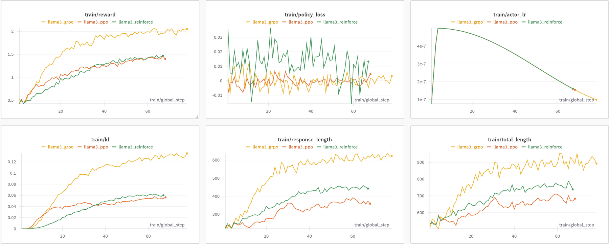

# REINFORCE++: global advantage normalization

<!-- source-sha256: d51638b54f567a69e78f489bd40edc515a0714073349b98d6a62e62ba38fe290 -->

[简体中文](README.md)

> Isolates the RL update on a public candidate policy or deterministic agent mini-suite. The lightweight experiment does not establish paper-scale model or benchmark outcomes.

## Paper information

| Field | Details |
|---|---|
| Paper | [REINFORCE++: global advantage normalization (arXiv 2501.03262)](https://arxiv.org/abs/2501.03262) |
| Organization | Independent researchers |
| First public release | 2025-01-04 |
| Authors' code | No official code was found. |
| Adapter / method | `reinforce-plus` |
| Local reproduction code | [`src/auto_research/post_training/`](https://github.com/daiwk/auto-research/tree/main/src/auto_research/post_training/) |

## Original paper

### Motivation and method

Prompt-local standard deviations in GRPO/RLOO can randomly reweight groups of different difficulty. REINFORCE++ retains within-group centering but normalizes by a global advantage scale across batches to reduce variance and local bias without a critic.


<!-- paper-figure:start -->
### Key figure from the paper

[](https://ar5iv.labs.arxiv.org/html/2501.03262/assets/imgs/llama3.png)

> **Figure 1:** Overview of the paper's method and key components. From the [original paper](https://arxiv.org/abs/2501.03262); copyright remains with the authors.
<!-- paper-figure:end -->

### Core equation

$$
\hat A_i=\frac{r_i-\overline r_{\rm group}}{\sqrt{\operatorname{EMA}_{\rm batch}[(r-\overline r)^2]}+\epsilon}.
$$

### Paper results

The paper reports that global advantage normalization improves on prompt-local critic-free baselines and some PPO controls in general RLHF, complex reasoning, and agent settings. No online A/B test is reported.

## Local reproduction

Maintain reward second moments across training steps and use them, rather than current-group standard deviation, to scale group-centered advantages.

```bash
auto-research post-train --algorithm reinforce-plus --dataset gsm8k-candidate --maximum-examples 256 --steps 120 --seed 42
```

See the [fixed-seed aggregate metrics](../../experiments/rl-papers-summary-seed42.json).

## Reproduction boundaries

The local EMA uses small batches of candidate trajectories. It does not represent the paper's large-batch distribution or human preference rewards.
