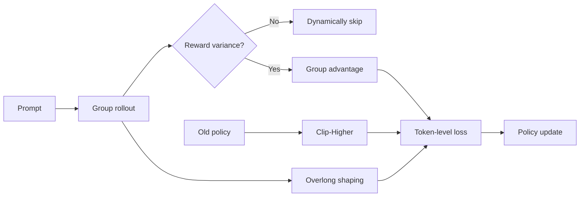
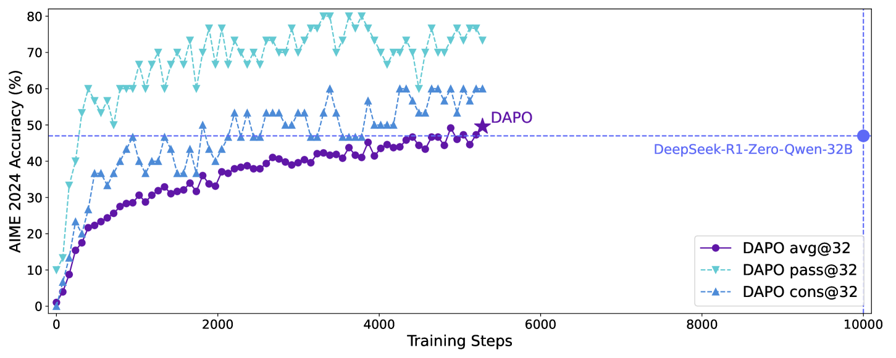

<!-- source-sha256: 26eaf39347f63a41ff3363249e60b764650e19d150089ccf7543b8084602083f -->

[简体中文](README.md) · English

# DAPO: Decoupled clipped policy optimization for long reasoning

> DAPO adds asymmetric clipping, dynamic sampling, token-level loss, and overlong reward shaping to GRPO-style online training, addressing entropy collapse and uninformative batches.

## Paper information

| Field | Details |
| --- | --- |
| Paper | [DAPO: An Open-Source LLM Reinforcement Learning System at Scale](https://arxiv.org/abs/2503.14476) |
| Institution | ByteDance Seed / Tsinghua University AIR |
| First public release | 2025-03-18 |
| Author code | [Released: BytedTsinghua-SIA/DAPO](https://github.com/BytedTsinghua-SIA/DAPO) |
| Local adapter or method key | `dapo` |
| Local reproduction code | `src/auto_research/post_training/` |

## Original paper summary

### Background and main changes

Standard symmetric clipping can suppress exploration in online RL for long chains of thought, and groups with all correct or all wrong answers offer no learning signal. DAPO's Clip-Higher gives more room to increase probabilities; Dynamic Sampling discards zero-variance groups; token-level loss handles responses of different lengths fairly; and overlong responses receive a piecewise penalty.



<!-- paper-figure:start -->
### Key figure from the paper

[](https://ar5iv.labs.arxiv.org/html/2503.14476/assets/x1.png)

> **Figure 1:** The training pipeline and key optimization stages in the paper. From the [paper](https://arxiv.org/abs/2503.14476); copyright belongs to the authors. Click for the source.
<!-- paper-figure:end -->

### Core equations

$$
\mathcal J_{\mathrm{DAPO}}=
\frac{1}{\sum_i|y_i|}\sum_{i,t}
\min\!\left(\rho_{i,t}\hat A_i,
\operatorname{clip}(\rho_{i,t},1-\epsilon_{\mathrm{low}},
1+\epsilon_{\mathrm{high}})\hat A_i\right),
$$

where $\epsilon_{\mathrm{high}}>\epsilon_{\mathrm{low}}$. Dynamic sampling retains only groups with $\operatorname{std}(r_1,\ldots,r_G)>0$.

### Offline and online results

With Qwen2.5-32B, DAPO scores 50 on AIME 2024 and reportedly surpasses the earlier DeepSeek-R1-Zero-Qwen-32B setting in roughly half the training steps. No production A/B test is reported.

## Local reproduction

| Metric | Untrained policy | DAPO |
|---|---:|---:|
| Accuracy | 0.1641 | **0.7578** |
| Mean reward | 0.3126 | **0.7996** |
| KL(reference) | 0.0000 | 1.0870 |

The old policy is refreshed 18 times in 300 steps. Final-step diagnostics are low/high clipping 0.20/0.28, clip fraction 0.25, average pseudo-token count 2.25, and overlong penalty 0.0125.

```bash
auto-research post-train --algorithm dapo \
  --dataset gsm8k-candidate --maximum-examples 512 \
  --steps 300 --group-size 4 --seed 42 --offline
```

Stable metrics: [`classic-post-training-gsm8k-seed42.json`](../../experiments/classic-post-training-gsm8k-seed42.json).

## Scope

The implementation runs the four training mechanisms and old-policy rollouts. Candidate lengths are simulated with deterministic pseudo-token lengths. It does not reproduce 32B long chain-of-thought generation, distributed training, real token masks, or the AIME verifier.
