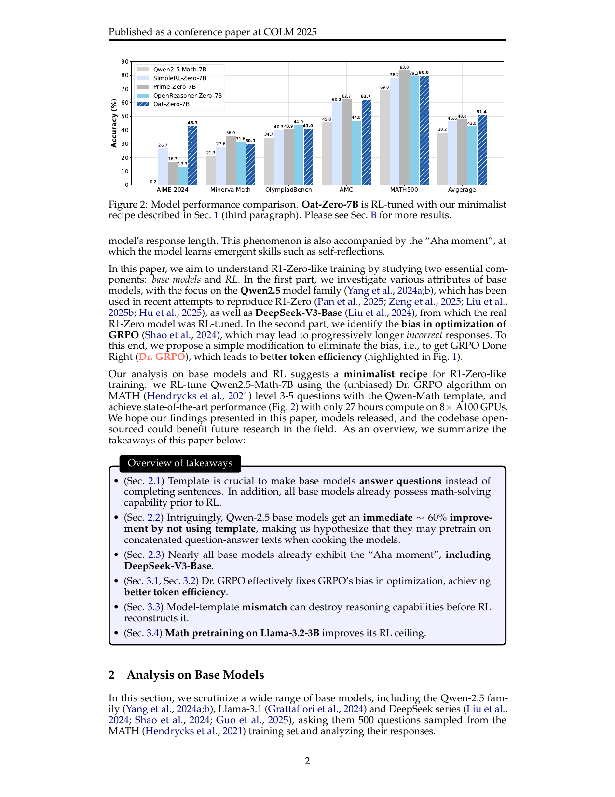

# Dr. GRPO: Remove length and group-variance bias

<!-- source-sha256: 604e3c3df040305405bda2166f684e95d0b0263b9fcee56bca0fbe8fc5f6c2fa -->

[简体中文](README.md)

> Isolated RL update, not paper-scale long reasoning.

## Paper information

| Field | Details |
|---|---|
| Paper | [Dr. GRPO (arXiv 2503.20783)](https://arxiv.org/abs/2503.20783) |
| Institution | SAIL research team. |
| First public release | 2025-03-26 |
| Author code | [sail-sg/understand-r1-zero](https://github.com/sail-sg/understand-r1-zero). |
| Local adapter or method key | `dr-grpo` |
| Local reproduction code | [`src/auto_research/post_training/`](https://github.com/daiwk/auto-research/tree/main/src/auto_research/post_training/) |

## Paper method and evidence

GRPO's response-length averaging and within-group standard deviation can introduce length and problem-difficulty biases. Remove both normalizations while keeping centered group-relative reward so trajectories retain their scale.


<!-- paper-figure:start -->
### Original paper figure

[](https://arxiv.org/pdf/2503.20783#page=2)

The original figure documents the GRPO normalization analysis. From the [original paper](https://arxiv.org/abs/2503.20783); copyright remains with the authors.
<!-- paper-figure:end -->

### Core equation

$$
\hat A_i=r_i-\frac1G\sum_{j=1}^G r_j,\qquad \mathcal L_{\rm DrGRPO}=-\frac1G\sum_i\min(r_i(\theta)\hat A_i,\operatorname{clip}(r_i(\theta))\hat A_i).
$$

### Reported results

The paper reports better token efficiency without losing reasoning performance and 43.3% AIME24 using a minimal R1-Zero recipe on a 7B base. No online A/B.

## Local reproduction

On the same GSM8K candidate policy, steps and seed, remove group std and proxy-length normalization and compare update statistics to GRPO.

```bash
auto-research post-train --algorithm dr-grpo --dataset gsm8k-candidate --maximum-examples 256 --steps 120 --seed 42
```

[Fixed-seed summary](../../experiments/rl-papers-summary-seed42.json). Candidate policies do not freely generate response lengths; proxy lengths expose normalization effects, not token-level long-CoT training.
