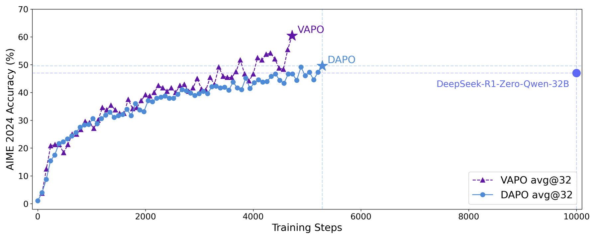

# VAPO: Critic-based PPO for long chain-of-thought reasoning

<!-- source-sha256: 989a2c60cf447e0ec8587044c2de8ee1cecce275de3a047602b53a793aa428fe -->

[简体中文](README.md)

> Isolated RL mechanism on a public candidate policy, not paper-scale reasoning.

## Paper information

| Field | Details |
|---|---|
| Paper | [VAPO (arXiv 2504.05118)](https://arxiv.org/abs/2504.05118) |
| Institution | ByteDance Seed. |
| First public release | 2025-04-07 |
| Author code | No official code found. |
| Local adapter or method key | `vapo` |
| Local reproduction code | [`src/auto_research/post_training/`](https://github.com/daiwk/auto-research/tree/main/src/auto_research/post_training/) |

## Paper method and evidence

Critic bias, heterogeneous lengths and sparse rewards destabilize value-based PPO on long traces. VAPO pretrains a value model and adapts GAE and actor updates to response length.


<!-- paper-figure:start -->
### Original paper figure

[](https://ar5iv.labs.arxiv.org/html/2504.05118/assets/fig/score.png)

The original figure illustrates VAPO training. From the [original paper](https://arxiv.org/abs/2504.05118); copyright remains with the authors.
<!-- paper-figure:end -->

### Core equation

$$
\hat A_t^{\rm VAPO}=\sum_{l\ge0}(\gamma\lambda(L))^l\delta_{t+l},\qquad \mathcal L_{\rm actor}=\min(r_t\hat A_t,\operatorname{clip}(r_t)\hat A_t).
$$

### Reported results

The paper reports 60.4 on Qwen-32B/AIME 2024, over ten points ahead of DeepSeek-R1-Zero-Qwen-32B and DAPO under the same setting. No production A/B.

## Local reproduction

A trainable linear critic uses proxy candidate lengths to adjust GAE; actor, old policy and critic actually update.

```bash
auto-research post-train --algorithm vapo --dataset gsm8k-candidate --maximum-examples 256 --steps 120 --seed 42
```

[Fixed-seed results](../../experiments/rl-papers-summary-seed42.json). The local critic is not a pretrained value model, and candidates/proxy lengths replace free-form long reasoning.
