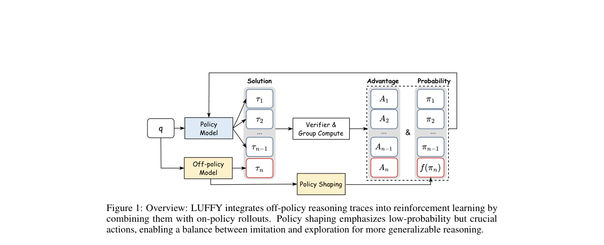

# LUFFY: a unified update for off-policy demonstrations and on-policy reasoning

<!-- source-sha256: 1152766b8fdc17120a082a3589818ec7a975f1cda9f30d633f0b6aa6a4cc70f0 -->

[简体中文](README.md)

> **Fidelity: core mechanism.** The deterministic mini-suite does not stand in for the paper's full benchmark.

## Paper information

| Field | Details |
|---|---|
| Paper | [LUFFY: a unified update for off-policy demonstrations and on-policy reasoning (arXiv 2504.14945)](https://arxiv.org/abs/2504.14945) |
| Organization | University of Washington / SimpleReasoning |
| First public release | 2025-04-21 (arXiv v1) |
| Authors' code | [Public implementation](https://github.com/Simplified-Reasoning/LUFFY) |
| Adapter / method | `luffy` |
| Local reproduction code | [`src/auto_research/post_training/`](https://github.com/daiwk/auto-research/tree/main/src/auto_research/post_training/) |

## Original paper

### Motivation and method

Put high-quality offline reasoning and online rollouts on the same support. Regularize importance ratios to retain on-policy behavior.


<!-- paper-figure:start -->
### Key figure from the paper

[](https://arxiv.org/pdf/2504.14945#page=3)

> **Figure 1:** Overview of the paper's method and key components. From the [original paper](https://arxiv.org/abs/2504.14945); copyright remains with the authors.
<!-- paper-figure:end -->

### Core equations

$$
\rho=\pi_\theta(y|x)/\mu(y|x),\quad\mathcal L=-\mathbb E[\operatorname{clip}(\rho)A\log\pi_\theta]+\beta D_{KL}(\pi_\theta\Vert\pi_{ref}).
$$

### Paper results

The paper outperforms pure SFT, pure off-policy, and pure on-policy baselines on mathematics reasoning benchmarks. No production online A/B test is reported; no online figures are inferred.

## Local reproduction

Arithmetic candidate suite, 120 steps, 256 examples, seed 42: accuracy 0.2344 → **0.5312 (+126.67%)**, at the same reward, KL, length, and candidate budgets.

```bash
auto-research post-train --algorithm luffy --dataset arithmetic-smoke --maximum-examples 256 --steps 120 --seed 42
auto-research evolve --model post-training --dataset arithmetic-smoke --direction "组合 luffy 与已安装论文算子" --generations 2 --population 4
```

See the [fixed metrics](../../experiments/global-p0-20260808-seed42.json).

## Reproduction boundaries

The local run checks the paper-specific objective, state updates, and fair budgets. It does not reproduce large models, multi-GPU RL, private environments, real websites, or the full benchmark. It validates the mechanism, not the numerical results in the original tables.
