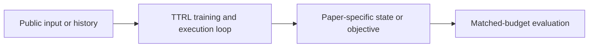
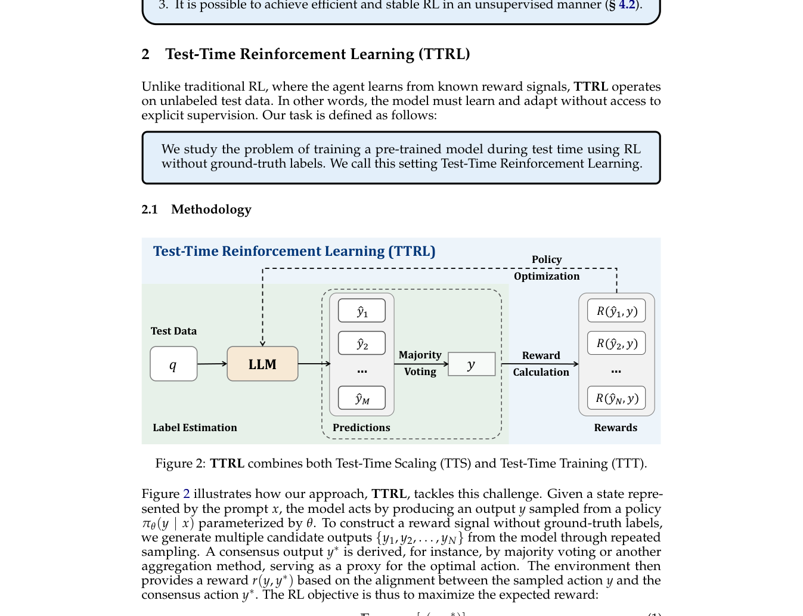

# TTRL: online reinforcement learning on unlabeled test sets

<!-- source-sha256: d70c70839d1b7d00fc74a6d2ab24b21d1df0248371fb7214ed4c0b5bd96fd016 -->

[简体中文](README.md)

> **Fidelity: core mechanism.** The deterministic mini-suite does not substitute for the full paper benchmark.

## Paper information

| Field | Details |
|---|---|
| Paper | [TTRL: online reinforcement learning on unlabeled test sets (arXiv 2504.16084)](https://arxiv.org/abs/2504.16084) |
| Organization | PRIME-RL author team |
| First public release | 2025-04-22 (arXiv v1) |
| Authors' code | [Public implementation](https://github.com/PRIME-RL/TTRL) |
| Adapter / method | `ttrl` |
| Local reproduction code | [`src/auto_research/post_training/`](https://github.com/daiwk/auto-research/tree/main/src/auto_research/post_training/) |

## Original paper

### Motivation and method

Sample several answers for the same test question, use the majority answer as a pseudo-label, and update immediately without gold labels.



<!-- paper-figure:start -->
### Key figure from the paper

[](https://arxiv.org/pdf/2504.16084#page=4)

> **Figure 2:** Overview of the paper's method and key components. From the [original paper](https://arxiv.org/abs/2504.16084); copyright remains with the authors.
<!-- paper-figure:end -->

### Core equations

$$
\hat y=\operatorname{mode}\{y_k\}_{k=1}^K,\quad r_k=\mathbf1[y_k=\hat y],\quad\theta' = \theta+\eta\nabla J_{GRPO}(r).
$$

### Paper results

The paper reports test-time gains across reasoning benchmarks and model sizes. It reports no production A/B, so there are no inferred online numbers.

## Local reproduction

Arithmetic candidate suite, 120 steps, 256 examples, seed 42: accuracy 0.2344 → **0.2344 (+0.00%)**. Reward, KL, length, and candidate budgets match.

```bash
auto-research post-train --algorithm ttrl --dataset arithmetic-smoke --maximum-examples 256 --steps 120 --seed 42
auto-research evolve --model post-training --dataset arithmetic-smoke --direction "组合 ttrl 与已安装论文算子" --generations 2 --population 4
```

See the [fixed metrics](../../experiments/global-p0-20260808-seed42.json).

## Reproduction boundaries

The local run checks the paper-specific objective, state updates, and fair budgets. It does not reproduce large models, multi-GPU RL, private environments, real websites, or the full benchmark. This is mechanism validation, not reproduction of the original tables.
