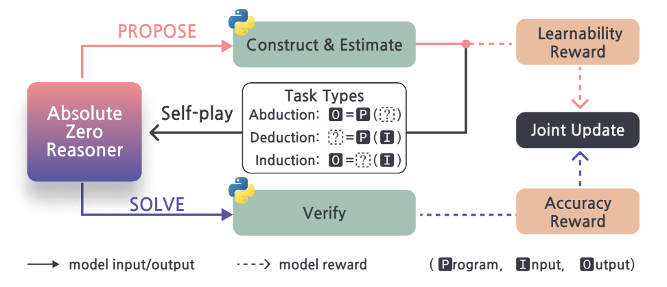

# Absolute Zero: A self-generated curriculum without human data

<!-- source-sha256: eaf9bee225a8a93e05d984a86555af3bfde8a4b629b8a52938ed08ecb5d623bd -->

[简体中文](README.md)

> Core candidate mechanism, not the full reasoning benchmark.

## Paper information

| Field | Details |
|---|---|
| Paper | [Absolute Zero (arXiv 2505.03335)](https://arxiv.org/abs/2505.03335) |
| Institution | Tsinghua University / LeapLab. |
| First public release | 2025-05-06 (arXiv v1) |
| Author code | [LeapLabTHU/Absolute-Zero-Reasoner](https://github.com/LeapLabTHU/Absolute-Zero-Reasoner). |
| Local adapter or method key | `absolute-zero` |
| Local reproduction code | [`src/auto_research/post_training/`](https://github.com/daiwk/auto-research/tree/main/src/auto_research/post_training/) |

## Paper method and evidence

A proposer generates verifiable tasks, a solver attempts them, and an executable verifier supplies rewards. Adapt task difficulty to the current capability boundary.


<!-- paper-figure:start -->
### Original paper figure

[](https://ar5iv.labs.arxiv.org/html/2505.03335/assets/x3.png)

The original figure shows the proposer–solver–verifier loop. From the [original paper](https://arxiv.org/abs/2505.03335); copyright remains with the authors.
<!-- paper-figure:end -->

### Core equation

$$
x\sim\pi_P,\ y\sim\pi_S(\cdot|x),\ r=V(x,y),\quad\max_{P,S}\mathbb E[r+\lambda H_{curriculum}(x)].
$$

### Reported results

Absolute Zero Reasoner bootstraps code/math reasoning from zero data and beats multiple human-data RLVR baselines. No production A/B.

## Local reproduction

Arithmetic candidates, 120 steps, 256 examples, seed 42: **0.2344→0.5938 (+153.33%)** with matched reward, KL, length and candidate budgets.

```bash
auto-research post-train --algorithm absolute-zero --dataset arithmetic-smoke --maximum-examples 256 --steps 120 --seed 42
auto-research evolve --model post-training --dataset arithmetic-smoke --direction "Combine absolute-zero with installed paper operators" --generations 2 --population 4
```

[Fixed-seed metrics](../../experiments/global-p0-20260808-seed42.json). Only the method-specific objective, state updates and matched budget are tested. No large model, multi-GPU RL, private environment, live web or full benchmark.
