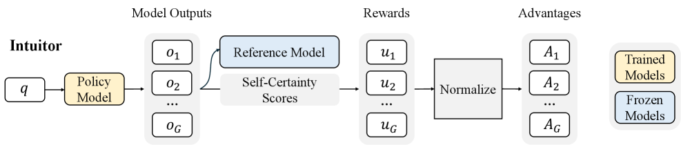

# INTUITOR: Replacing the External Verifier with Self-Certainty

<!-- source-sha256: e23d63d21201d359ee094c21724a65cf1bcd84897498f2b2ca14b75905ac91ec -->

[简体中文](README.md)

> **Local candidate-distribution diagnostic.** The existing operator does not implement per-token full-vocabulary self-certainty. Its mini-suite does not validate that defining reward or the paper's reasoning capability.

## Paper information

| Field | Details |
|---|---|
| Paper | [INTUITOR (arXiv 2505.19590)](https://arxiv.org/abs/2505.19590) |
| Organization | University of California, Berkeley |
| First public release | 2025-05-26 (arXiv v1) |
| Authors' code | [Released: sunblaze-ucb/Intuitor](https://github.com/sunblaze-ucb/Intuitor). |
| Adapter / method | `intuitor` |
| Local reproduction code | [`src/auto_research/post_training/`](https://github.com/daiwk/auto-research/tree/main/src/auto_research/post_training/) |

## Original paper

### Motivation and method

For each generated prefix, compute $D_{KL}(U\Vert\pi_\theta)$ on the full next-token vocabulary, then average over response length as intrinsic self-certainty. The direction is uniform-to-policy, not negative policy entropy. Confidence does not imply correctness.


<!-- paper-figure:start -->
### Key figure from the paper

[](https://arxiv.org/html/2505.19590v5/x2.png)

> **Figure 2:** Training flow and key optimization stages. From the [original paper](https://arxiv.org/abs/2505.19590); copyright remains with the authors.
<!-- paper-figure:end -->

### Core equation

$$
r_{int}(y)=\frac{1}{|y|}\sum_{t=1}^{|y|}
D_{KL}(U\Vert\pi_\theta(\cdot|x,y_{<t}))
=-\frac{1}{|y||\mathcal V|}\sum_{t=1}^{|y|}\sum_{j\in\mathcal V}
\log\bigl(|\mathcal V|\pi_\theta(j|x,y_{<t})\bigr).
$$

See [v1 Section 3.3, Eq. 4](https://arxiv.org/html/2505.19590v1#S3.SS3). The intrinsic reward estimates within-group advantages. It is separate from the reference KL regularizer for policy drift.

### Paper results

The paper improves several reasoning tasks without external reward. The local mini-suite lacks test distribution shift, so may show no improvement. No production online A/B is reported.

## Local reproduction

Historical arithmetic candidate suite, 120 steps, 256 examples, seed 42: accuracy 0.2344 → **0.2344 (+0.00%)**. This unchanged record tests the existing candidate operator only, not the paper's self-certainty.

```bash
auto-research post-train --algorithm intuitor --dataset arithmetic-smoke --maximum-examples 256 --steps 120 --seed 42
auto-research evolve --model post-training --dataset arithmetic-smoke --direction "组合 intuitor 与已安装论文算子" --generations 2 --population 4
```

The second command's direction asks Evolve to combine Intuitor with installed paper operators. See [pinned metrics](../../experiments/global-p0-20260808-seed42.json).

## Limits

The `intuitor` branch of `p0_20260808.py` uses sampled-candidate `log p + log N` as reward. The `intrinsic_kl_to_uniform` diagnostic measures $D_{KL}(p\Vert U)$, the opposite direction. There is no per-token full-vocabulary computation, so this remains a candidate reward diagnostic and not the defining Intuitor mechanism. Original-scale model training was not run; historical metrics remain visible.
