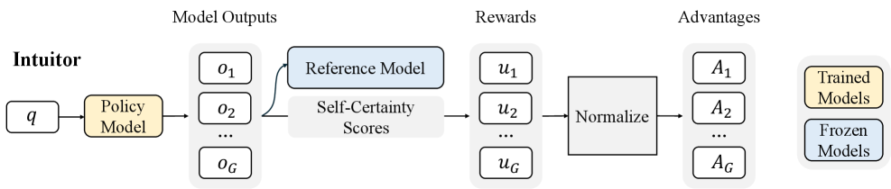

# INTUITOR：以自置信度替代外部 verifier

> **本地为候选分布机制诊断**。当前算子没有实现原文逐 token、全词表的 self-certainty；现有 mini-suite 不能作为该定义性奖励或原论文推理能力的验证。

## 论文信息

| 字段 | 内容 |
|---|---|
| 论文链接 | [INTUITOR：以自置信度替代外部 verifier（arXiv 2505.19590）](https://arxiv.org/abs/2505.19590) |
| 公司 / 机构 | University of California, Berkeley |
| 首次公开日期 | 2025-05-26（arXiv v1） |
| 原作者代码 | [已开源](https://github.com/sunblaze-ucb/Intuitor) |
| 本地 adapter / 方法键 | `intuitor` |
| 本地复现代码 | [`src/auto_research/post_training/`](https://github.com/daiwk/auto-research/tree/main/src/auto_research/post_training/) |

## 原始论文总结

### 背景与主要改动

以每个生成前缀下的全词表 next-token 分布计算 $D_{KL}(U\Vert\pi_\theta)$，再沿回答长度平均，作为 intrinsic self-certainty reward。方向是均匀分布到策略分布，并非策略的负熵；高置信度也不等于答案一定正确。


<!-- paper-figure:start -->
### 原论文关键图

[](https://arxiv.org/html/2505.19590v5/x2.png)

> **原论文 Figure 2（关键图）**：展示原论文的训练流程与关键优化环节。图片来自[原论文](https://arxiv.org/abs/2505.19590)，版权归原作者所有；点击图片可查看来源。
<!-- paper-figure:end -->

### 核心公式

$$
r_{int}(y)=\frac{1}{|y|}\sum_{t=1}^{|y|}
D_{KL}(U\Vert\pi_\theta(\cdot|x,y_{<t}))
=-\frac{1}{|y||\mathcal V|}\sum_{t=1}^{|y|}\sum_{j\in\mathcal V}
\log\bigl(|\mathcal V|\pi_\theta(j|x,y_{<t})\bigr).
$$

依据：[原论文 v1 §3.3 Eq.4](https://arxiv.org/html/2505.19590v1#S3.SS3)。内在奖励用于组内优势估计；这里的 KL 与训练中约束策略漂移的 reference KL 也要分开。

### 论文离线与线上效果

论文在无外部奖励条件下提升多项推理任务；本地 mini-suite 不具测试分布漂移，因此可能不提升。 论文未报告生产线上 A/B，本页不补造线上数字。

## 本地复现

历史 Arithmetic candidate suite、120 steps、256 examples、seed 42：accuracy 0.2344 → **0.2344（+0.00%）**。保留原始结果；这次对照只涉及现有候选算子，不能解释为原文 self-certainty 的实验结果。

```bash
auto-research post-train --algorithm intuitor --dataset arithmetic-smoke --maximum-examples 256 --steps 120 --seed 42
auto-research evolve --model post-training --dataset arithmetic-smoke --direction "组合 intuitor 与已安装论文算子" --generations 2 --population 4
```

固定指标见 [`../../experiments/global-p0-20260808-seed42.json`](../../experiments/global-p0-20260808-seed42.json)。

## 复现边界

当前 `p0_20260808.py` 的 `intuitor` 分支以采样候选的 `log p + log N` 作为奖励，诊断量 `intrinsic_kl_to_uniform` 则是 $D_{KL}(p\Vert U)$。它既没有原文的逐 token 全词表计算，也使用了相反方向的 KL，因此仅为候选奖励更新诊断，尚未复现 Intuitor 的定义性 self-certainty。未运行原文规模的模型训练，历史指标继续保留。
