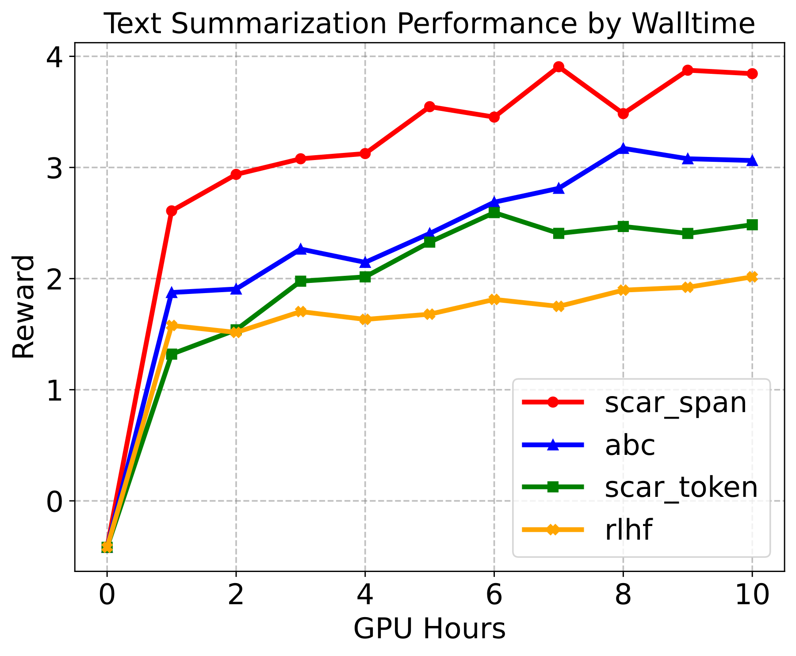

# SCAR: Shapley Credit Assignment for More Efficient RLHF

<!-- source-sha256: 2a9592a898a45d29687475feff9600e98b69b5d5ef8fb889532ccde70d8d1440 -->

[简体中文](README.md)

> **Standalone L1 numerical/protocol component; diagnostic only.** Full experiment not reproduced due to cost (review complete); no checkpoint/data downloads or automatic retry. This is a user-selected historical conference paper, not a new publication.

## Paper information

| Field | Details |
|---|---|
| Paper | [Original arXiv v1](https://arxiv.org/abs/2505.20417v1) |
| Organization | First author Meng Cao lists McGill University first and Mila additionally. Coauthor Doina Precup lists DeepMind, McGill, Mila, and CIFAR. The work is grouped under McGill, not reassigned for Google priority. |
| First public release | **2025-05-26 18:06:52 UTC**, arXiv v1. |
| Authors' code | Pinned v1 links upstream SHAP, TRL, and baseline tools only; no author repository was verified in the paper or by exact-title search. This is not proof none was released. |
| Adapter / method | `scar-shapley-credit`; `adapter=null`; `promotion_eligible=false`; `evolve_integrated=false`. |
| Local reproduction code | `src/auto_research/post_training/scar_shapley_credit.py`; `exact_shapley` and `diagnostic`. |
| Pinned method | [v1 text](https://arxiv.org/html/2505.20417v1); first publication remains the original v1 date. |
| License | No verified author repository, so source license and pinned SHA are not applicable. Paper and figure: arXiv.org perpetual non-exclusive license. |
| Local checks | `tests/post_training/test_google_emnlp25_post_protocols.py`; A100 receipt `docs/gpu-validations/scar-shapley-credit-a100-20261025.json`. A GPU pass requires actual execution and validation. |

SCAR allocates a response's scalar reward to tokens or spans using Shapley marginal contributions on space-masked text coalitions. It injects each span's credit at that span's final token and interpolates with the original terminal reward using alpha without changing per-token KL penalties.

## Original paper

### Motivation and method

Sections 3.2–3.4, Eqs. 3–6: an external frozen reward model scores text coalitions in the original order with nonmember positions replaced by spaces, with v(empty)=0. Shapley credit preserves negative contributions; span credit goes only to the final token. The paper uses adaptive segmentation and SHAP/Owen approximations. The local scope is exact enumeration for N<=10 and reward scatter at gamma=1. It does not treat an unspecified parser, an Owen hierarchy, or a synthetic reward model as the original system.

<!-- paper-figure:start -->
### Key figure from the paper



Figure 4 is rasterized from the original SVG in [pinned v1](https://arxiv.org/html/2505.20417v1#S4.F4) without scientific changes. Copyright remains with the authors; the arXiv nonexclusive publication license does not imply CC BY or arbitrary relicensing. The source, SHA-256, and visual verification are recorded in `assets/provenance.json`.
<!-- paper-figure:end -->

### Core equation

$$
\phi_i=\sum_{S\subseteq N\setminus\{i\}}\frac{|S|!(N-|S|-1)!}{N!}[v(S\cup\{i\})-v(S)],\quad R_t=R_t^{KL}+\alpha\phi_i\mathbf1[t=t_i]+(1-\alpha)r\mathbf1[t=T].
$$

The empty coalition is worth zero and the full coalition equals the original terminal reward. Negative contributions are not clipped. The local code accepts complete value tables of at most 1024 entries, with an explicit cost check before enumeration. Span endpoints must strictly increase and end at the final token. Reward totals are equivalent per trajectory at gamma=1; this is not a guarantee about optimal policies at gamma<1.

### Paper results

Span-level credit improves reward per GPU-hour over token-level credit in the reported comparison, not necessarily in every setting. Figure 4 is a selected TL;DR time curve, not a confidence interval across seeds. This implementation does not reproduce task reward or alignment effects. No production online A/B is reported; neither offline analysis nor numerical diagnostics establish online uplift.

## Local reproduction

`exact_shapley` and its numerical protocol run locally. Genuine model/data observations must come from the caller; fixtures do not supply fake ones.

```bash
PYTHONPATH=src python -c 'from auto_research.post_training.scar_shapley_credit import diagnostic; print(diagnostic(42))'
PYTHONPATH=src python -m pytest tests/post_training/test_google_emnlp25_post_protocols.py -q
```

Random tensors from `diagnostic(seed,device='cpu')` check the definition, negative controls, and isolation. Seeds 42/43/44 do not turn a synthetic diagnostic into a capability evaluation. No evaluated agent sees gold answers and no test data selects a model. This component computes rewards from frozen observations; it does not update an LLM. The shared CUDA runner uses A100/A30, with source, three-seed metrics, and receipt bound together. Do not claim a pass without that receipt.

The exact formula and gamma=1 scatter preserve the defining credit mechanism, including original-order space masking, empty-coalition value zero, negative values, and last-token span credit. Adaptive segmentation, approximate SHAP/Owen credit, and a trained reward model remain outside the reproduction.

### High-cost full experiment

Sections 4 and Appendix B use one A100 80GB and five seeds. Pythia-1B on TL;DR uses 2000 SFT steps and reward-model training on 92K preferences; the paper additionally studies 7B instruction tuning. For 1K steps the selected timing run costs about 48 GPU-hours for token-level SCAR and seven for spans. These are representative reported timings, not local measurements. Full multitask, multiseed training is above the short-run budget of a single A100/A30 or Mac, so no download or trial is attempted. The local component is not a substitute and is not Evolve improvement evidence.
