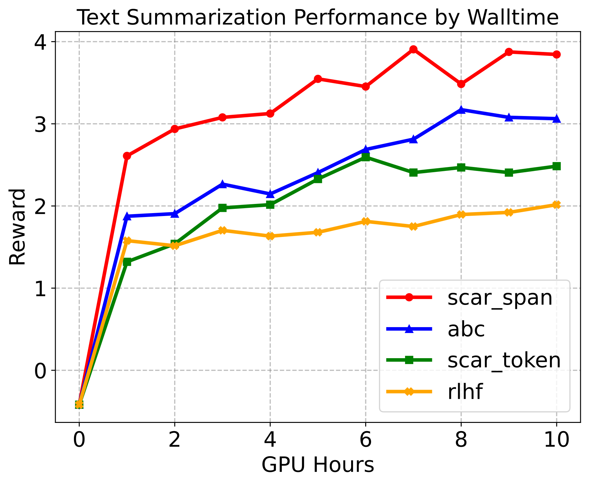

# SCAR: Shapley Credit Assignment for More Efficient RLHF

将完整响应的标量奖励按各token或文本span对空间遮蔽coalition的Shapley边际贡献分配，在span结束位置注入密集奖励，并以alpha与原终局奖励插值，保持逐token KL惩罚不变。

> 状态：独立 **L1 数值/协议组件，diagnostic only**；不代表真实LLM能力、训练收益或完整论文复现。完整实验：**成本过高，不复现（审查 DONE）**，不下载权重/数据、不自动重试。此为用户指定的历史会议补漏，不是本日新发表。

## 论文信息

| 字段 | 内容 |
|---|---|
| 论文链接 | [原始 arXiv v1](https://arxiv.org/abs/2505.20417v1) |
| 固定方法版本 | [v1正文](https://arxiv.org/html/2505.20417v1)；原始发布日期仍按v1，不把更新版日期当首发 |
| 公司 / 作者机构 | 一作 Meng Cao 第一机构为 McGill University，另列 Mila；共同作者 Doina Precup 明确列 DeepMind、McGill、Mila 与 CIFAR。按 McGill 聚合，不为 Google 优先改归属。 |
| 原始发布日期 | **2025-05-26 18:06:52 UTC**，arXiv v1 |
| 原作者代码 | 固定原文仅链接上游SHAP/TRL/基线工具，未找到本论文作者源码仓库；精确标题公开检索也未核实作者发布。未找到不等于断言未发布。 |
| 原作者代码许可 | 未核实作者源码仓库，源码许可与固定SHA不适用。论文/原图许可：arXiv.org perpetual non-exclusive license |
| 本地 Adapter / key | `scar-shapley-credit`；`adapter=null`；`promotion_eligible=false`；`evolve_integrated=false` |
| 本地代码 | `src/auto_research/post_training/scar_shapley_credit.py`，入口 `exact_shapley` / `diagnostic` |
| 本地验证 | 定向测试 `tests/post_training/test_google_emnlp25_post_protocols.py`；A100收据 `docs/gpu-validations/scar-shapley-credit-a100-20261025.json`，实际执行和校验前不宣称GPU通过 |

## 原始论文总结

### 背景与主要改动

原文Sec.3.2–3.4 Eq.3–6：外部冻结RM对原顺序、未入选位置填空格的文本coalition评分，v(empty)=0；Shapley必须保留负贡献，span credit只给该span末token。完整论文用自适应分段和SHAP/Owen近似。这里只保真实现N<=10的完整coalition精确式及gamma=1的奖励散布；不把未指定解析器、Owen层次结构或合成RM冒充原系统。

<!-- paper-figure:start -->
### 原论文关键图



Figure 4取自固定v1的原始SVG，仅栅格化为PNG，不改科学内容。图片来自[原论文](https://arxiv.org/html/2505.20417v1#S4.F4)，版权归原作者所有。原文为arXiv非独占发布许可，未据此声称CC BY或允许任意再许可；这里仅作明确署名的研究图示引用。来源、SHA256与实际目视核验见 `assets/provenance.json`。
<!-- paper-figure:end -->

### 核心公式

$$
\phi_i=\sum_{S\subseteq N\setminus\{i\}}\frac{|S|!(N-|S|-1)!}{N!}[v(S\cup\{i\})-v(S)],\quad R_t=R_t^{KL}+\alpha\phi_i\mathbf1[t=t_i]+(1-\alpha)r\mathbf1[t=T].
$$

空coalition价值为0，完整coalition为原终局reward；不截断负贡献。本地只接受完整最多1024项值表，显式成本门槛先于枚举。span末位置必须递增并结束在最后token。只承诺gamma=1时逐轨迹总奖励等价，不把它推广为gamma<1的最优策略保证。

### 论文离线与线上效果

原文报告span级在reward/GPU-hour上优于token级，不能据此宣称所有设置都更便宜。Figure4为选取的一次TL;DR时间曲线，不是全种子置信区间；本地不复现任务奖励或对齐效果。 未报告互联网生产线上A/B；不得将离线分析或本地数值测试写成线上收益。

## 本地复现

本地仅执行 `exact_shapley` 及配套数值协议。外部真实模型/数据观测是调用方前提，不由fixture伪造。

```bash
PYTHONPATH=src python -c 'from auto_research.post_training.scar_shapley_credit import diagnostic; print(diagnostic(42))'
PYTHONPATH=src python -m pytest tests/post_training/test_google_emnlp25_post_protocols.py -q
```

`diagnostic(seed,device='cpu')` 的随机张量只核对定义、负控和隔离；seed42/43/44并不把合成诊断变成真实能力评测。没有被测Agent看到gold答案，也没有根据test数据选模。该组件是冻结观测的统计/奖励计算，不声称更新了LLM。CUDA实际路径由统一runner在A100/A30执行，源码、三seed标量与收据需绑定；没有收据不得宣称通过。

保真边界：原文Sec.3.2–3.4 Eq.3–6：外部冻结RM对原顺序、未入选位置填空格的文本coalition评分，v(empty)=0；Shapley必须保留负贡献，span credit只给该span末token。完整论文用自适应分段和SHAP/Owen近似。这里只保真实现N<=10的完整coalition精确式及gamma=1的奖励散布；不把未指定解析器、Owen层次结构或合成RM冒充原系统。

### 高成本完整实验

原文Sec.4与Appendix B：单A100 80GB，5种子，Pythia-1B TL;DR含2000步SFT与92K偏好RM训练，另有7B instruction tuning；1K步token级SCAR约48GPU小时，span级约7GPU小时。论文注明token/span时间对比是单次代表性运行。完整多任务多种子训练明显超短时预算；不下载/不试跑。

资源基准为单张A100/A30或本地Mac。上述为原论文配置/公开报告，不是本地实测耗时，也不推造未披露的GPU型号或训练小时。完整实验结论：**成本过高，不复现（审查 DONE）**。低成本组件可交付，但不替代完整实验，也不被Evolve当作改善证据。
