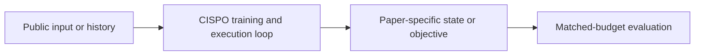
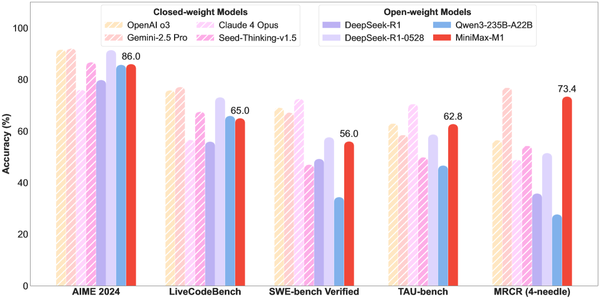

# CISPO / MiniMax-M1: clip importance weights, not advantages

<!-- source-sha256: 6c141b4b3932d4c7e101c14f7a5aef2ebe3def2b6411d59b451ab4e9961e5184 -->

[简体中文](README.md)

> **Fidelity: core mechanism.** The deterministic mini-suite does not stand in for the paper's full benchmark.

## Paper information

| Field | Details |
|---|---|
| Paper | [CISPO / MiniMax-M1: clip importance weights, not advantages (arXiv 2506.13585)](https://arxiv.org/abs/2506.13585) |
| Organization | MiniMax |
| First public release | 2025-06-16 (arXiv v1) |
| Authors' code | [Public implementation](https://github.com/MiniMax-AI/MiniMax-M1) |
| Adapter / method | `cispo` |
| Local reproduction code | [`src/auto_research/post_training/`](https://github.com/daiwk/auto-research/tree/main/src/auto_research/post_training/) |

## Original paper

### Motivation and method

Sample with a fixed rollout policy and compute token-level importance ratios. Clipping only the ratios preserves the direction of advantages and effective gradients.



<!-- paper-figure:start -->
### Key figure from the paper

[](https://ar5iv.labs.arxiv.org/html/2506.13585/assets/x1.png)

> **Figure 1:** Overview of the paper's method and key components. From the [original paper](https://arxiv.org/abs/2506.13585); copyright remains with the authors.
<!-- paper-figure:end -->

### Core equations

$$
\mathcal L=-\mathbb E[\operatorname{clip}(\pi_\theta/\pi_{old},1-\epsilon,1+\epsilon)A\log\pi_\theta].
$$

### Paper results

The MiniMax-M1 technical report presents efficiency for long-context RL and reasoning/agent benchmark results. No production online A/B test is reported; no online figures are inferred.

## Local reproduction

Arithmetic candidate suite, 120 steps, 256 examples, seed 42: accuracy 0.2344 → **0.5000 (+113.33%)**. Rewards, KL, length, and candidate budgets are matched.

```bash
auto-research post-train --algorithm cispo --dataset arithmetic-smoke --maximum-examples 256 --steps 120 --seed 42
auto-research evolve --model post-training --dataset arithmetic-smoke --direction "组合 cispo 与已安装论文算子" --generations 2 --population 4
```

See the [fixed metrics](../../experiments/global-p0-20260808-seed42.json).

## Reproduction boundaries

The local run checks the paper-specific objective, state updates, and fair budgets. It does not reproduce large models, multi-GPU RL, private environments, real websites, or the full benchmark. It verifies the mechanism, not the numerical results in the original tables.
