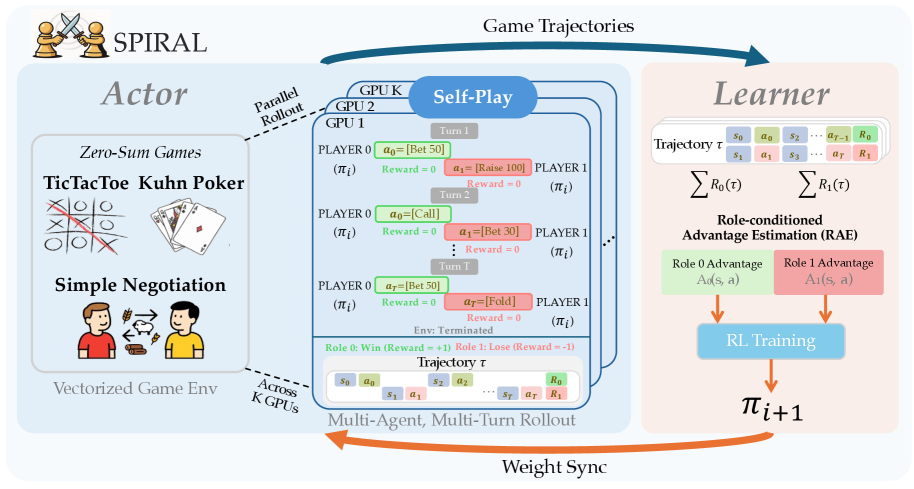

# SPIRAL: Reasoning through Zero-Sum Language-Game Self-Play

<!-- source-sha256: 8baab85992a6054dee1f726e88a270042e15fdcd9e61d73623929d91a5d43e26 -->

[简体中文](README.md)

> **Core mechanism evidence.** Paper and local evaluations are separate.

## Paper information

| Field | Value |
| --- | --- |
| Paper | [SPIRAL (arXiv 2506.24119)](https://arxiv.org/abs/2506.24119) |
| Affiliations | Apple / academic collaborators |
| First public release | 2025-06-30 (arXiv v1) |
| Authors' code | [Author code](https://github.com/spiral-rl/spiral). |
| Adapter / method | `spiral` |
| Local code | [`src/auto_research/post_training/`](https://github.com/daiwk/auto-research/tree/main/src/auto_research/post_training/) |

## Original paper

### Background and contribution

The same model plays problem setter and solver. Automatically scored zero-sum multiround games create a progressively harder curriculum.


<!-- paper-figure:start -->
### Key figure from the paper

[](https://arxiv.org/html/2506.24119v3/x3.png)

Original Figure 3: SPIRAL. From the [paper](https://arxiv.org/abs/2506.24119); copyright belongs to the authors. Not a local result.
<!-- paper-figure:end -->

### Core mechanism

$$
\max_{\pi_A}\min_{\pi_B}\mathbb E_{\tau\sim(\pi_A,\pi_B)}[R(\tau)],\quad A_A=-A_B.
$$

### Paper results

Self-play alone improves reasoning benchmarks and transfers to small models in the paper. No production A/B.

## Local reproduction

Arithmetic candidate suite, 120 steps, 256 examples, seed 42: 0.2344→0.3438 (+46.67%) with matched reward, KL, length, and candidate budgets. [Metrics](../../experiments/global-p0-20260808-seed42.json).

```bash
auto-research post-train --algorithm spiral --dataset arithmetic-smoke --maximum-examples 256 --steps 120 --seed 42
auto-research evolve --model post-training --dataset arithmetic-smoke --direction "Combine spiral with installed paper operators" --generations 2 --population 4
```

## Reproduction limits

A mechanism and fixed-budget check, not the paper's large models, distributed RL, real web/private environments, or full benchmarks.
