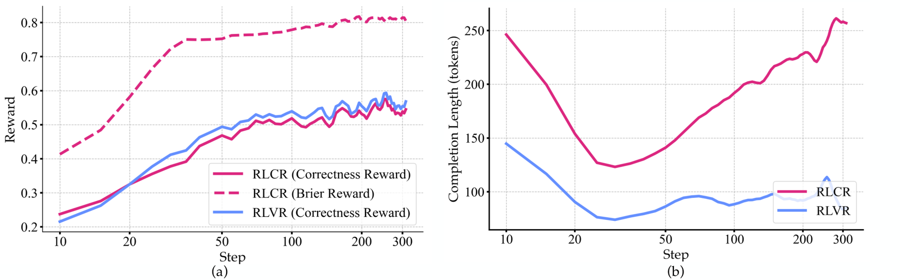

# RLCR: Train confidence with proper scoring rules

<!-- source-sha256: f2a362132aa66abb8a2931694c74387c5e29509b82ba0ac211ccf98666b1f8f5 -->

[简体中文](README.md)

> Scoring-rule mechanism, not the paper's LLM rollouts, RL stack, or confidence-weighted scaling.

## Paper information

| Field | Details |
|---|---|
| Paper | [arXiv 2507.16806](https://arxiv.org/abs/2507.16806) |
| Institution | Massachusetts Institute of Technology (first author). |
| First public release | 2025-07-22 (arXiv v1) |
| Author code | [damanimehul/RLCR](https://github.com/damanimehul/RLCR). |
| Local adapter or method key | `system-one:rival-brier`, `system-one:rival-hybrid` |
| Local reproduction code | `src/auto_research/system_one/local.py` |

## Paper method and evidence

Binary correctness alone can reward indiscriminate confidence. RLCR predicts both an answer and its confidence and adds a bounded proper scoring rule so honest probabilities maximize expected reward. The local baseline minimizes multiclass Brier over the full candidate distribution.

<!-- paper-figure:start -->
### Original paper figure

Figure 11 shows the original training curves. From the [original paper](https://arxiv.org/abs/2507.16806); copyright remains with the authors.
<!-- paper-figure:end -->

### Core equation

$$
\mathcal{L}_{Brier}=\sum_k(p_k-y_k)^2,
\qquad
\mathcal{L}_{hybrid}=\tfrac12(\mathcal{L}_{CE}+\mathcal{L}_{Brier}).
$$

Gradients propagate through the full softmax rather than treating confidence as a display-only field.

### Reported results

The authors report better calibration without losing accuracy across in-domain and out-of-domain tasks. The local results compare objectives only within a shared Banking77 protocol.

## Local reproduction

The local implementation verifies the proper-scoring objective without the authors' checkpoint or RL rollouts.
