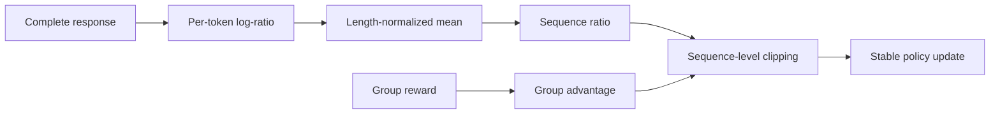
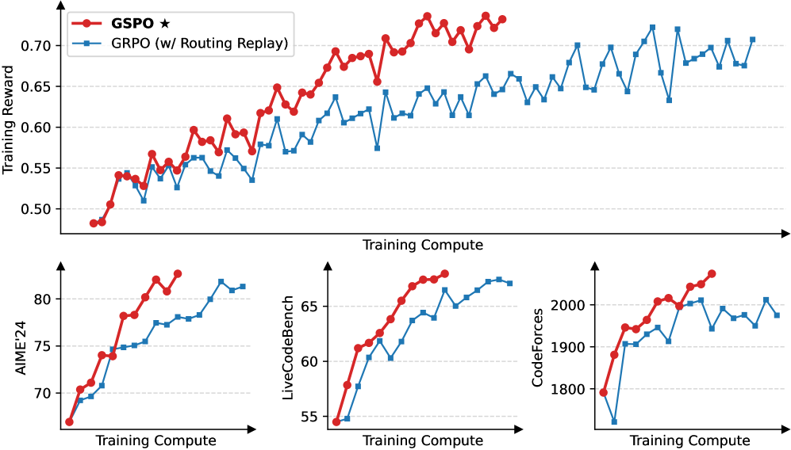

<!-- source-sha256: fda878cdb88b508a8fe4a5ddaf65e51e5a0da920b18e85ad292627dd969d8ed3 -->

[简体中文](README.md) · English

# GSPO: Stable RL with sequence-level importance sampling

> GSPO replaces token-level importance ratios with a single response-level ratio. This aligns the optimization unit with sequence-level rewards and reduces variance for long responses and MoE training.

## Paper information

| Field | Details |
| --- | --- |
| Paper | [Group Sequence Policy Optimization](https://arxiv.org/abs/2507.18071) |
| Institution | Alibaba Qwen Team |
| First public release | 2025-07-24 |
| Author code | No standalone repository was released with the paper. [Alibaba ROLL later provided a GSPO implementation](https://alibaba.github.io/ROLL/docs/User%20Guides/Algorithms/GSPO/). |
| Local adapter or method key | `gspo` |
| Local reproduction code | `src/auto_research/post_training/` |

## Original paper summary

### Background and main changes

GRPO and PPO commonly clip ratios per token, but rewards are assigned to complete sequences. An outlier token in a long sequence can trigger substantial clipping, and changes in MoE routing can worsen instability. GSPO averages the log-ratios for a response, then exponentiates the result to get one sequence ratio. The entire sequence shares the clipping weight.



<!-- paper-figure:start -->
### Key figure from the paper

[](https://arxiv.org/html/2507.18071v2/x1.png)

> **Figure 1:** The training pipeline and key optimization stages in the paper. From the [paper](https://arxiv.org/abs/2507.18071); copyright belongs to the authors. Click for the source.
<!-- paper-figure:end -->

### Core equations

$$
s_i(\theta)=
\exp\!\left(\frac{1}{|y_i|}\sum_t
\log\frac{\pi_\theta(y_{i,t}|x,y_{i,<t})}
{\pi_{\theta_{\mathrm{old}}}(y_{i,t}|x,y_{i,<t})}\right),
$$

$$
\mathcal J_{\mathrm{GSPO}}=
\frac1G\sum_i\min\!\left(
s_i\hat A_i,\operatorname{clip}(s_i,1-\epsilon,1+\epsilon)\hat A_i
\right).
$$

### Offline and online results

The paper reports that GSPO is more stable than token-level GRPO in large-scale Qwen3 training, particularly for long responses and MoE, and supported subsequent model training. Public materials do not report a production A/B test.

## Local reproduction

| Metric | Untrained policy | GSPO |
|---|---:|---:|
| Accuracy | 0.1641 | **0.8281** |
| Mean reward | 0.3126 | **0.8509** |
| KL(reference) | 0.0000 | 0.7017 |

In 300 steps, the old policy is refreshed 18 times. The final group's sequence ratio has mean 1.0131 and standard deviation 0.0117.

```bash
auto-research post-train --algorithm gspo \
  --dataset gsm8k-candidate --maximum-examples 512 \
  --steps 300 --group-size 4 --seed 42 --offline
```

Stable metrics: [`classic-post-training-gsm8k-seed42.json`](../../experiments/classic-post-training-gsm8k-seed42.json).

## Scope

The local implementation includes the length-normalized sequence ratio, group advantage, sequence-level clipping, and reference KL. Local candidates do not have real token trajectories, and the experiment does not reproduce Qwen3 MoE expert routing or training-cluster scale.
