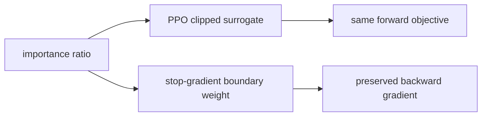
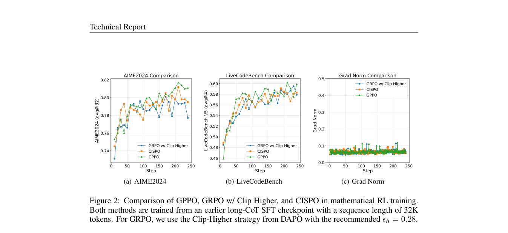

# GPPO: PPO clipping that preserves out-of-range gradients

<!-- source-sha256: 0ff27997609b1b44e8007185695336862456b5c5d58d73962479588b337dd26e -->

[简体中文](README.md)

> Isolates the RL update on a public candidate policy or deterministic agent mini-suite. The lightweight experiment does not establish paper-scale model or benchmark results.

## Paper information

| Field | Details |
|---|---|
| Paper | [GPPO: PPO clipping that preserves out-of-range gradients (arXiv 2508.07629)](https://arxiv.org/abs/2508.07629) |
| Organization | Alibaba Group / Klear-Reasoner Team |
| First public release | 2025-08-11 |
| Authors' code | No standalone public implementation of the algorithm was found. |
| Adapter / method | `gppo` |
| Local reproduction code | [`src/auto_research/post_training/`](https://github.com/daiwk/auto-research/tree/main/src/auto_research/post_training/) |

## Original paper

### Motivation and method

Ordinary PPO zeroes gradients for positive advantages with high ratios and negative advantages with low ratios outside the clip range. This can suppress exploration and learning from negative samples. GPPO keeps PPO's forward clipped objective while restoring backward signals in those regions with a stop-gradient boundary weight.



<!-- paper-figure:start -->
### Key figure from the paper

[](https://arxiv.org/pdf/2508.07629#page=11)

> **Figure 2:** Training flow and key optimization steps. From the [original paper](https://arxiv.org/abs/2508.07629); copyright remains with the authors.
<!-- paper-figure:end -->

### Core equations

$$
\tilde r_t=\operatorname{sg}(\operatorname{clip}(r_t,1-\epsilon,1+\epsilon)-r_t)+r_t,\quad \mathcal L=-\min(r_tA_t,\operatorname{clip}(r_t)A_t).
$$

### Paper results

Klear-Reasoner reports improved exploration and use of negative samples with GPPO, and strong whole-model results on AIME 2024/2025 and LiveCodeBench. No online A/B is reported.

## Local reproduction

On the GSM8K candidate policy, distinguish ordinary and out-of-range PPO samples. The forward pass still computes the clipped surrogate; the backward pass preserves out-of-range gradients with clip-boundary weights.

```bash
auto-research post-train --algorithm gppo --dataset gsm8k-candidate --maximum-examples 256 --steps 120 --seed 42
```

See the [fixed-seed aggregate metrics](../../experiments/rl-papers-summary-seed42.json).

## Reproduction boundaries

No Klear-Reasoner or long-chain-of-thought SFT is trained locally. Only the GPPO forward/backward separation is reproduced.
