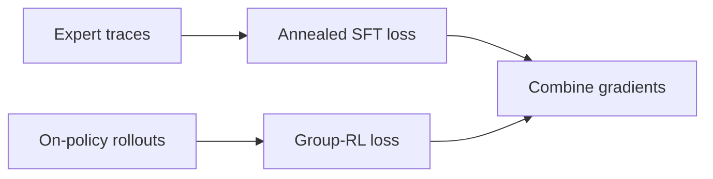
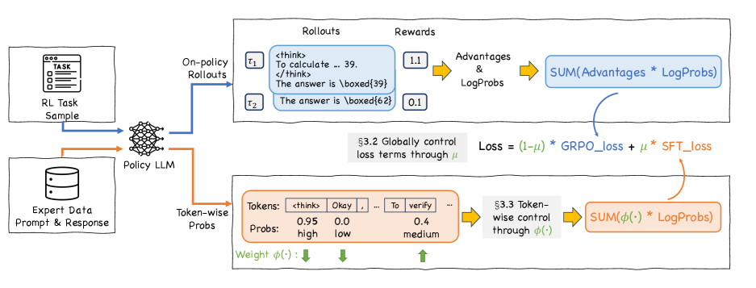

# CHORD: Dynamically balance SFT and on-policy RL

<!-- source-sha256: 999511f22515b48d8603340ab9c2db3493a952a06c3f3e2edcb530a67d33c939 -->

[简体中文](README.md)

> Isolated RL update on a public candidate policy, not a paper-scale benchmark.

## Paper information

| Field | Details |
|---|---|
| Paper | [CHORD (arXiv 2508.11408)](https://arxiv.org/abs/2508.11408) |
| Institution | Alibaba Group / ModelScope. |
| First public release | 2025-08-15 |
| Author code | [Trinity-RFT CHORD example](https://github.com/modelscope/Trinity-RFT/tree/main/examples/mix_chord). |
| Local adapter or method key | `chord` |
| Local reproduction code | [`src/auto_research/post_training/`](https://github.com/daiwk/auto-research/tree/main/src/auto_research/post_training/) |

## Paper method and evidence

Separate SFT and RL stages can overfit expert data or forget it too early. Add expert SFT as an annealed auxiliary term during on-policy RL; token-level uncertainty weights smooth the transition from imitation to exploration.



<!-- paper-figure:start -->
### Original paper figure

[](https://arxiv.org/html/2508.11408v3/x3.png)

The original figure shows the dynamic training mixture. From the [original paper](https://arxiv.org/abs/2508.11408); copyright remains with the authors.
<!-- paper-figure:end -->

### Core equation

$$
\mathcal L=\lambda_t\mathcal L_{\rm SFT}+(1-\lambda_t)\mathcal L_{\rm RL},\qquad \lambda_t\downarrow\ \text{during training}.
$$

### Reported results

The paper reports gains over staged SFT+RL and static mixtures on multiple tasks. No production A/B.

## Local reproduction

Use verified gold candidates as expert traces, anneal the SFT term, and add its gradient to the on-policy group-RL gradient.

```bash
auto-research post-train --algorithm chord --dataset gsm8k-candidate --maximum-examples 256 --steps 120 --seed 42
```

[Fixed-seed summary](../../experiments/rl-papers-summary-seed42.json). No learned LLM token-uncertainty model; the gold candidate is a deterministic expert proxy.
