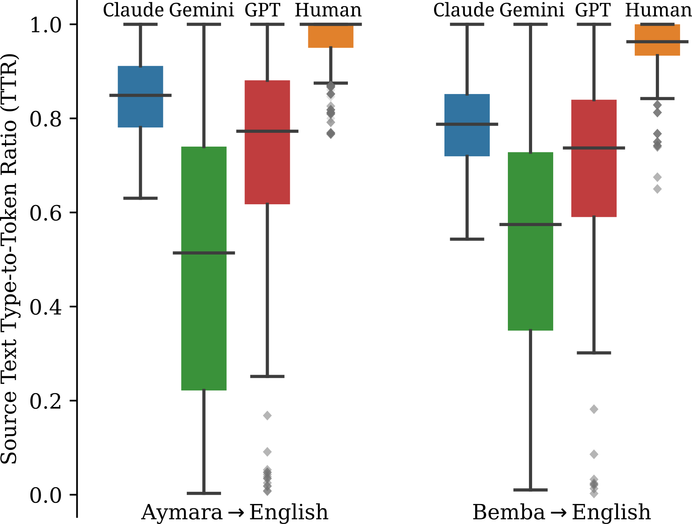

<!-- source-sha256: 30c5b785ac877843a2da71f00f935f4e72b054a643041783c480624aa76006e1 -->

[简体中文](README.md) · English

# When LLMs Benchmark Themselves: Deconstructing Self-Bias in Automated Evaluation

The paper separates using LLMs to generate a test set, judge it, or do both. It ranks systems per example and subtracts the mean peer rank excluding self from the self rank. Negative values mean relative self-preference.

> **Standalone L1 numerical and protocol component; diagnostic only.** Not real LLM capability, training gains, or a full paper reproduction. The full experiment is **too costly; not reproduced (review DONE)**, with no weight/data downloads or automatic retries. This is a user-identified historical conference omission, not a new publication today.

## Paper information

| Field | Details |
|---|---|
| Paper | [Original arXiv v1](https://arxiv.org/abs/2509.26600v1) |
| Pinned method version | [v3 full text](https://arxiv.org/html/2509.26600v3); the original release date follows v1, not an update |
| Institution | First author Wenda Xu lists Google first. Coauthors also come from ETH Zurich; Google participation is confirmed by the paper's affiliations. |
| First public release | **2025-09-30 17:48:35 UTC**, arXiv v1 |
| Author code | No author source link verified in the pinned v3, abstract, or exact-title search. Third-party evaluation frameworks are not author implementations. |
| Author code license | No verified author repository, so source license and pinned SHA are not applicable. Paper and figure license: CC BY 4.0. |
| Local adapter or method key | `benchmark-self-bias`; `adapter=null`; `promotion_eligible=false`; `evolve_integrated=false` |
| Local reproduction code | `src/auto_research/post_training/benchmark_self_bias.py`; entry points `self_bias` / `diagnostic` |
| Local verification | Focused tests `tests/post_training/test_google_emnlp25_post_protocols.py`; A100 receipt `docs/gpu-validations/benchmark-self-bias-a100-20261025.json`. Do not claim GPU acceptance before execution and validation. |

## Original paper summary

### Background and main changes

Sec. 2, Eq. 1 uses per-segment rankings indexed by [segment, target, benchmark-role]. Average over segments, then subtract the leave-self-out peer mean from the diagonal. Score direction must be explicit: lower MetricX-QE is better. The paper does not specify tie handling. Average ranks for ties are an explicit local choice. Peer consensus is not absolute truth, and synthetic tables do not establish real-model bias.

<!-- paper-figure:start -->
### Key figure from the paper



Figure 1 from the pinned v3 SVG, rasterized to PNG without changing its scientific content. From the [paper](https://arxiv.org/html/2509.26600v3#S5.F1), copyright the authors; CC BY 4.0. See `assets/provenance.json` for the source, SHA256, and visual verification.
<!-- paper-figure:end -->

### Core equations

$$
bias_i=\theta_{ii}-\frac1{M-1}\sum_{j\ne i}\theta_{ij},\quad\theta_{ij}=\mathbb E_{segment}[rank_{segment,i,j}].
$$

The axes are segment, evaluated target, and benchmark role. Rank within segments before averaging. The peer mean excludes the diagonal. Negative values mean better self-ranks. Averaging ties is an explicit local convention because the paper does not disclose tie handling.

### Offline and online results

The paper finds that generator and judge self-preference can compound. Greater source-text diversity only partially mitigates it, and full-benchmark effects vary by model. This measures relative self-preference, not absolute accuracy or proof that peers are correct. No internet production online A/B is reported. Offline analysis and local numerical tests are not online gains.

## Local reproduction

The local implementation runs only `self_bias` and its numerical protocol. Real model and data observations are inputs from the caller, not fabricated by fixtures.

```bash
PYTHONPATH=src python -c 'from auto_research.post_training.benchmark_self_bias import diagnostic; print(diagnostic(42))'
PYTHONPATH=src python -m pytest tests/post_training/test_google_emnlp25_post_protocols.py -q
```

The random tensors in `diagnostic(seed,device='cpu')` check definitions, negative controls, and isolation only. Seeds 42/43/44 do not make synthetic diagnostics a real capability evaluation. The evaluated agent does not see gold answers, and the test set is not used for model selection. The component computes statistics and rewards from frozen observations, without updating an LLM. The shared runner executes the CUDA path on A100/A30. Source, three-seed scalars, and the receipt must be bound; no receipt means no acceptance claim.

Fidelity boundary: Sec. 2 Eq. 1 ranks each segment on [segment,target,benchmark-role], averages over segments, then compares the diagonal with leave-self-out peers. Score orientation must be specified, with lower MetricX-QE better. Average ties are local, not a disclosed paper detail. Peer consensus is not absolute truth and synthetic results are not claims of model bias.

### High-cost full experiment

Sec. 3 and the appendices cover Gemini2.5Pro, GPT4.1, and ClaudeOpus4; six translation directions across three role settings; 200 source texts per direction with outputs from all three models; and 10K bootstrap/permutation samples. They also cover ChatbotArena and open 27B/32B/larger models. The complete multilingual API/model matrix is costly and not run.

The resource baseline is a single A100/A30 or a local Mac. These are paper configurations and public reports, not measured local runtimes. Undisclosed GPU types or training hours are not invented. **Full experiment too costly; not reproduced (review DONE).** A deliverable low-cost component is not a substitute for the full experiment or evidence of improvement for Evolve.
