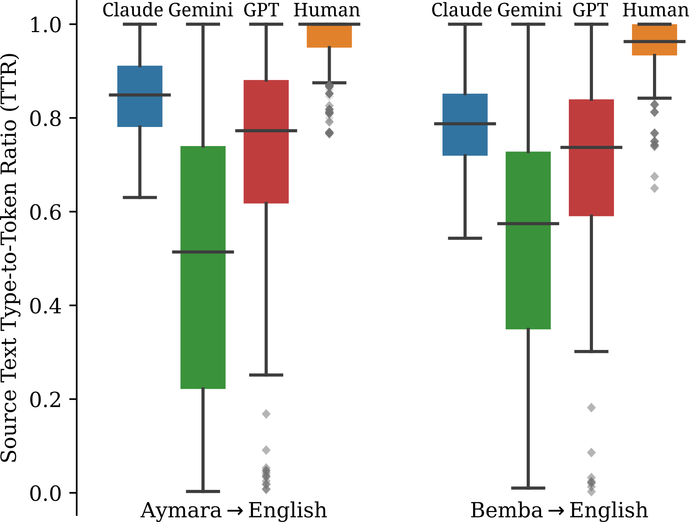

# When LLMs Benchmark Themselves: Deconstructing Self-Bias in Automated Evaluation

将LLM生成测试集、LLM担任评审及两者合一分开研究，用每条样本上的系统排名计算自身排名减去排除自身后的同行平均，负值表示相对自偏好。

> 状态：独立 **L1 数值/协议组件，diagnostic only**；不代表真实LLM能力、训练收益或完整论文复现。完整实验：**成本过高，不复现（审查 DONE）**，不下载权重/数据、不自动重试。此为用户指定的历史会议补漏，不是本日新发表。

## 论文信息

| 字段 | 内容 |
|---|---|
| 论文链接 | [原始 arXiv v1](https://arxiv.org/abs/2509.26600v1) |
| 固定方法版本 | [v3正文](https://arxiv.org/html/2509.26600v3)；原始发布日期仍按v1，不把更新版日期当首发 |
| 公司 / 作者机构 | 一作 Wenda Xu 第一机构为 Google；共同作者还来自 ETH Zurich，Google参与由正文作者机构确认。 |
| 原始发布日期 | **2025-09-30 17:48:35 UTC**，arXiv v1 |
| 原作者代码 | 固定v3正文、摘要与精确标题检索未核实作者源码链接；不把第三方评测框架当作者实现。 |
| 原作者代码许可 | 未核实作者源码仓库，源码许可与固定SHA不适用。论文/原图许可：CC BY 4.0 |
| 本地 Adapter / key | `benchmark-self-bias`；`adapter=null`；`promotion_eligible=false`；`evolve_integrated=false` |
| 本地代码 | `src/auto_research/post_training/benchmark_self_bias.py`，入口 `self_bias` / `diagnostic` |
| 本地验证 | 定向测试 `tests/post_training/test_google_emnlp25_post_protocols.py`；A100收据 `docs/gpu-validations/benchmark-self-bias-a100-20261025.json`，实际执行和校验前不宣称GPU通过 |

## 原始论文总结

### 背景与主要改动

Sec.2 Eq.1使用[segment,target,benchmark-role]的逐segment排名，先按segment平均，再diag−leave-self-out peers。原始分数方向必须明确，MetricX-QE越低越好。论文未公开ties细节，本地平均tie是显式约定；不把peer consensus当绝对真值，不在合成表上宣称真实模型有偏。

<!-- paper-figure:start -->
### 原论文关键图



Figure 1取自固定v3的原始SVG，仅栅格化为PNG，不改科学内容。图片来自[原论文](https://arxiv.org/html/2509.26600v3#S5.F1)，版权归原作者所有。许可 CC BY 4.0。来源、SHA256与实际目视核验见 `assets/provenance.json`。
<!-- paper-figure:end -->

### 核心公式

$$
bias_i=\theta_{ii}-\frac1{M-1}\sum_{j\ne i}\theta_{ij},\quad\theta_{ij}=\mathbb E_{segment}[rank_{segment,i,j}].
$$

轴顺序固定为segment、被测target、benchmark-role。先逐segment排名再平均，同行均值排除对角自身；负值表示更有利的自排名。平均ties只是本地明确约定，原文未公开ties处理。

### 论文离线与线上效果

原文发现生成器和评审自偏好可能叠加；提升源文本多样性只部分缓解，完整benchmark条件对不同模型效果不一致。该量是相对self preference，不是绝对准确率或“同行一定正确”的证明。 未报告互联网生产线上A/B；不得将离线分析或本地数值测试写成线上收益。

## 本地复现

本地仅执行 `self_bias` 及配套数值协议。外部真实模型/数据观测是调用方前提，不由fixture伪造。

```bash
PYTHONPATH=src python -c 'from auto_research.post_training.benchmark_self_bias import diagnostic; print(diagnostic(42))'
PYTHONPATH=src python -m pytest tests/post_training/test_google_emnlp25_post_protocols.py -q
```

`diagnostic(seed,device='cpu')` 的随机张量只核对定义、负控和隔离；seed42/43/44并不把合成诊断变成真实能力评测。没有被测Agent看到gold答案，也没有根据test数据选模。该组件是冻结观测的统计/奖励计算，不声称更新了LLM。CUDA实际路径由统一runner在A100/A30执行，源码、三seed标量与收据需绑定；没有收据不得宣称通过。

保真边界：Sec.2 Eq.1使用[segment,target,benchmark-role]的逐segment排名，先按segment平均，再diag−leave-self-out peers。原始分数方向必须明确，MetricX-QE越低越好。论文未公开ties细节，本地平均tie是显式约定；不把peer consensus当绝对真值，不在合成表上宣称真实模型有偏。

### 高成本完整实验

Sec.3 / Appendices：Gemini2.5Pro、GPT4.1、ClaudeOpus4，六个翻译方向×三种角色设置，每方向200来源文本与全部三模型输出，10K bootstrap/permutation；还含ChatbotArena及27B/32B/更大开放模型。完整API/模型多语矩阵高成本，不运行。

资源基准为单张A100/A30或本地Mac。上述为原论文配置/公开报告，不是本地实测耗时，也不推造未披露的GPU型号或训练小时。完整实验结论：**成本过高，不复现（审查 DONE）**。低成本组件可交付，但不替代完整实验，也不被Evolve当作改善证据。
