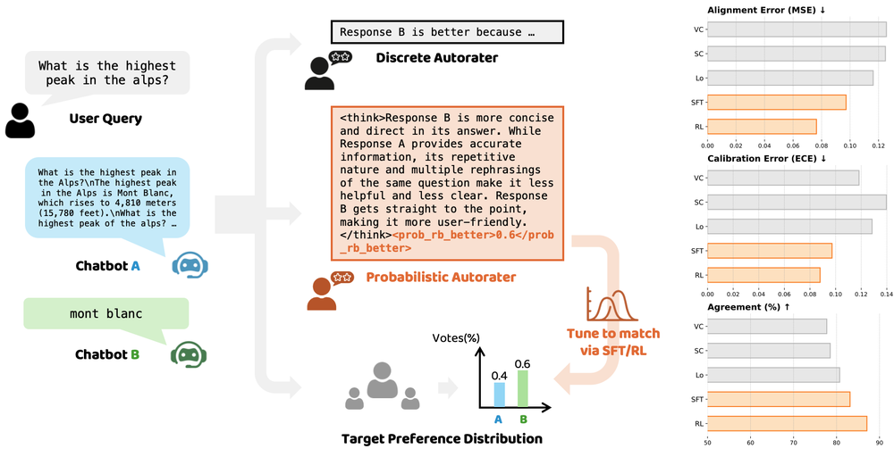

<!-- source-sha256: fe6f7067f554183ee185f524f706a4377ac0b1bd4191c607c03acc6c3acd8057 -->

[简体中文](README.md) · English

# Judging with Confidence: Calibrating Autoraters to Preference Distributions

The autorater predicts the probability that B is better than A instead of outputting one discrete preference. Dense multi-annotator labels use probability-text SFT; a single binary label uses RL with a strictly proper Brier or clipped-log reward that penalizes parsing failures.

> **Standalone L1 numerical and protocol component; diagnostic only.** Not a real LLM capability, training gain, or complete reproduction. The full experiment is **too costly; not reproduced (review DONE)**, without weight/data downloads or automatic retries. This is a user-identified historical conference omission, not a new publication today.

## Paper information

| Field | Details |
|---|---|
| Paper | [Original arXiv v1](https://arxiv.org/abs/2510.00263v1) |
| Pinned method version | [v1 full text](https://arxiv.org/html/2510.00263v1); publication date follows v1, not an update |
| Institution | First author Zhuohang Li lists Google first and also Vanderbilt University; coauthors include Google DeepMind |
| First public release | **2025-09-30 20:36:41 UTC**, arXiv v1 |
| Author code | No method-specific code link in the pinned abstract or full text, and exact-title search did not verify a repository. No verifiable author parser was released; the local implementation documents its independent convention. |
| Author code license | No verified author repository, so a source license and pinned SHA are not applicable. Paper/figure license: arXiv.org perpetual non-exclusive license. |
| Local adapter or method key | `probabilistic-autorater`; `adapter=null`; `promotion_eligible=false`; `evolve_integrated=false` |
| Local reproduction code | `src/auto_research/post_training/probabilistic_autorater.py`; entry points `proper_rewards` / `diagnostic` |
| Local verification | Focused tests `tests/post_training/test_google_emnlp25_post_protocols.py`; A100 receipt `docs/gpu-validations/probabilistic-autorater-a100-20261025.json`. Do not claim GPU acceptance before execution and validation. |

## Original paper summary

### Background and main changes

The piecewise rewards in Sec. 3, Eq. 1–2 and experimental epsilon=.001 can be implemented exactly. A successful parse is in [0,1]; a failure yields Brier=0 and Log=log(epsilon). The strict local tag parser is an explicit local choice, not the unpublished author parser. A numerical gradient diagnostic does not establish backpropagation through text-to-float parsing or GRPO training.

<!-- paper-figure:start -->
### Key figure from the paper



Original PNG of Figure 1 from the pinned v1, not redrawn. Image from the [paper](https://arxiv.org/html/2510.00263v1#S1.F1), copyright the authors. The arXiv non-exclusive license does not imply CC BY or unrestricted relicensing; this is an attributed research illustration. See `assets/provenance.json` for the source, SHA256, and visual verification.
<!-- paper-figure:end -->

### Core equations

$$
R_B=1-(p-y)^2\;(valid),\;0\;(invalid);\qquad R_L=y\log p'+(1-y)\log(1-p')\;(valid),\;\log\epsilon\;(invalid),\quad p'=clip(p,\epsilon,1-\epsilon).
$$

The invalid branch must isolate NaNs before nonlinear computation. Actual RL samples text, parses and freezes rewards, then applies policy gradients. Gradients with respect to numerical $p$ diagnose the proper rule, not actual training through the text parser.

### Offline and online results

Table 1 reports improved calibration after distribution matching; Table 2 examines position bias. Data conditions use an equal total annotation budget, not an assumption that a single label reveals the true population preference distribution. The local experiment only verifies proper reward values and parsing boundaries and does not report ECE/F1 capability gains. The paper does not report an internet production A/B test; offline analyses and local numerical tests are not online lifts.

## Local reproduction

The local implementation runs only `proper_rewards` and its numerical protocol. Real model and data observations must be supplied by the caller and are not fabricated by a fixture.

```bash
PYTHONPATH=src python -c 'from auto_research.post_training.probabilistic_autorater import diagnostic; print(diagnostic(42))'
PYTHONPATH=src python -m pytest tests/post_training/test_google_emnlp25_post_protocols.py -q
```

The random tensors in `diagnostic(seed,device='cpu')` check definitions, negative controls, and isolation only. Seeds 42/43/44 do not turn synthetic diagnostics into capability evaluation. The evaluated agent does not see gold answers, and the test set is not used for model selection. One backward pass and update on numerical probability logits is performed, but this is not generative autorater training. The shared runner executes the CUDA path on A100/A30. Source, three-seed scalars, and the receipt must be bound; without a receipt, acceptance cannot be claimed.

Fidelity boundary: the piecewise rewards of Sec. 3 Eq. 1–2 and experimental epsilon=.001 are exact. A successful parse is in [0,1]; failure yields Brier=0 and Log=log(epsilon). The strict tag parser is a documented local convention, not the unpublished parser. The gradient diagnostic does not backpropagate through generated text parsing and is not GRPO training.

### High-cost full experiment

Sec. 4 and Appendix C use full-parameter SFT/RL of Gemma-2-9B and Qwen2.5-7B, about 110K Gemini-2.5-Flash preference labels, 32/64 prompts per RL step, 32 generations per prompt, batch size 512, and max sequence length 2048. The full large-model and paid annotation matrix is too costly on one GPU and is not run.

The resource baseline is one A100/A30 or a local Mac. These are paper configurations and public reports, not local runtime measurements; undisclosed GPU models or training hours are not invented. **Full experiment too costly; not reproduced (review DONE).** The low-cost component is deliverable but not a substitute for the full experiment or Evolve improvement evidence.
