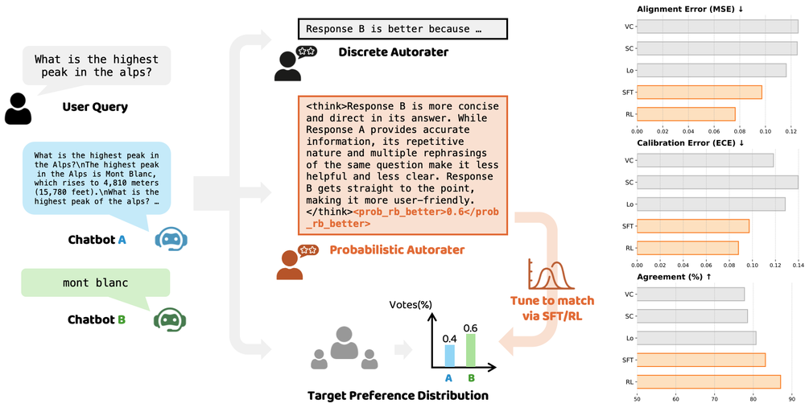

# Judging with Confidence: Calibrating Autoraters to Preference Distributions

让autorater输出B优于A的概率而非单一离散偏好；稠密多标注走概率文本SFT，单个二元标签则用包含解析失败惩罚的Brier或clipped-log严格proper reward做RL。

> 状态：独立 **L1 数值/协议组件，diagnostic only**；不代表真实LLM能力、训练收益或完整论文复现。完整实验：**成本过高，不复现（审查 DONE）**，不下载权重/数据、不自动重试。此为用户指定的历史会议补漏，不是本日新发表。

## 论文信息

| 字段 | 内容 |
|---|---|
| 论文链接 | [原始 arXiv v1](https://arxiv.org/abs/2510.00263v1) |
| 固定方法版本 | [v1正文](https://arxiv.org/html/2510.00263v1)；原始发布日期仍按v1，不把更新版日期当首发 |
| 公司 / 作者机构 | 一作 Zhuohang Li 第一机构为 Google，同时列 Vanderbilt University；共同作者包含 Google DeepMind。 |
| 原始发布日期 | **2025-09-30 20:36:41 UTC**，arXiv v1 |
| 原作者代码 | 固定摘要/正文未给本方法作者源码链接；精确标题检索未核实作者仓库。原文parser实现未公开可核验，本地独立实现并标明约定。 |
| 原作者代码许可 | 未核实作者源码仓库，源码许可与固定SHA不适用。论文/原图许可：arXiv.org perpetual non-exclusive license |
| 本地 Adapter / key | `probabilistic-autorater`；`adapter=null`；`promotion_eligible=false`；`evolve_integrated=false` |
| 本地代码 | `src/auto_research/post_training/probabilistic_autorater.py`，入口 `proper_rewards` / `diagnostic` |
| 本地验证 | 定向测试 `tests/post_training/test_google_emnlp25_post_protocols.py`；A100收据 `docs/gpu-validations/probabilistic-autorater-a100-20261025.json`，实际执行和校验前不宣称GPU通过 |

## 原始论文总结

### 背景与主要改动

Sec.3 Eq.1–2 piecewise奖励和实验用epsilon=.001可精确实现。解析成功必须在[0,1]；失败Brier=0、Log=log(epsilon)。本地严格tag parser是明确的本地约定，不是作者未公开parser；数学梯度诊断不代表可以对生成文本float解析反传，更不等于GRPO训练。

<!-- paper-figure:start -->
### 原论文关键图



Figure 1取自固定v1的原始PNG，未重绘。图片来自[原论文](https://arxiv.org/html/2510.00263v1#S1.F1)，版权归原作者所有。原文为arXiv非独占发布许可，未据此声称CC BY或允许任意再许可；这里仅作明确署名的研究图示引用。来源、SHA256与实际目视核验见 `assets/provenance.json`。
<!-- paper-figure:end -->

### 核心公式

$$
R_B=1-(p-y)^2\;(valid),\;0\;(invalid);\qquad R_L=y\log p'+(1-y)\log(1-p')\;(valid),\;\log\epsilon\;(invalid),\quad p'=clip(p,\epsilon,1-\epsilon).
$$

invalid分支必须在非线性计算前隔离NaN。现实RL先采样文本、解析并冻结奖励再做policy gradient；对数值p做梯度仅是proper rule数学诊断，不是穿过文本parser的实际训练图。

### 论文离线与线上效果

原文Table1报告分布匹配后校准改善，Table2考察位置偏置；不同数据条件比较的是等总标注预算，不是说单标签已经观测到真实人口偏好分布。本地只验证proper reward数学值和解析边界，不报告ECE/F1能力收益。 未报告互联网生产线上A/B；不得将离线分析或本地数值测试写成线上收益。

## 本地复现

本地仅执行 `proper_rewards` 及配套数值协议。外部真实模型/数据观测是调用方前提，不由fixture伪造。

```bash
PYTHONPATH=src python -c 'from auto_research.post_training.probabilistic_autorater import diagnostic; print(diagnostic(42))'
PYTHONPATH=src python -m pytest tests/post_training/test_google_emnlp25_post_protocols.py -q
```

`diagnostic(seed,device='cpu')` 的随机张量只核对定义、负控和隔离；seed42/43/44并不把合成诊断变成真实能力评测。没有被测Agent看到gold答案，也没有根据test数据选模。诊断里确有一次对数值概率logits的反传/更新，但不是生成式autorater训练。CUDA实际路径由统一runner在A100/A30执行，源码、三seed标量与收据需绑定；没有收据不得宣称通过。

保真边界：Sec.3 Eq.1–2 piecewise奖励和实验用epsilon=.001可精确实现。解析成功必须在[0,1]；失败Brier=0、Log=log(epsilon)。本地严格tag parser是明确的本地约定，不是作者未公开parser；数学梯度诊断不代表可以对生成文本float解析反传，更不等于GRPO训练。

### 高成本完整实验

Sec.4 / Appendix C：Gemma-2-9B与Qwen2.5-7B全参数SFT/RL；约110K Gemini-2.5-Flash偏好标注，RL每步32/64 prompts、每prompt32 generations、batch512，maxseq2048。单卡完整大模型与付费标注矩阵高成本，不运行。

资源基准为单张A100/A30或本地Mac。上述为原论文配置/公开报告，不是本地实测耗时，也不推造未披露的GPU型号或训练小时。完整实验结论：**成本过高，不复现（审查 DONE）**。低成本组件可交付，但不替代完整实验，也不被Evolve当作改善证据。
